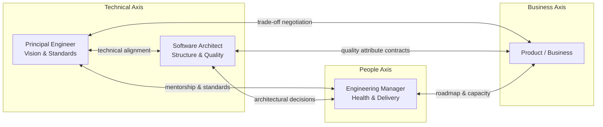
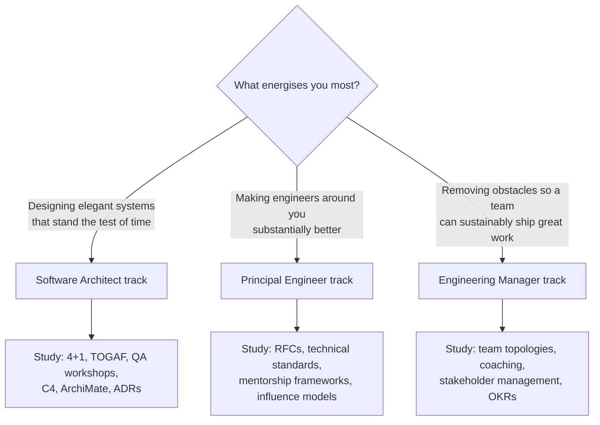

# 01 · Roles & Responsibilities

> **Level:** Conceptual — Strategic
> **Pre-reading:** [Home](index.md)

The single most important thing to get right before a principal-level interview is to understand **what the role actually is** — and how it differs from adjacent senior roles. Interviewers at this level are experts at detecting when a candidate is answering as a Senior Engineer wearing a principal hat.

---

## The Three Roles: Common Ground and Key Distinctions

All three roles — Software Architect, Principal Engineer, Engineering Manager — operate at a **system level**, above the ticket-by-ticket execution of a senior engineer. Each one holds a different *contract* with the organisation.

---

## Software Architect

### WHO they are
An architect is the **custodian of system structure**. They define how large systems are decomposed, what quality attributes (QAs) are non-negotiable, and how teams interface through their components.

### What they own
- **Architecture decisions** — captured formally in Architecture Decision Records (ADRs)
- **View models** — Logical, Process, Physical, Development views (4+1 model)
- **Quality attribute scenarios** — availability, scalability, security, maintainability targets
- **Technology radar** — what tech is adopt/trial/assess/hold

### How they operate
- Work across **multiple teams**, seldom embedded in one
- Hold **design authority**: their sign-off gates significant structural changes
- Spend heavy time in **whiteboarding, documentation, and review** phases

### Academic frameworks they are evaluated against
| Framework | What it governs |
|:---|:---|
| **4+1 View Model** (Kruchten) | Logical, Development, Process, Physical, Scenarios |
| **TOGAF** | Enterprise architecture lifecycle (ADM phases) |
| **ISO/IEC 25010** | System quality model (reliability, portability, maintainability…) |
| **SEI Quality Attribute Workshop** | Eliciting and prioritising QA scenarios with stakeholders |
| **Architecture Fitness Functions** | Continuous, automated checks of architectural constraints |

!!! note "The Architect's fundamental tension"
    Architects must serve **two masters simultaneously**: the engineering organisation (keep the system buildable and maintainable) and the business (ensure the system meets current and future requirements). Managing this tension is what separates great architects from good ones.

→ **[Deep Dive: Software Architect](01.01-software-architect.md)**

---

## Principal Engineer

### WHO they are
A Principal Engineer is a **technical force-multiplier**: they make the engineers around them better, set the technical direction of their domain, and ensure the organisation makes sound technical decisions at scale.

### What they own
- **Technical standards & best practices** — the "how we do things here" document set
- **RFCs (Requests for Comments)** — proposing major technical changes through peer review
- **Mentorship pipeline** — raising Senior Engineers to Staff/Principal level
- **Cross-cutting concerns** — security, observability, performance standards that span teams
- **Technical roadmap input** — translating business goals into a multi-year technical strategy

### How they operate
- **Influence without authority** — they rarely have direct reports
- Spend significant time in **code review, pairing, design sessions, and writing**
- Act as the **technical conscience** of the organisation: say "this is wrong" even when it is uncomfortable

### The Scope Ladder

| Level | Scope | Typical span |
|:---|:---|:---|
| Senior Engineer | One team, one service | 1 team |
| Staff Engineer | Multiple teams, one domain | 2–4 teams |
| Principal Engineer | Organisation-wide or across domains | Entire engineering org |
| Distinguished / Fellow | Industry-wide influence | Multiple orgs |

!!! warning "The most common misconception"
    A Principal Engineer is NOT "a Senior Engineer who codes more". They are evaluated on **organisational impact**, not personal code output. A Principal who ships less code but raises team quality by 2x is performing better than one who out-codes everyone but leaves no lasting improvement.

→ **[Deep Dive: Principal Engineer](01.02-principal-engineer.md)**

---

## Engineering Manager

### WHO they are
An Engineering Manager is the **organisational operator**: they ensure the team is healthy, capable, and delivering reliably. Their primary *product* is the team itself.

### What they own
- **Team health** — psychological safety, morale, retention
- **Delivery execution** — sprint planning, dependency management, roadmap commitments
- **Hiring and career development** — performance reviews, promotions, PIPs
- **Stakeholder communication** — status, risks, and blockers to product and leadership

### How they operate
- Have **line management authority** — the only role of the three with direct reports
- Spend most time in **1:1s, planning meetings, hiring loops, and cross-team coordination**
- Are evaluated on **team outcomes**, not personal technical output

!!! tip "Technical depth requirement for EMs"
    At principal-level organisations, EMs are expected to maintain enough technical depth to detect when engineers are going off-track technically — even if they cannot fix it themselves. They *translate* between business and technical, but cannot do so if they have entirely lost technical fluency.

→ **[Deep Dive: Engineering Manager](01.03-engineering-manager.md)**

---

## Comparison Matrix — The Full Picture

| Dimension | Software Architect | Principal Engineer | Engineering Manager |
|:---|:---|:---|:---|
| **Primary question they answer** | "Is this system well-structured?" | "Are we building the right thing, the right way?" | "Is this team capable of delivering?" |
| **Output format** | Architecture documents, ADRs, views | RFCs, standards docs, code, mentorship | Roadmaps, hiring plans, performance reviews |
| **Authority type** | Design authority | Influence (technical credibility) | Line management |
| **Time horizon** | 1–3 years | 1–5 years | 3–12 months |
| **Failure mode** | Ivory tower — designs that can't be built | Lone genius — impact not multiplied | People-pleasing — avoids hard technical truths |
| **Success metric** | System meets QA targets; low architectural debt | Engineering org level rises; RFCs implemented | Team ships reliably; engineers promoted |
| **Relationship to code** | Reviews; may prototype; not day-to-day | Frequent; sets the bar | Minimal; maintains fluency only |
| **Relationship to business** | Quality attribute contracts | Technical feasibility and trade-offs | Delivery commitments and capacity |
| **Source of credibility** | Track record of well-structured, long-lived systems | Technical mastery + interpersonal trust | Delivery track record + team trust |

---

## Where the Roles Blur

In practice, large companies (Google, Amazon, Meta) define these roles differently. Some patterns:

- **Architect-track vs IC-track**: Many companies collapse Architect into the IC track. At Google, there is no "Architect" title — Principal and Distinguished Engineers *are* the architects.
- **Tech Lead Manager (TLM)**: A hybrid of PE and EM — has reports but also does technical direction. Common at mid-size companies. Demanding and often unsustainable at scale.
- **Platform vs Product Principal**: Platform PEs own cross-cutting technical infrastructure. Product PEs are embedded in product domains. Different skills, same title.

!!! danger "Interview trap: the role conflation"
    If you are interviewing for Principal Engineer, don't answer as if you were a Software Architect (pure design, no execution) or an Engineering Manager (pure people, no technical depth). Know the exact profile the company is interviewing for. Ask clarifying questions in the interview.

---

## Decision Framework: Which Role Fits You?

---

!!! tip "Key takeaway"
    The titles are less important than understanding the *contracts*. In your interview, make it clear you understand the full contract of the role — not just the technical parts.
