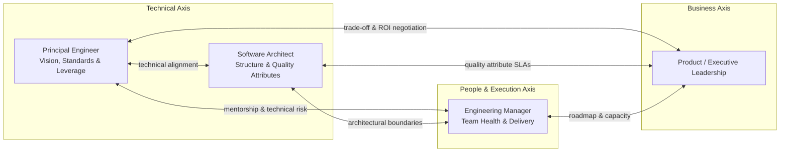
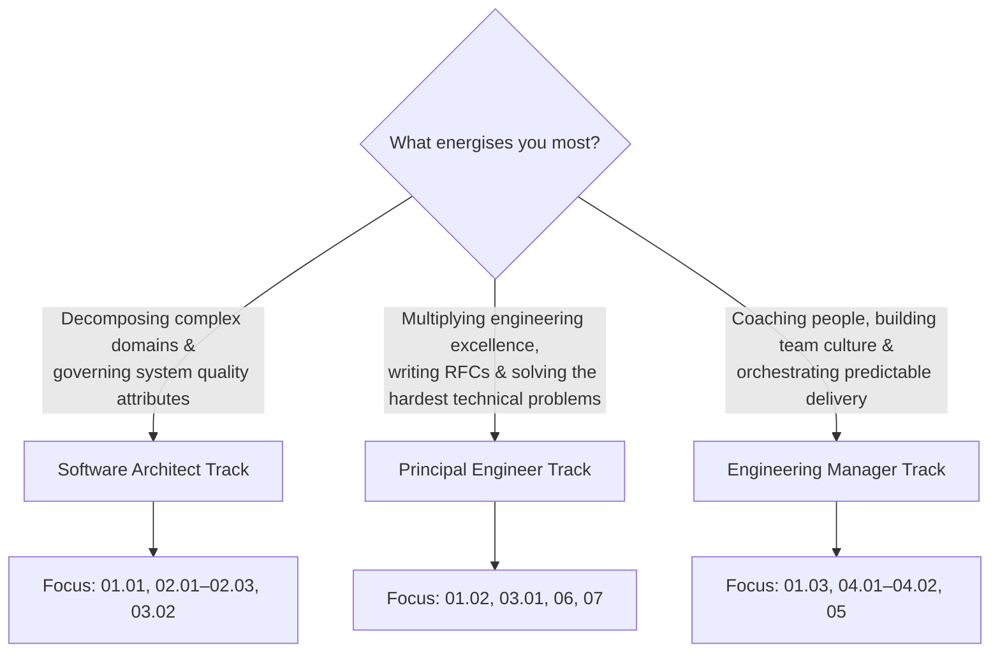

---
tags:
  - Principal Engineering
  - Leadership
  - Career Tracks
---

# 01 · Roles & Responsibilities

> **Level:** Conceptual — Strategic · **Reading Time:** ~8 mins · **Track:** Role Alignment
> **Prerequisites:** [Home](index.md)

The single most important thing to calibrate before a principal-level interview is **what the role actually is** — and how its organizational contract differs from adjacent senior leadership roles. Interviewers at this level immediately detect when a candidate answers as a Senior Engineer wearing a Principal hat, an ivory-tower Architect detached from code, or a people-focused Engineering Manager.

!!! abstract "TL;DR — The 30-Second Mental Model"
    - **Software Architect:** Custodian of **system structure and quality attributes** (ADRs, views, fitness functions).
    - **Principal Engineer:** **Technical force-multiplier** who scales engineering quality and direction across teams via **influence without authority** (RFCs, reference code, standards, sponsorship).
    - **Engineering Manager:** **Organizational operator** whose primary product is the **team itself** (health, hiring, career growth, predictable delivery).
    - **Interview Signal:** Always frame your answers around the specific contract of the role you are interviewing for — while showing how you partner with the other two.

---

!!! note "Company Calibration Comes First"
    Level numbers, scope, time horizons, coding expectations, and architect authority vary substantially by company. The matrices below are **interview heuristics**, not an industry-wide levelling standard. Ask for the target organization's role charter and evaluate evidence against it.

## The Leadership Triad: Shared System, Distinct Contracts

All three roles operate at a **systemic level** above ticket-by-ticket execution. Each holds a distinct contract with the organization:

---

## Deep-Dive Modules in This Section

-   :material-compass-outline:{ .lg .middle } **01.01 · Software Architect**

    ---

    Master **ADRs**, **SEI Quality Attribute Scenarios**, Kruchten's **4+1 View Model**, **Technology Radars**, and automated **Architecture Fitness Functions**.

    [:octicons-arrow-right-24: Software Architect Deep Dive](01.01-software-architect.md)

-   :material-lightning-bolt-outline:{ .lg .middle } **01.02 · Principal Engineer**

    ---

    Learn the **Force-Multiplier equation**, the **RFC lifecycle**, **Influence Without Authority**, **Sponsorship vs. Mentorship**, and cross-cutting ownership.

    [:octicons-arrow-right-24: Principal Engineer Deep Dive](01.02-principal-engineer.md)

-   :material-account-supervisor-outline:{ .lg .middle } **01.03 · Engineering Manager**

    ---

    Understand **high-leverage 1:1s**, continuous **performance calibration**, structured **hiring loops**, and proactive **stakeholder risk communication**.

    [:octicons-arrow-right-24: Engineering Manager Deep Dive](01.03-engineering-manager.md)

---

## Role Overview: Who Owns What?

=== "Software Architect"
    ### Custodian of System Structure
    An architect defines how large systems are decomposed, which quality attributes (NFRs) are non-negotiable, and how teams interface through crisp contracts.

    - **Core Ownership:** Architecture Decision Records (ADRs), 4+1 View Models, Quality Attribute Scenarios, Fitness Functions, Technology Radar.
    - **Operating Mode:** Works across multiple teams; facilitates structural decisions and may hold **explicitly delegated design authority**, depending on the organization's decision-rights model; balances long-term maintainability against delivery speed.
    - **Academic & Industry Anchors:** Kruchten's 4+1 Views, TOGAF ADM, [ISO/IEC 25010:2023](https://www.iso.org/standard/78176.html) (nine-characteristic product quality model), SEI Quality Attribute Workshops, Evolutionary Architecture Fitness Functions.

    !!! note "The Architect's Fundamental Tension"
        Architects serve **two masters simultaneously**: the engineering organization (keep the system buildable, operable, and maintainable) and the business (meet current and future market needs).

=== "Principal Engineer"
    ### Technical Force-Multiplier
    A Principal Engineer makes the engineers and systems around them substantially better, sets multi-year technical direction, and acts as the **technical conscience** of the organization.

    - **Core Ownership:** Technical Vision & Roadmaps, RFCs, Engineering Standards (API, security, observability, testing), Mentorship & Sponsorship pipeline, high-risk reference code/prototypes.
    - **Operating Mode:** **Influence without line authority**; leads through technical credibility, crisp writing, pairing on hard problems, and systemic debt reduction.

    | Level | Scope of Impact | Typical Span | Primary Evaluation Metric |
    |:---|:---|:---|:---|
    | **Senior Engineer (L5)** | One team, one service | 1 team | High-quality component delivery & operational ownership |
    | **Staff Engineer (L6)** | Multi-team domain | 2–4 teams | Cross-team technical health, unblocking complex delivery |
    | **Principal Engineer (L7)** | Org-wide / Multi-domain | 5–20+ teams | Organizational leverage, multi-year technical direction |
    | **Distinguished / Fellow (L8+)** | Company / Industry-wide | Entire company | Pioneering company-defining platforms & industry standards |

=== "Engineering Manager"
    ### Organizational Operator
    An Engineering Manager ensures the team is psychologically safe, capable, well-staffed, and delivering predictably. Their primary *product* is the team itself.

    - **Core Ownership:** Team health & retention, sprint/roadmap execution, hiring bar, performance management & promotions, upward/lateral stakeholder communication.
    - **Operating Mode:** Holds **line management authority**; typically spends most time on coaching, staffing, planning, and dependency unblocking while maintaining enough **technical fluency** to understand risk and challenge assumptions. Exact allocation varies by team and organizational context.

---

## Comparison Matrix — The Full Picture

| Dimension | Software Architect | Principal Engineer | Engineering Manager |
|:---|:---|:---|:---|
| **Primary Question Answered** | *"Is this system well-structured for our quality attributes?"* | *"Are we building the right thing, the right way, at scale?"* | *"Is this team healthy and capable of delivering?"* |
| **Primary Artifacts** | ADRs, C4/UML/ArchiMate views, fitness functions | RFCs, technical vision docs, standards, reference code | Roadmaps, hiring plans, career growth plans, reviews |
| **Authority Model** | Design authority | Influence (technical credibility & trust) | Line management (formal authority) |
| **Time Horizon** | 1–3 years | 1–5 years | 3–12 months |
| **Primary Failure Mode** | **Ivory Tower** — designs systems that can't be built or operated | **Lone Genius** — hoards hard work; impact is not multiplied | **People-Pleaser / Over-Coder** — avoids hard feedback or micromanages code |
| **Relationship to Code** | Reviews & prototypes high-risk seams; not daily feature coding | Writes high-leverage code, prototypes, and sets the quality bar | Minimal production coding; maintains architectural fluency |
| **Relationship to Business** | Quality attribute contracts & structural feasibility | Technical strategy, ROI of tech investments, trade-off menus | Delivery predictability, capacity planning, scope negotiation |

---

## Where the Roles Blur in Modern Tech Companies

In practice, companies map these three contracts differently:

- **Unified IC Track:** Many product companies fold architecture responsibilities into senior IC roles rather than maintaining a separate "Software Architect" family. Titles, levels, and scope differ; use [Will Larson's archetypes](https://staffeng.com/guides/staff-archetypes/) as patterns rather than assuming a fixed L6/L7/L8 mapping.
- **Enterprise vs. Solution vs. Domain Architect:** Some enterprises and regulated industries separate **Enterprise Architects** (portfolio and cross-layer governance) from **Principal Engineers** (technical strategy, execution, and platform standards); other organizations combine them.
- **Tech Lead Manager (TLM):** A hybrid combining IC technical direction with people management. Review the actual charter carefully—people load, delivery scope, and available senior IC support matter more than a generic direct-report threshold. A Staff/Principal IC + EM pair can separate concerns when the combined load becomes unsustainable.

!!! danger "Interview Trap: Role Conflation"
    If you are interviewing for **Principal Engineer**, do not answer as if you stop at the whiteboard (*"I hand the spec to the team and move on"*) or as if you manage people (*"I put the engineer on a PIP"*). Show that you **co-own the outcome** from RFC through production SLOs.

---

## Decision Framework: Which Track Fits You?

---

## Active Recall & Self-Check

Test your understanding before moving to the deep dives:

??? question "Self-Check 1: A candidate says, 'As a Principal Engineer, I wrote 60% of the code for our flagship service to make sure it hit the deadline.' Why is this a yellow/red flag in an L7 interview?"
    **Answer Rubric:**
    - While heroic coding is occasionally needed during a SEV-1 crisis, writing 60% of a team's production code means the candidate operated as a **Super-Senior Engineer (Lone Genius)** rather than a **Force Multiplier**.
    - They likely created a **bus-factor of 1**, deprived senior engineers on the team of growth opportunities, and neglected cross-team standards, architecture decomposition, or mentoring that would have allowed the *team* to ship it.
    - **Better framing:** *"I prototyped the high-risk consensus engine (10% of the code), wrote the RFC and interface contracts so 4 engineers could parallelize the remaining modules, and paired with two senior engineers on the load-testing harness."*

??? question "Self-Check 2: How do a Principal Engineer and an Engineering Manager partner when a critical project is slipping due to technical debt?"
    **Answer Rubric:**
    - **Principal Engineer owns the technical diagnosis and options menu:** Quantifies the velocity drag, designs an incremental strangler/refactoring path vs. tactical workaround, and estimates technical risk for each option.
    - **Engineering Manager owns capacity, team health, and delivery rescheduling:** Protects the team from burnout, aligns sprint commitments, and co-presents the trade-off menu with the PE to Product/Executive stakeholders.
    - Neither blames the other; they operate **"Two-in-a-Box"** with a unified message to leadership.
