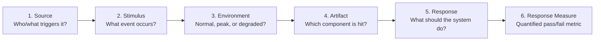
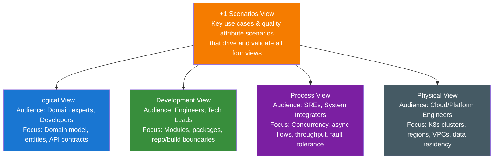
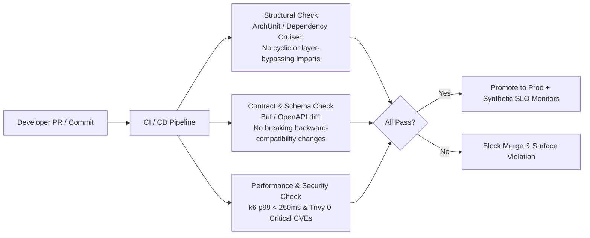

---
tags:
  - Software Architecture
  - Architecture Decisions
---

# 01.01 · Software Architect Deep Dive

> **Level:** Practitioner — Strategic · **Reading Time:** ~9 mins · **Track:** Role Alignment
> **Prerequisites:** [01 · Roles & Responsibilities](01-roles-responsibilities.md)

A Software Architect is the **custodian of system structure and quality attributes**. This deep dive covers what that contract looks like in practice — the artifacts, measurable scenarios, architectural views, and automated governance mechanisms that define modern software architecture.

!!! abstract "TL;DR — The 30-Second Mental Model"
    - **Stay Hands-On by Prototyping Risk:** Credible architects don't sit in an ivory tower — they prototype the riskiest 10% of an architecture and verify constraints with code.
    - **ADRs Capture *Why* and *What Was Rejected*:** An ADR without genuine rejected alternatives is a rubber stamp, not architectural reasoning.
    - **NFRs Must Be Testable:** Replace vague adjectives (*"fast, scalable, secure"*) with **SEI Quality Attribute Scenarios** (`Stimulus → Response → Measure`) enforced by automated **CI Fitness Functions**.

---

## What an Architect Actually Does Day-to-Day

The following is an **illustrative allocation**, not a universal time benchmark; adjust it to the organization's decision rights, domain risk, and operating model.

| Activity | Approx. Time | Primary Output |
|:---|:---|:---|
| **Architecture Design & Review** | 30% | ADRs, C4/sequence diagrams, domain boundary specifications |
| **Cross-Team Collaboration** | 25% | API contracts, event schemas, integration patterns |
| **Technical Strategy & Roadmap** | 20% | Technology Radar, multi-quarter modernisation/migration plans |
| **Mentoring & Design Coaching** | 15% | Design review feedback, pairing with tech leads on ADRs |
| **Hands-On Prototyping & Spikes** | 10% | Proof-of-concept benchmarks, fitness function tests, spike code |

!!! note "Answering the 'Are You Still Hands-On?' Question"
    Interviewers will probe whether you stay technical. The winning answer is not *"I write feature code 40 hours a week"* — it is:
    > *"I write enough code to stay credible with the engineers building the system: I prototype the highest-risk architectural seams, benchmark candidate technologies under realistic load, and author automated fitness functions in CI."*

---

## Architecture Decision Records (ADRs) — Canonical Reference

ADRs (pioneered by Michael Nygard) are the architect's most durable artifact. They create **organizational memory** by capturing **why** a decision was made under the constraints of that moment — and what trade-offs were accepted.

### Canonical ADR Template

```markdown
# ADR-{number}: {Short, Action-Oriented Decision Title}

- **Status:** Proposed | Accepted | Deprecated | Superseded by [ADR-XXX]
- **Date:** YYYY-MM-DD
- **Deciders:** {Named Owner (R)}, {Accountable Approver (A)}, {Consulted Teams (C)}
- **Review / Reversal Trigger:** {Date, evidence threshold, or changed constraint that prompts reassessment}

## Context & Problem Statement
What business, technical, or organizational forces forced this decision?
What are the hard constraints (regulatory, timeline, team cognitive load)?

## Decision Drivers (Top Quality Attributes)
1. {e.g., p99 latency < 150ms under 10x flash-sale load}
2. {e.g., Zero cross-region PII egress (GDPR)}
3. {e.g., Operable by a 6-person stream-aligned team}

## Considered Options & Trade-off Matrix
| Option | Pros | Cons / Risks | Verdict |
|:---|:---|:---|:---|
| **Option A (Chosen)** | ... | ... | Accepted |
| **Option B** | ... | ... | Rejected because... |
| **Option C (Status Quo)** | ... | ... | Rejected because... |

## Decision Outcome
We chose **Option A** because it satisfies Drivers 1 and 2 while keeping operational complexity within team bounds.

## Consequences
- **Positive:** What becomes easier or faster?
- **Negative / Accepted Trade-offs:** What becomes harder? What technical debt or operational cost are we knowingly accepting?
- **Compliance / Fitness Function:** How will we verify this decision is respected in CI/production?
```

!!! tip "The #1 Signal of a Mature ADR"
    The **Considered Options** and **Negative Consequences** sections separate a Principal-level ADR from a junior justification doc. Every real architectural choice has a downside — naming it explicitly builds immediate trust with interviewers and peers.

---

## Quality Attribute Scenarios (SEI Format)

Vague requirements like *"the system must be highly available and fast"* are untestable. Use the **Software Engineering Institute (SEI)** 6-part scenario structure to make every quality attribute concrete and falsifiable:



### Example: Degraded-Mode Availability Scenario

| SEI Field | Concrete Specification |
|:---|:---|
| **1. Source** | External payment gateway (Stripe) |
| **2. Stimulus** | Returns HTTP `503` or times out (`> 2,000ms`) |
| **3. Environment** | Degraded third-party dependency during peak checkout traffic |
| **4. Artifact** | Payment Orchestration Service |
| **5. Response** | Circuit breaker opens after 5 consecutive failures; fails over to secondary PSP (Adyen) or queues idempotent retry |
| **6. Response Measure** | Checkout success rate remains `>= 99.95%`; p99 checkout latency stays `< 800ms`; zero duplicate charges |

### Core Quality Attributes & Their Inherent Trade-Offs

| Quality Attribute | Measurable Target Example | What It Trades Off Against |
|:---|:---|:---|
| **Availability** | `99.99%` permitted unavailability (`52.6 min/yr`) for a defined SLI | Redundancy/failover cost; partition-time linearizability (CAP), plus normal-operation coordination latency (PACELC) |
| **Performance (Latency)** | `p99 < 150ms` read, `p99 < 400ms` write | Data freshness (caching), hardware cost, query flexibility (denormalisation) |
| **Scalability (Elasticity)** | Absorb `10×` traffic spike in `< 60s` with `< 0.1%` errors | Stateful simplicity, cross-shard joins, distributed coordination overhead |
| **Security** | Zero trust mTLS, field-level PII encryption, `< 24h` critical CVE patch | Developer velocity, latency overhead, debugging ergonomics |
| **Maintainability / Evolvability** | New domain feature deployed independently in `< 1 day` | Upfront modularisation effort, abstraction boilerplate |
| **Observability** | Critical user journeys propagate context across sync and async hops; alert on correctness and SLO burn | Telemetry ingestion/storage and cardinality cost; set a measured telemetry budget and sampling policy |

---

## Kruchten's 4+1 View Model

A single diagram cannot serve all stakeholders. **Philippe Kruchten's 4+1 View Model** separates architecture into four structural/runtime views unified by a fifth validation view (**Scenarios**):



---

## Architecture Fitness Functions

Coined in *Building Evolutionary Architectures* (Ford, Parsons, Kua), an **Architecture Fitness Function** is an automated, objective check (usually in CI/CD or continuous production monitoring) that prevents architectural drift.



| Fitness Function Category | Tooling Examples | What Architectural Drift It Prevents |
|:---|:---|:---|
| **Modularity & Layering** | `ArchUnit` (JVM), `Pytest-Archon` / `import-linter` (Python), `dependency-cruiser` (TS) | Domain layer importing infrastructure/DB internals; circular module dependencies |
| **API & Event Contracts** | `Buf` (Protobuf), `Optic` / `oasdiff` (OpenAPI), Confluent Schema Registry | Breaking downstream consumers via unversioned schema mutations |
| **Performance & Latency** | `k6`, `Gatling`, continuous profiling (`Parca` / `Pyroscope`) | N+1 query regressions or memory leaks degrading p99 latency |
| **Security & Compliance** | `OPA / Rego`, `Checkov`, `Trivy`, PII log-scanners | Unencrypted storage buckets, over-privileged IAM roles, PII leaking into logs |

---

## Technology Radar Summary

Architects govern technology sprawl using a **Technology Radar** (Adopt / Trial / Assess / Hold) so teams standardize on proven defaults while safely experimenting in bounded contexts.
*(See [07 · Technical Leadership — Technology Radar](07-technical-leadership.md#technology-radar-governing-the-technology-portfolio) for the full 4-ring × 4-quadrant governance playbook.)*

---

### Primary Architecture References

- [Michael Nygard — documenting architecture decisions](https://cognitect.com/blog/2011/11/15/documenting-architecture-decisions)
- [SEI — Quality Attribute Workshop collection](https://www.sei.cmu.edu/library/quality-attribute-workshop-collection/)
- [ISO/IEC 25010:2023 — product quality model](https://www.iso.org/standard/78176.html)

---

## Common Architect Interview Prompts

=== "System Design"
    - *"Design a global payment ledger or notification platform handling 100k RPS."*
    - *"How do you decompose a 5-year-old monolith when 15 teams are actively shipping features in it?"*
    - *"Design a multi-tenant SaaS data architecture that satisfies strict EU/US data residency and noisy-neighbor isolation."*

=== "Decision Making & Governance"
    - *"Walk me through the hardest ADR you authored. What option came in second place, and under what future condition would you reverse your decision?"*
    - *"How do you enforce architectural boundaries across 20 teams without becoming a central review bottleneck?"*

=== "Quality Attributes"
    - *"A stakeholder asks for 99.999% availability. How do you walk them through the architectural and financial implications?"*
    - *"How do you balance strong consistency vs. high availability when designing an inventory reservation flow?"*

---

## Active Recall & Self-Check

??? question "Self-Check 1: Why is relying solely on manual 'Architecture Review Boards (ARBs)' an anti-pattern at scale, and what replaces it?"
    **Answer Rubric:**
    - Manual review boards become **scheduling bottlenecks** (increasing Lead Time for Changes), encourage teams to hide changes until it's too late to redesign, and rely on human memory rather than objective checks.
    - **Modern Replacement:** Combine **lightweight asynchronous RFCs/ADRs** for high-cost-of-change decisions with **automated Architecture Fitness Functions** and **golden-path templates** for routine checks. Measure review wait time, escaped violations, exception age, and false positives; do not assume a fixed percentage of changes should bypass human review.

??? question "Self-Check 2: Convert the vague requirement 'Our API must be resilient to downstream database hiccups' into a 6-part SEI Quality Attribute Scenario."
    **Answer Rubric:**
    - **Source:** Primary PostgreSQL instance
    - **Stimulus:** Experiences a primary-to-replica failover (`15 seconds` of write unavailability)
    - **Environment:** Normal peak traffic (`5,000 RPS`)
    - **Artifact:** Order Ingestion Service
    - **Response:** Read endpoints serve from read-replica/cache; write endpoints buffer validated commands in a durable Kafka/SQS queue and return `202 Accepted` with a status polling token
    - **Response Measure:** `0%` HTTP 5xx user-facing errors; `100%` of buffered writes persisted within `30 seconds` of failover completion.
