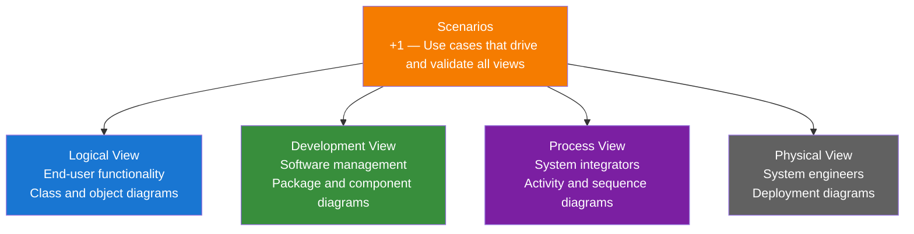
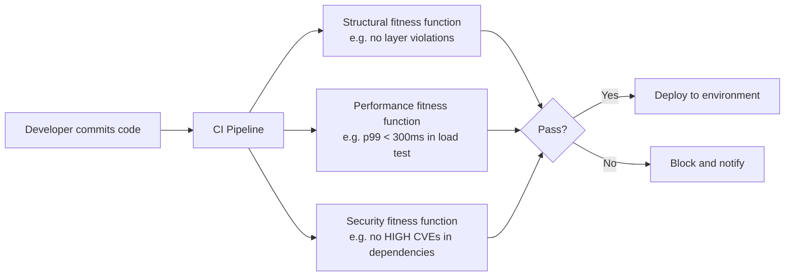

# 01.01 · Software Architect Deep Dive

> **Level:** Practitioner — Strategic
> **Pre-reading:** [01 · Roles & Responsibilities](01-roles-responsibilities.md)

A Software Architect is the **custodian of system structure**. This deep dive covers what that means in practice — the tools, frameworks, decisions, and daily work that define the role.

---

## What an Architect Actually Does Day-to-Day

| Activity | Time allocation (approx.) | Output |
|:---|:---|:---|
| Architecture design & review | 30% | ADRs, diagrams, design docs |
| Cross-team collaboration | 25% | Alignment on interfaces, APIs, standards |
| Technical strategy & roadmap | 20% | Technology radar, migration plans |
| Mentoring & coaching | 15% | Code reviews, design sessions |
| Hands-on prototyping | 10% | Proof-of-concept code, spike results |

!!! note "The 'hands-on' question"
    Interviewers will probe whether you stay technical. The answer is not "I write code all day" — it is "I write enough code to stay credible, and I prototype the riskiest parts of every architecture."

---

## Architecture Decision Records (ADRs)

ADRs are the architect's most important artefact. They capture **why** a decision was made, not just what was decided.

### ADR Template

```markdown
# ADR-{number}: {Short Decision Title}

## Status
Proposed | Accepted | Deprecated | Superseded by ADR-{N}

## Context
What situation forced this decision? What forces are at play?

## Decision
What was decided?

## Consequences
What becomes easier? What becomes harder? What do we give up?

## Alternatives Considered
| Option | Why rejected |
|:---|:---|
| Option A | Reason |
| Option B | Reason |
```

!!! tip "The most important field"
    **Alternatives Considered** separates a mature ADR from a rubber-stamp. Interviewers can always tell if you genuinely weighed options.

---

## Quality Attribute Scenarios

Quality attributes (QAs) are non-functional requirements expressed as **measurable scenarios**. The SEI Quality Attribute Workshop format structures them as:

`Source → Stimulus → Environment → Artifact → Response → Response Measure`

### Example: Availability QA Scenario

| Field | Value |
|:---|:---|
| **Source** | End user |
| **Stimulus** | Sends a payment request |
| **Environment** | Normal operation |
| **Artifact** | Payment processing service |
| **Response** | Request is processed or queued |
| **Response Measure** | 99.99% of requests succeed; no data loss |

### Common Quality Attributes and Their Trade-offs

| QA | Definition | Key trade-off |
|:---|:---|:---|
| **Availability** | System is operational when needed | Cost of redundancy; complexity |
| **Performance** | Response time and throughput | Consistency; hardware cost |
| **Scalability** | Handles growth without redesign | Complexity; eventual consistency |
| **Security** | Resistant to unauthorised access | Developer velocity; UX friction |
| **Maintainability** | Easy to modify and extend | Abstraction overhead |
| **Testability** | Easy to verify correctness | Design constraints |
| **Observability** | System state is visible | Storage and processing cost |
| **Portability** | Runs in different environments | Vendor-neutral overhead |

---

## The 4+1 View Model (Kruchten)

The **4+1 View Model** structures architecture documentation into five complementary views, each targeting a different audience.



| View | Audience | Content | UML diagrams |
|:---|:---|:---|:---|
| **Logical** | End-users, Business analysts | Functionality, domain model | Class, Object |
| **Development** | Developers, Architects | Code organisation, modules | Package, Component |
| **Process** | Integrators, QA | Concurrency, processes | Activity, Sequence |
| **Physical** | DevOps, Infrastructure | Deployment topology | Deployment |
| **+1 Scenarios** | All | Key use cases that validate the other views | Use Case |

---

## Technology Radar

A **Technology Radar** (pioneered by ThoughtWorks) classifies technologies into four rings:

| Ring | Meaning |
|:---|:---|
| **Adopt** | Proven; use it in production with confidence |
| **Trial** | Worth using on low-risk projects; build expertise |
| **Assess** | Explore; understand its potential impact |
| **Hold** | Avoid new usage; existing usage may continue |

!!! tip "Running a radar workshop"
    Effective architects run regular radar sessions with their teams. The act of classifying technology together builds shared understanding — the output is less important than the conversation.

---

## Architecture Fitness Functions

A **fitness function** is an automated check that a specific architectural characteristic is maintained as the system evolves.



| Tool | What it checks |
|:---|:---|
| **ArchUnit** (Java) | Package dependencies, layer violations, naming conventions |
| **Dependency-check** | Known CVEs in dependencies |
| **Gatling / k6** | Latency SLOs under load |
| **Trivy** | Container image vulnerabilities |
| **OPA / Rego** | Policy-as-code (Kubernetes, API gateway) |

---

## The Architect's Typical Interview Questions

=== "System Design"
    - "Design a URL shortener that handles 100M requests per day."
    - "How would you architect a real-time notification system?"
    - "Design the storage layer for a ride-sharing application."

=== "Decision Making"
    - "Walk me through a significant architecture decision you made. What alternatives did you consider?"
    - "How do you decide when a monolith should be broken into microservices?"
    - "How do you handle disagreement with senior engineers on an architecture choice?"

=== "Quality Attributes"
    - "How would you design for 99.99% availability?"
    - "What does 'observable' mean to you, and how do you build it in from the start?"
    - "How do you balance performance and consistency in a distributed system?"

!!! warning "The trap: jumping to solution"
    Interviewers at principal level want to see **your process** first — context gathering, constraint identification, quality attribute prioritisation — before any solution. Engineers who jump to "I'd use Kafka and Kubernetes" fail to demonstrate architectural thinking.

