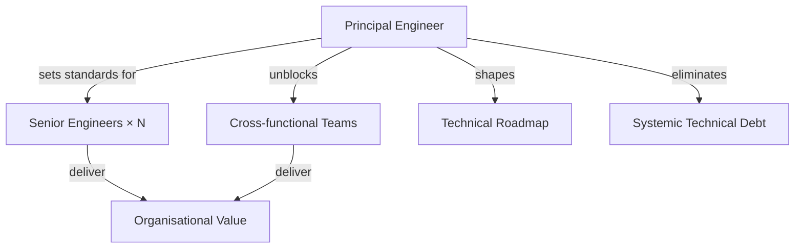
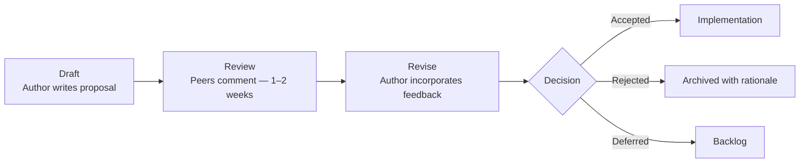
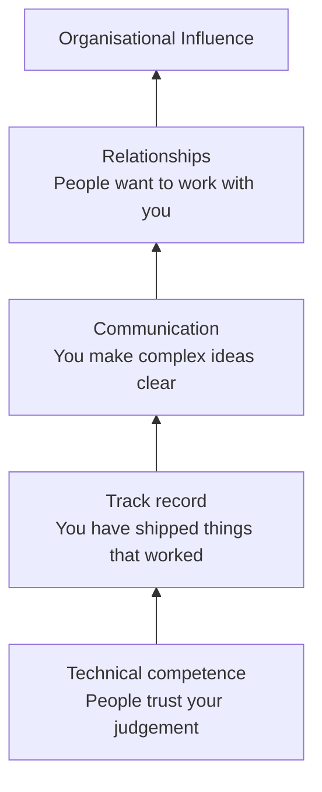

# 01.02 · Principal Engineer Deep Dive

> **Level:** Practitioner — Strategic
> **Pre-reading:** [01 · Roles & Responsibilities](01-roles-responsibilities.md)

A Principal Engineer is a **technical force-multiplier** — their impact is measured by the improvement they create in the engineers and systems around them, not by the code they personally write.

---

## The Force-Multiplier Mental Model



If a Principal Engineer raises the output quality of 10 senior engineers by 20%, the leverage is **2× an entire senior engineer's output** — without writing a single additional line of code.

---

## The RFC Process — Technical Leadership at Scale

**Requests for Comments (RFCs)** are the primary mechanism through which Principal Engineers drive change at scale.

### RFC Lifecycle



### RFC Template

```markdown
# RFC-{number}: {Title}

## Summary
One-paragraph description of the proposed change.

## Motivation
Why is this change necessary? What problem does it solve?

## Detailed Design
Technical specification of the proposed solution.

## Drawbacks
What are the downsides of this approach?

## Alternatives
What other approaches were considered and why were they rejected?

## Unresolved Questions
What aspects are still uncertain and need community input?
```

!!! tip "What makes a great RFC"
    The best RFCs **frame the problem so well** that the solution becomes obvious to the reader. A Principal Engineer who can do this consistently demonstrates architectural thinking, not just technical ability.

---

## Technical Standards and Best Practices

Principal Engineers own the "how we do things here" documentation. This typically includes:

| Standard type | Examples |
|:---|:---|
| **Coding standards** | Language style guides, naming conventions, anti-patterns list |
| **API design standards** | REST resource naming, versioning strategy, error response format |
| **Observability standards** | Required metrics, log format, distributed tracing requirements |
| **Security standards** | Secrets management, authentication patterns, OWASP top-10 controls |
| **Testing standards** | Coverage thresholds, test pyramid ratios, contract testing policy |
| **Data standards** | Schema versioning, PII classification, retention policies |

!!! warning "Standards that nobody follows"
    A standard that exists only as a document has zero value. Principal Engineers must embed standards into **tooling, templates, linting, and CI gates** — making the right thing the easy thing.

---

## The Scope Ladder

| Level | Scope | Primary concern | Evaluated on |
|:---|:---|:---|:---|
| **Senior Engineer** | One team, one service | Correct implementation | Code quality, delivery |
| **Staff Engineer** | 2–4 teams, one domain | Domain technical health | Cross-team impact |
| **Principal Engineer** | Entire engineering org | Org-wide technical direction | Organisational leverage |
| **Distinguished Engineer** | Industry-wide | Pioneering new approaches | Industry influence |

---

## Influence Without Authority

A Principal Engineer has **no line management authority** — influence must be earned through credibility and trust.

### The Credibility Stack



### Influence Strategies

=== "Pull (Preferred)"
    - Write a compelling RFC — let others come to the idea
    - Prototype the solution — show don't tell
    - Make the problem visible — good data on technical debt
    - Mentor the team building the thing you want built

=== "Push (Use Sparingly)"
    - Escalate to engineering leadership
    - Set a standard with explicit mandate
    - Gate deployment via CI fitness function

!!! note "The influence paradox"
    Principal Engineers who rely on formal authority (escalation, mandates) quickly lose credibility. Those who rarely need it — because their ideas are so clearly right — accumulate more influence over time.

---

## Mentorship Pipeline

A key accountability of a Principal Engineer is **raising the next generation** of senior and staff engineers.

| Mentorship activity | Mechanism |
|:---|:---|
| **Pairing on design** | Co-author an ADR or RFC with a senior engineer |
| **Stretch assignments** | Delegate a cross-team technical problem to a senior engineer with support |
| **Design review feedback** | Written, detailed feedback on design docs — not just "LGTM" |
| **Career conversations** | Explicit discussion of what staff/principal level looks like for them |
| **Sponsorship** | Actively advocate for promotion in calibration |

!!! tip "Sponsorship vs. mentorship"
    Mentorship is giving advice. **Sponsorship** is using your credibility to open doors for someone. Principal Engineers should do both — but sponsorship has higher leverage for the sponsored engineer's career.

---

## Cross-Cutting Concerns

Principal Engineers own the technical concerns that **span team boundaries**:

| Concern | What ownership means |
|:---|:---|
| **Security** | Define security standards, run threat modelling, gate PRs on security posture |
| **Observability** | Define the metrics/logging/tracing standard; own the observability platform selection |
| **Performance** | Define SLO targets across services; run regular performance reviews |
| **Developer experience** | Own the internal developer platform strategy; measure and improve build/test times |
| **Technical debt** | Maintain a tech debt register; advocate for debt reduction in roadmap planning |

---

## Common Interview Questions for Principal Engineers

=== "Leadership & Influence"
    - "Tell me about a time you drove a major technical change without having authority over the engineers involved."
    - "How do you handle a situation where a senior engineer disagrees with your technical recommendation?"
    - "How do you decide which technical problems are worth your attention vs. delegating?"

=== "Technical Direction"
    - "How do you set the technical roadmap for an engineering organisation?"
    - "What is your approach to managing technical debt at scale?"
    - "How do you ensure engineering standards are followed across multiple teams?"

=== "Mentorship"
    - "How do you identify and develop principal-level talent?"
    - "Tell me about an engineer you significantly impacted. What did you do and what was the outcome?"

