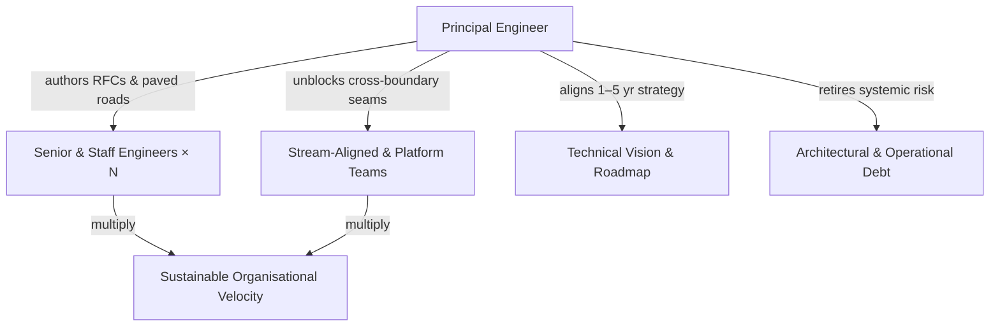
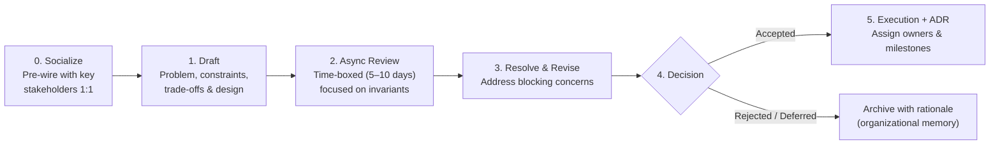
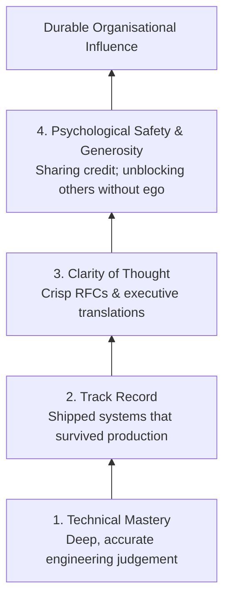

---
tags:
  - Principal Engineering
  - Technical Leadership
---

# 01.02 · Principal Engineer Deep Dive

> **Level:** Practitioner — Strategic · **Reading Time:** ~9 mins · **Track:** Role Alignment
> **Prerequisites:** [01 · Roles & Responsibilities](01-roles-responsibilities.md) · [01.01 · Software Architect](01.01-software-architect.md)

A Principal Engineer is a **technical force-multiplier** — their impact is measured by the durable improvement they create in the engineers, architecture, and delivery velocity across the organization, not merely by the volume of code they personally type.

!!! abstract "TL;DR — The 30-Second Mental Model"
    - **The Leverage Mental Model:** Improving 20 engineers' effectiveness by 20% represents **four engineer-equivalents of capacity** in a deliberately simplified illustration. Real leverage is measured by customer, reliability, and delivery outcomes—not commits or a universal productivity formula.
    - **Paved Roads over Mandates:** Standards that exist only in a wiki are ignored. Principal Engineers embed standards into **scaffolding templates, shared SDKs, linters, and CI fitness gates**.
    - **Pull > Push Influence:** Earn influence via **technical credibility, prototypes, and clear RFCs**; reserve formal escalation ("push") for rare, irreversible systemic risks.

---

## The Force-Multiplier Mental Model

### Senior vs. Principal: How You Attack the Same Problem

=== "Senior Engineer Approach (Local Optimization)"
    - Sees a recurring production bug in their team's service.
    - Writes a clean patch, adds unit tests, and merges the PR.
    - **Scope of impact:** 1 service fixed; 15 other services still vulnerable to the same failure pattern.

=== "Principal Engineer Approach (Systemic Leverage)"
    - Fixes or pairs on the immediate bug, then asks: *"Why did our architecture make this bug easy to write?"*
    - Extracts the fix into the **shared platform SDK / middleware** (e.g., automatic idempotency keys or deadline propagation).
    - Adds a **CI linter / fitness check** so the anti-pattern cannot be merged anywhere in the org.
    - **Scope of impact:** Whole class of production incidents eliminated across all teams.

---

## The RFC Process — Driving Technical Alignment at Scale

**Requests for Comments (RFCs)** are the primary vehicle through which Principal Engineers align autonomous teams around cross-cutting changes before expensive implementation begins.

!!! tip "The Secret to Landing Controversial RFCs: Pre-Wiring"
    Never drop a surprise 10-page RFC into a public channel cold. Before publishing for broad review, hold 15-minute 1:1s with the **2–3 most skeptical senior/staff engineers** and affected EMs. Incorporate their sharpest objections into the **Drawbacks** and **Alternatives** sections up front. When the RFC goes public, your toughest critics are already co-authors of the trade-offs.

*(See [05 · Negotiation & Stakeholders — RFC Template](05-negotiation-stakeholders.md#rfc-culture-canonical-template-for-written-negotiation) for the canonical RFC markdown template.)*

---

## Engineering Standards: Making the Right Thing the Easy Thing

Principal Engineers own the organization's cross-cutting technical standards — and more importantly, the **paved roads (golden paths)** that make compliance effortless:

| Standard Domain | Documented Principle | Paved-Road Enforcement Mechanism |
|:---|:---|:---|
| **API Design** | Resource naming, cursor pagination, [RFC 9457 Problem Details](https://www.rfc-editor.org/info/rfc9457/) (obsoletes RFC 7807), idempotency | OpenAPI/Protobuf linter (`Buf` / `Spectral`) in CI + generated client SDKs |
| **Observability** | Structured logs, RED metrics (Rate, Errors, Duration), [W3C Trace Context](https://www.w3.org/TR/trace-context/) | Base service chassis / middleware that auto-instruments synchronous and asynchronous hops |
| **Security** | Zero hardcoded secrets, mTLS, least-privilege IAM, OWASP controls | Pre-commit secret scanners, Vault/Cloud IAM workload identity modules |
| **Resilience** | Explicit timeouts, exponential backoff + jitter, circuit breaking | Shared HTTP/gRPC client wrapper with mandatory timeout parameters |
| **Data & Schemas** | Expand-and-contract migrations, PII tagging, retention TTLs | Automated migration linter + schema registry compatibility checks |

---

## Influence Without Authority

Because Principal Engineers rarely have direct reports, their authority is **informal and earned**.

### The Credibility Flywheel

### Pull vs. Push Influence Tactics

=== "Pull Tactics (Default — High Trust)"
    - **Show, Don't Just Tell:** Build a 200-line working prototype or benchmark that proves the latency/simplicity win.
    - **Quantify the Pain:** Surface objective DORA, incident, or cloud-cost metrics that make the status quo untenable.
    - **Co-Author with the Target Team:** Invite a senior engineer from the skeptical team to co-author the RFC and share the credit.
    - **Frame the Problem Clearly:** Define the constraints so crisply that the team arrives at the same architectural conclusion themselves.

=== "Push Tactics (Reserve for Rare, High-Impact Risks)"
    - **CI / Deployment Gate:** Block merges that violate critical security, compliance, or data-integrity invariants.
    - **Architectural Escalation:** Escalate to VP Eng / CTO when a local team decision creates an unacceptable org-wide blast radius (Type 1 one-way door).

!!! warning "The Escalation Tax"
    Executive escalation can spend trust and hide a broken decision system. If escalation becomes routine, inspect your **problem framing**, **paved-road ergonomics**, **decision rights**, and **stakeholder pre-wiring**. Immediate escalation remains appropriate for active security, safety, legal, or severe customer-risk scenarios.

---

## Mentorship vs. Sponsorship Pipeline

A core evaluation criterion for L7+ engineers is whether they **create new Staff and Principal Engineers**:

| Activity | Mentorship (Skill Building) | Sponsorship (Opportunity Creation) |
|:---|:---|:---|
| **Focus** | Coaching *how* to think, design, and write | Using your reputation to put them in high-visibility seats |
| **Concrete Action** | Pairing on an ADR; giving detailed feedback on a draft RFC | Delegating ownership of a high-profile cross-team RFC to a Senior/Staff engineer and backing them in exec reviews |
| **Calibration Role** | Helping them identify skill gaps in 1:1s | Writing promotion packet peer feedback and advocating in calibration |

---

## Active Recall & Self-Check

??? question "Self-Check 1: A team refuses to adopt your new organization-wide observability standard because 'we have a tight Q3 deadline.' How do you handle this as a Principal Engineer?"
    **Answer Rubric:**
    1. **Diagnose before pushing:** Ask *why* adoption feels expensive. Is it taking 2 weeks of manual boilerplate? If so, that's a failure of the **platform/standard ergonomics**, not the team.
    2. **Reduce extraneous cognitive load:** Provide a drop-in middleware/sidecar or submit the initial PR yourself (pairing with a team member) so adoption takes 2 hours instead of 2 weeks.
    3. **Negotiate phased risk if needed:** If a true deadline constraint exists, agree on the minimum viable telemetry (e.g., error rate + latency SLO alert) for Q3 launch, and log a tracked commitment for full distributed tracing in Q4.

??? question "Self-Check 2: How do you decide where to spend your time when 5 different teams ask for your help in the same week?"
    **Answer Rubric:**
    Prioritize along two axes: **Cost of Reversal (Type 1 vs. Type 2 decision)** and **Mentorship Leverage**:
    - **Personally lead:** High-blast-radius, irreversible (Type 1) cross-domain problems where no one else has the context.
    - **Delegate with coaching (Sponsorship):** Medium-complexity cross-team designs where a high-potential Senior/Staff engineer can grow by leading, with you reviewing their RFC.
    - **Decline / Point to Paved Road:** Local, reversible (Type 2) team decisions where your involvement would bottleneck autonomy.
