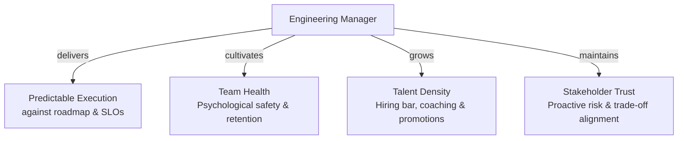
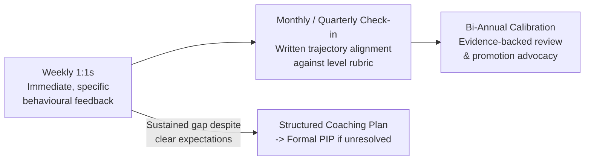

---
tags:
  - Engineering Management
  - Leadership
---

# 01.03 · Engineering Manager Deep Dive

> **Level:** Practitioner — Organisational · **Reading Time:** ~8 mins · **Track:** Role Alignment
> **Prerequisites:** [01 · Roles & Responsibilities](01-roles-responsibilities.md)

An Engineering Manager's (EM) primary product is **the team itself** — its psychological safety, technical capability, operational discipline, and ability to deliver predictably. Whether you are interviewing for an EM role or partnering with EMs as a Principal Engineer, mastering this operating model is essential.

!!! abstract "TL;DR — The 30-Second Mental Model"
    - **Your Output = Team Output:** An EM is evaluated on **sustainable delivery, retention of high performers, and talent growth** — never on personal code commits.
    - **Continuous Calibration:** Performance feedback delivered for the first time during an annual review is a management failure.
    - **The No-Surprises Rule:** Stakeholders can handle bad news (scope cuts, timeline slips) if they hear it **early, from you, with root cause and options**.

---

## The EM's Contract with the Organisation

---

## Time Allocation: An Illustrative Operating Model

The percentages below are a discussion baseline, not an industry benchmark. Team size, level, incident load, hiring demand, and organizational context should change the allocation.

| Activity | Approx. Time | High-Leverage Goal |
|:---|:---|:---|
| **1:1s & Coaching** | 20–25% | Build trust, surface hidden blockers early, coach career growth |
| **Planning & Execution** | 20% | Roadmap sizing, cross-team dependency management, sprint hygiene |
| **Stakeholder Alignment** | 15% | Translate technical risks/trade-offs to Product and leadership |
| **Hiring & Talent Bar** | 15% | Structured interviewing, calibration debriefs, closing candidates |
| **Performance Management** | 10% | Continuous feedback, promotion packets, underperformance turnaround |
| **Technical Fluency** | 10–15% | Architecture/design reviews, incident post-mortems, challenging estimates |
| **Team Culture & Process** | 5–10% | Retros, DORA metric improvements, reducing extraneous cognitive load |

!!! warning "The Over-Coding EM Anti-Pattern"
    EMs who spend `> 20%` of their week on critical-path feature coding become a bottleneck (their calendar is fragmented by meetings) and signal to senior engineers that they don't trust them. Stay technically sharp via **design reviews, observability dashboards, post-mortems, and non-blocking tooling spikes**.

---

## The 1:1 — The EM's Highest-Leverage Meeting

A 1:1 should not become **only a Jira status update** (routine status usually belongs in async tools or standups). Protect space for coaching, psychological safety, and strategic alignment while still covering urgent delivery or operational concerns.

### Recommended 30-Minute Structure

| Segment | Time | Focus |
|:---|:---|:---|
| **1. The Engineer's Agenda** | 15 min | Whatever is top-of-mind for them (friction, ideas, interpersonal dynamics) |
| **2. Coaching & Feedback** | 10 min | Specific, timely behavioural or technical feedback; organizational context |
| **3. Career & Stretch Trajectory** | 5 min | Progress toward next level, upcoming sponsorship opportunities |

### High-Signal Questions for Senior/Staff Direct Reports

- *"What is the biggest technical or organizational risk we are currently ignoring?"*
- *"Where are we wasting the most engineering time every week due to process or tooling friction?"*
- *"Who on the team (or in an adjacent team) is quietly doing exceptional work that I might not be seeing?"*
- *"What decision are you waiting on that you feel you should be empowered to make yourself?"*

---

## Continuous Performance Management

### The Anatomy of High-Caliber Performance Feedback (SBI Framework)

Use **Situation – Behavior – Impact (SBI)** so feedback is objective and actionable:

| Weak / Vague Feedback | Principal-Caliber SBI Feedback |
|:---|:---|
| *"You need to communicate better with other teams."* | *"In Tuesday's checkout RFC review (**Situation**), when the Payments team raised latency concerns, you dismissed their question without showing benchmark data (**Behavior**). That stalled sign-off by a week and eroded trust with their tech lead (**Impact**). Next time, let's pre-wire the latency numbers with them before the group review."* |
| *"Great job on the migration!"* | *"By designing the dual-write verification shadow pipeline for the Orders DB migration (**Behavior**), we caught 3 edge-case serialization bugs before cutover and completed the migration with zero customer downtime (**Impact**)."* |

---

## Structured Hiring Loops

The EM owns the **signal-to-noise ratio** of the team's hiring loop:

1. **Role Scorecard First:** Define the exact level rubrics and non-negotiable signals *before* opening reqs.
2. **Orthogonal Interview Assignments:** Assign each interviewer a specific competency (e.g., *System Design*, *Coding/Debugging*, *Cross-Team Collaboration*) so 4 interviewers don't ask the same generic questions.
3. **Independent Written Feedback Before Debrief:** Require interviewers to submit written evidence + hire/no-hire inclination *before* seeing others' scores to prevent seniority bias and groupthink.

---

## Proactive Stakeholder Risk Communication

| Project State | Communication Cadence & Mechanism | Required Content |
|:---|:---|:---|
| **Green (On Track)** | Weekly async written digest | Progress against milestones + top 1–2 horizon risks being monitored |
| **Yellow (At Risk)** | Proactive sync/async heads-up *before* milestone slips | What changed, quantified risk to deadline, and **mitigation plan in flight** |
| **Red (Blocked / Slipping)** | Immediate synchronous escalation with PE + PM | Root cause, **3-option trade-off menu** (e.g., cut scope X, slip date by Y, or accept temporary operational constraint Z), and recommended call |

---

## Active Recall & Self-Check

??? question "Self-Check 1: Two of your strongest Senior Engineers are deadlocked in a heated architectural disagreement that is blocking a critical project. How do you resolve it?"
    **Answer Rubric:**
    1. **De-escalate & move from Positions to Objective Criteria:** Meet with them (or bring in the Principal Engineer as a neutral facilitator) to separate ego from the problem.
    2. **Time-box a structured ADR comparison:** Require both engineers to write down the top 3 quality attribute drivers and evaluate both proposals against those drivers in a shared table within 48 hours (or run a 1-day benchmark spike).
    3. **Disagree and Commit:** If the options are a close call (Type 2 reversible decision), empower the **named service owner / tech lead** to make the call, record the ADR, and hold both engineers accountable for full commitment once decided.

??? question "Self-Check 2: How do you balance a Product Manager pushing for 100% feature velocity against a Principal Engineer warning that the system is on the verge of an outage?"
    **Answer Rubric:**
    - Avoid acting as a passive message-carrier between Product and Engineering.
    - Partner with the Principal Engineer to **translate the stability risk into business terms** (e.g., error budget burn rate, customer churn risk, engineering hours lost to unplanned firefighting per sprint).
    - Institute a **risk-based capacity and error-budget policy**: agree in advance which burn-rate or control signals pause feature work and shift capacity to reliability. Do not assume a universal `20%` allocation is sufficient—or necessary—for every team.
