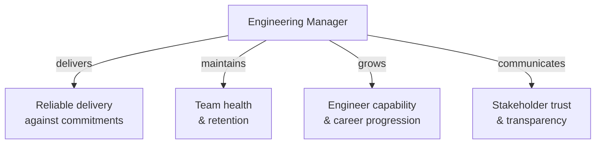
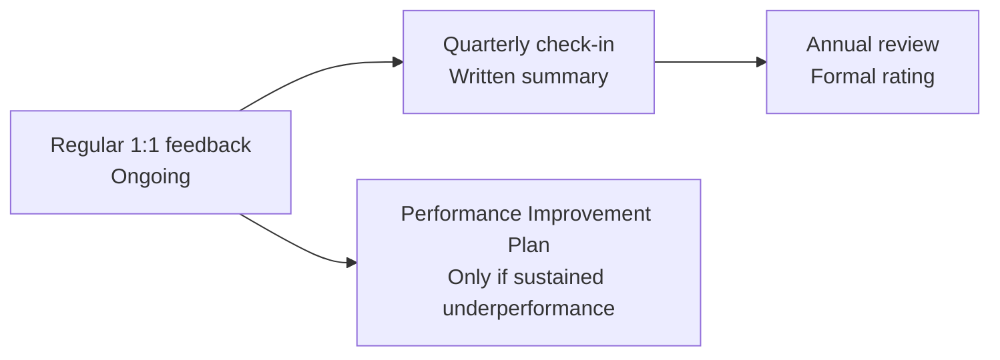
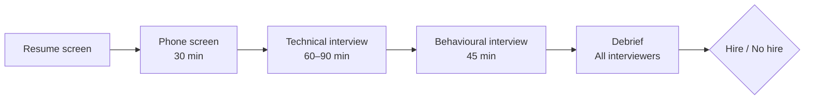

# 01.03 · Engineering Manager Deep Dive

> **Level:** Practitioner — Organisational
> **Pre-reading:** [01 · Roles & Responsibilities](01-roles-responsibilities.md)

An Engineering Manager's (EM) primary product is **the team itself** — its health, capability, and ability to reliably deliver. Everything else flows from that.

---

## The EM's Contract with the Organisation

---

## Time Allocation: Where EMs Actually Spend Their Time

| Activity | Approx. time | Purpose |
|:---|:---|:---|
| **1:1 meetings** | 20–25% | Unblock, coach, build trust |
| **Planning & coordination** | 20% | Sprint planning, dependency management, roadmap |
| **Stakeholder communication** | 15% | Status, risks, trade-offs to product and leadership |
| **Hiring** | 15% | Interviews, debriefs, offer decisions |
| **Performance management** | 10% | Reviews, promotions, PIPs, calibrations |
| **Technical involvement** | 10–15% | Design reviews, staying technically fluent |
| **Team culture & process** | 5–10% | Retros, team events, norms |

!!! warning "The over-coding EM"
    EMs who spend > 20% on coding signal to their team that they don't trust them — and miss the people and process work that only an EM can do. Technical fluency is required; daily coding is not.

---

## The 1:1 — The EM's Most Important Meeting

A 1:1 is **not a status update**. It is the primary forum for trust-building, coaching, and unblocking.

### Structure

| Segment | Time | Content |
|:---|:---|:---|
| **Their agenda** | 50–60% | What matters to the engineer this week |
| **EM's agenda** | 20–30% | Feedback, context, coaching |
| **Career development** | 10–20% | Growth goals, stretch opportunities |

### Questions That Work

- "What's the one thing I could do this week to make your work easier?"
- "What are you most uncertain about right now?"
- "Is there anything you're not telling me that I should know?"
- "What part of your work energises you most right now? What drains you?"

---

## Performance Management

### The Performance Conversation Spectrum

!!! danger "The delayed feedback trap"
    Performance feedback delivered for the first time in a formal review is a management failure. By that point, it is too late to correct course — and the engineer is surprised and demoralised. Feedback must be **continuous and specific**.

### Writing Effective Performance Reviews

| Component | What good looks like |
|:---|:---|
| **Evidence** | Specific examples with outcomes, not vague adjectives |
| **Impact** | Quantified where possible ("reduced deploy time by 40%") |
| **Level calibration** | Mapped explicitly to the engineering ladder |
| **Development areas** | Specific and actionable, not "communicate better" |
| **Trajectory** | Is this engineer on track? Ahead? Falling behind? |

---

## Hiring

The EM owns the **quality of the hiring bar** for their team.

### Structured Interview Process

### Common EM Hiring Mistakes

| Mistake | Consequence |
|:---|:---|
| **Hiring for today's skills only** | Engineers who can't grow with the role |
| **Skipping structured debriefs** | Groupthink; the loudest voice wins |
| **Ignoring culture / collaboration signal** | Technical excellence but team friction |
| **Moving too slowly** | Lose candidates to faster-moving competitors |
| **Inconsistent bar** | One tough interviewer, one lenient — noisy decisions |

---

## Stakeholder Management

EMs must translate between **engineering reality** and **business expectations**.

### The Status Communication Framework

| Situation | What to communicate | How |
|:---|:---|:---|
| On track | Confidence level + key risks on horizon | Weekly async update |
| At risk | What's at risk, why, and mitigation plan | Synchronous — proactively |
| Blocked | What's blocking, who can unblock, cost of delay | Escalate immediately |
| Slipping | Revised estimate + root cause + what changes | Face-to-face with stakeholder |

!!! tip "The no-surprises rule"
    A stakeholder who hears bad news from an EM first — with context and options — can manage it. A stakeholder who hears it from someone else is a stakeholder who no longer trusts the EM.

---

## Maintaining Technical Fluency

EMs don't need to be the best coder on the team. They need to:

- Understand the **technical trade-offs** being made
- Detect when the team is going **technically off-track**
- Have enough depth to **challenge estimates** meaningfully
- Earn the **technical respect** of senior engineers

### Practices to Stay Sharp

| Practice | Frequency |
|:---|:---|
| Attend and contribute to design reviews | Weekly |
| Read technical RFCs and ADRs | As produced |
| Pair with engineers on complex problems | Monthly |
| Read one technical book or paper | Quarterly |
| Do a small technical spike or prototype | Quarterly |

---

## Common EM Interview Questions

=== "People & Culture"
    - "How do you build psychological safety in a team?"
    - "Tell me about a time you had to manage a low performer. What was your approach?"
    - "How do you handle conflict between two senior engineers?"

=== "Delivery"
    - "How do you manage a project that is at risk of missing a deadline?"
    - "How do you estimate engineering effort accurately?"
    - "How do you manage technical debt alongside feature delivery?"

=== "Leadership"
    - "How do you balance your team's development needs against business delivery pressure?"
    - "What does good engineering culture look like to you? How do you build it?"
    - "How do you stay technically credible as your team grows?"

