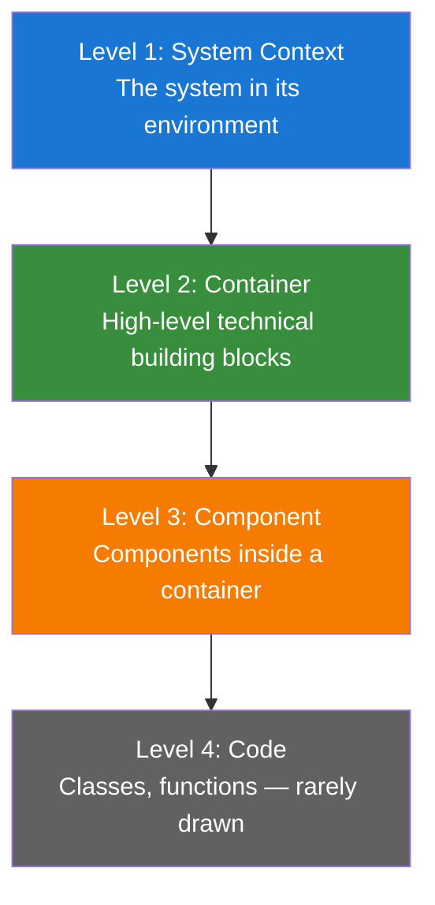
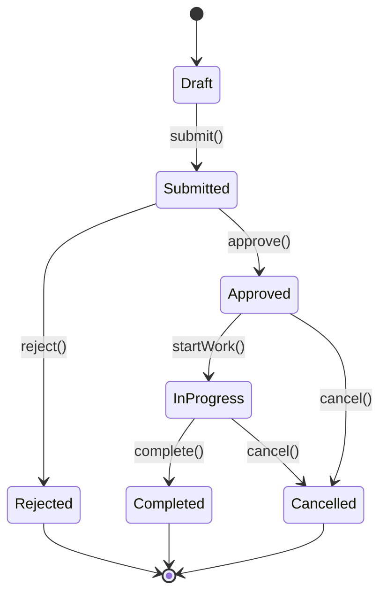
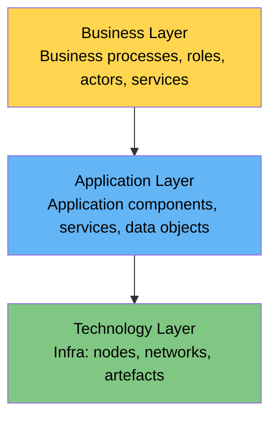
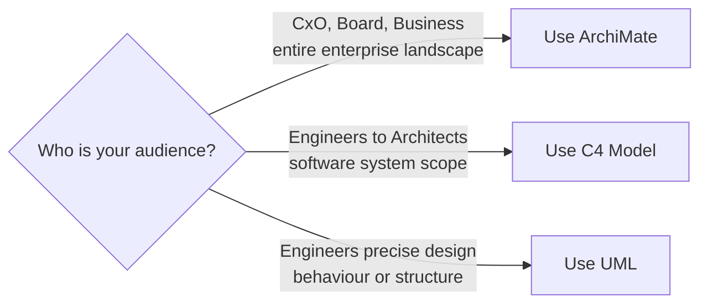

# 02 · Architecture Diagramming

> **Level:** Conceptual — Practitioner
> **Pre-reading:** [Home](index.md) · [01 · Roles & Responsibilities](01-roles-responsibilities.md)

Architecture diagrams are not *decorations*. They are **epistemic tools** — they shape how a team thinks about a system. A poorly chosen diagram notation or abstraction level causes misaligned understanding, bad decisions, and wasted engineering effort.

The three major notation systems — **C4**, **UML**, and **ArchiMate** — each answer a different set of questions. Knowing when to use which is a mark of architectural maturity.

---

## The Core Problem with Architecture Diagrams

Most "architecture diagrams" in the industry are informal box-and-arrow drawings. They suffer from:

- **No consistent abstraction level** — a single diagram mixes code-level classes with deployment topology
- **Undefined notation** — a box means "service" in one team's diagram and "database" in another's
- **Audience mismatch** — a VP needs a different view than a backend engineer
- **Stale documentation** — diagrams are created once and never updated

!!! warning "The #1 diagramming failure"
    The most common failure is drawing a diagram at the *wrong abstraction level* for the audience. Showing a class diagram to a CTO, or a high-level context diagram to an engineer implementing a specific API — both destroy communication instead of enabling it.

---

## The Three Systems at a Glance

| Notation | Creator | Best for | Audience | Formality |
|:---|:---|:---|:---|:---|
| **C4 Model** | Simon Brown | Software architecture communication | Engineers to executives | Low — free-form, guided |
| **UML** | OMG Consortium | Precise software structure and behaviour | Engineers, architects | High — standardised |
| **ArchiMate** | The Open Group | Enterprise architecture (business + IT + infra) | Enterprise architects, CxOs | High — standardised |

---

## C4 Model

The C4 Model is a *hierarchical* diagramming approach. The name comes from its four levels of abstraction: **Context, Container, Component, Code**.

### The Four Levels



| Level | Zoom | Who uses it | What it shows |
|:---|:---|:---|:---|
| **System Context (L1)** | Whole system in its environment | Everyone (CTO to engineer) | The system, its users, and external dependencies |
| **Container (L2)** | Inside one system | Engineers, architects | Web apps, APIs, databases, queues — the deployable units |
| **Component (L3)** | Inside one container | Engineers | Services, controllers, repositories inside a single deployable |
| **Code (L4)** | Inside one component | IDEs generate this | Class diagrams — usually auto-generated, rarely hand-drawn |

### C4 Notation Rules

C4 uses a deliberately minimal visual vocabulary:

- **Person** (stick figure or rounded box) — a human user or role
- **System** (box) — your software system or an external one
- **Container** (box with technology label) — a deployable / runnable unit
- **Component** (box inside a container) — a logical grouping inside a container
- **Relationship** (arrow with label) — "uses", "reads from", "publishes to"

!!! tip "The C4 'key' principle"
    Every C4 diagram **must** include a key/legend. Never assume the reader shares your mental model of what a box or arrow means.

### When to Use C4

| Situation | C4 Level |
|:---|:---|
| Explaining the system to a new CTO | L1 — Context |
| Onboarding a new engineer to the team | L2 — Container |
| Reviewing a specific service's internal design | L3 — Component |
| Auto-generated class diagram in a PR | L4 — Code |
| Documenting microservice landscape across domains | L2 across multiple systems |

→ **[Deep Dive: C4 Model](02.01-c4-model.md)**

---

## UML — Unified Modelling Language

UML is the **ISO-standardised** notation for software models. It defines 14 diagram types across two categories.

### Structural Diagrams (the *what*)

| Diagram | What it models | Principal Engineer usage |
|:---|:---|:---|
| **Class** | Object types, attributes, relationships | Designing domain models, API contracts |
| **Object** | Instance snapshots | Explaining complex object graphs |
| **Component** | Logical system components and interfaces | Service boundaries and interface contracts |
| **Package** | Namespace/module groupings | Module dependencies, layered architecture |
| **Composite Structure** | Internal structure of a class | Rare — complex component internals |
| **Deployment** | Physical deployment topology | Infrastructure mapping; cloud resource layout |
| **Profile** | UML extensions | Rare — framework extensions |

### Behavioural Diagrams (the *how*)

| Diagram | What it models | Principal Engineer usage |
|:---|:---|:---|
| **Use Case** | System behaviour from user perspective | Requirements capture, scope definition |
| **Sequence** | Interaction chronology between objects | API call flows, distributed transaction tracing |
| **Communication** | Object interactions with message numbering | Alternative to sequence for complex webs |
| **Activity** | Business / algorithm flow | Workflow design, saga choreography |
| **State Machine** | Object lifecycle states and transitions | Order state, payment state, saga compensation |
| **Timing** | Time-constrained interactions | Real-time systems — rare in enterprise |
| **Interaction Overview** | High-level sequence of sequences | Complex orchestration |

### The Three UML Diagrams Every Principal Must Know

#### 1. Sequence Diagram — The "how does X happen" diagram

```
Client -> API Gateway: POST /orders (JWT)
API Gateway -> Auth Service: validate token
Auth Service --> API Gateway: 200 OK, claims
API Gateway -> Order Service: createOrder(userId, items)
Order Service -> Inventory Service: reserveStock(items)
Inventory Service --> Order Service: stockReserved
Order Service -> Payment Service: chargeCard(amount)
Payment Service --> Order Service: paymentConfirmed
Order Service -> Event Bus: OrderPlaced {orderId}
Order Service --> API Gateway: 201 Created {orderId}
API Gateway --> Client: 201 Created {orderId}
```

Use when: explaining an API flow, a distributed transaction, or a debugging scenario to another engineer.

#### 2. Class Diagram — The "what does the domain look like" diagram

Key relationships to know:

| UML Notation | Meaning | Example |
|:---|:---|:---|
| **Association** (plain arrow) | "has a" reference | Order has OrderLines |
| **Aggregation** (hollow diamond) | Whole-part, part can exist alone | Team aggregates Members |
| **Composition** (filled diamond) | Whole-part, part cannot exist alone | Invoice is composed of LineItems |
| **Inheritance** (hollow triangle) | "is a" | CreditCardPayment extends Payment |
| **Interface realisation** (dashed triangle) | Implements an interface | OrderService implements IOrderService |
| **Dependency** (dashed arrow) | "uses" temporarily | ReportGenerator depends on DataExporter |

#### 3. State Machine Diagram — The "what are the rules of state" diagram

Use when: designing order state transitions, saga compensation logic, or any entity with a lifecycle.



→ **[Deep Dive: UML for Architects](02.02-uml-architects.md)**

---

## ArchiMate

ArchiMate is the **enterprise architecture modelling language** standardised by The Open Group. It operates at a higher abstraction than UML — it models the entire enterprise landscape: business processes, applications, and technology infrastructure in a single unified framework.

### The Three Layers



| Layer | Models | Examples |
|:---|:---|:---|
| **Business** | What the business does | Business process: "Process Loan Application"; Role: "Loan Officer" |
| **Application** | Software that supports the business | Application: "Loan Origination System"; Interface: "REST API" |
| **Technology** | Infrastructure that runs the software | Node: "Kubernetes Cluster"; Artefact: "Docker Image" |

### Key ArchiMate Relationships

| Relationship | Meaning |
|:---|:---|
| **Serving** | One element provides services to another |
| **Realisation** | A lower-level element realises a higher-level intent |
| **Assignment** | Links active elements (roles, components) to behaviour |
| **Composition / Aggregation** | Structural containment |
| **Triggering** | Causal relationship between processes |
| **Flow** | Transfer of information or materials |

### ArchiMate vs C4 vs UML — Choosing the Right Tool



| If you need to... | Use |
|:---|:---|
| Show how a business process maps to IT systems | ArchiMate |
| Explain your microservice to a new engineer | C4 L2–L3 |
| Document the API call flow for a specific feature | UML Sequence diagram |
| Show the state transitions of a domain entity | UML State Machine |
| Present a new system to the executive team | C4 L1 (Context) |
| Audit the technology landscape across the enterprise | ArchiMate |
| Design the class hierarchy of a domain model | UML Class diagram |

→ **[Deep Dive: ArchiMate](02.03-archimate.md)**

---

## Diagram Quality Checklist

Before presenting any architecture diagram, verify:

- [ ] **Purpose is clear** — the diagram answers exactly one question
- [ ] **Abstraction level is consistent** — no mixing of L1 and L3 in the same diagram
- [ ] **All elements are labelled** — no unlabelled boxes or arrows
- [ ] **Relationships carry meaning** — arrows have verbs ("reads from", "publishes to")
- [ ] **A key/legend exists** — notation is explained, not assumed
- [ ] **Technology is named** — "microservice" is not a technology; "Spring Boot Java service" is
- [ ] **The audience is identified** — who is this diagram for?
- [ ] **The date/version is recorded** — diagrams become misleading when stale

!!! tip "The Simon Brown test"
    Simon Brown (creator of C4) asks: "Can someone read this diagram without you explaining it?" If the answer is no, the diagram has failed — no matter how beautiful it looks.
