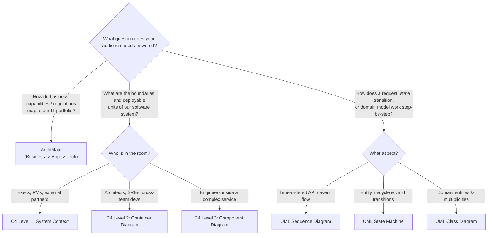

---
tags:
  - Software Architecture
  - System Design
  - Diagrams
---

# 02 · Architecture Diagramming

> **Level:** Conceptual — Practitioner · **Reading Time:** ~8 mins · **Track:** Systems & Architecture
> **Prerequisites:** [Home](index.md) · [01 · Roles & Responsibilities](01-roles-responsibilities.md)

Architecture diagrams are not decorations — they are **epistemic tools** that govern how an organization reasons about a system. A poorly chosen notation or mixed abstraction level causes misaligned mental models, broken boundaries, and wasted engineering months.

!!! abstract "TL;DR — The 30-Second Mental Model"
    - **C4 Model (Simon Brown):** Best for **software system architecture** across audiences — zoom cleanly from System Context (`L1`) → Container (`L2`) → Component (`L3`) → Code (`L4`).
    - **UML (OMG):** Best for **precise runtime behaviour and domain contracts** — specifically **Sequence diagrams**, **State Machines**, and **Domain Class models**.
    - **[ArchiMate 3.2](https://pubs.opengroup.org/architecture/archimate3-doc/) (The Open Group):** Best for **enterprise architecture** — tracing **Business Capabilities & Processes** through **Applications** to **Technology and Physical Infrastructure**.
    - **The Golden Rule:** Never mix abstraction levels in a single diagram, and never draw an arrow without a verb and protocol label.

---

## Why Most Industry Diagrams Fail

Most "architecture diagrams" in engineering wikis are informal box-and-arrow drawings that suffer from four fatal flaws:

1. **Mixed Abstraction Levels:** Placing a `PostgreSQL Index` or `Java Class` next to an `AWS Region` or `Stripe External System` in the same diagram.
2. **Ambiguous Visual Vocabulary:** A blue rectangle means "microservice" on one slide, "shared library" on the next, and "team" on the third.
3. **Silent Arrows:** Unlabelled lines (`A ───> B`) that fail to specify *direction of dependency* vs. *direction of data flow*, sync vs. async, or protocol (`gRPC`, `Kafka`, `HTTPS`).
4. **Audience Mismatch:** Showing a 40-box class diagram to a VP of Product, or a 3-box executive cartoon to an engineer implementing a distributed saga.

---

## Deep-Dive Modules in This Section

<div class="grid cards" markdown>

-   :material-layers-triple-outline:{ .lg .middle } **02.01 · C4 Model**

    ---

    Learn Simon Brown's 4-level hierarchical zoom model (`Context → Container → Component → Code`) plus System Landscape and Dynamic views.

    [:octicons-arrow-right-24: C4 Model Deep Dive](02.01-c4-model.md)

-   :material-transit-connection-variant:{ .lg .middle } **02.02 · UML for Architects**

    ---

    Focus on the high-leverage 20% of UML that Principal Engineers use weekly: **Sequence**, **State Machine**, **Class**, and **Activity** diagrams.

    [:octicons-arrow-right-24: UML for Architects](02.02-uml-architects.md)

-   :material-domain:{ .lg .middle } **02.03 · ArchiMate**

    ---

    Connect **Business Processes & Regulatory Drivers** to **Application Services** and **Cloud Infrastructure** in enterprise landscapes.

    [:octicons-arrow-right-24: ArchiMate Deep Dive](02.03-archimate.md)

</div>

---

## The Three Notation Systems Compared

| Dimension | C4 Model | [UML 2.5.1](https://www.omg.org/spec/UML/2.5.1) | ArchiMate 3.2 |
|:---|:---|:---|:---|
| **Standard / Creator** | Simon Brown | OMG / ISO | The Open Group |
| **Primary Scope** | Software system structure (zoomable map) | Detailed software behaviour, state, and domain types | End-to-end enterprise (Business + App + Tech) |
| **Target Audience** | Engineers, Tech Leads, Architects, Executives (`L1`) | Software Engineers & Domain Architects | Enterprise Architects, CTO/CIO, Compliance |
| **Notation Strictness** | Low — notation-independent, metadata-strict | High — standardized shapes & arrowheads | High — layer colors & relationship symbols |
| **Diagram-as-Code Tools** | Structurizr DSL, Mermaid, C4-PlantUML | Mermaid (`sequenceDiagram`, `stateDiagram-v2`, `classDiagram`), PlantUML | Archi, PlantUML-ArchiMate, Mermaid subgraphs |

---

## Decision Tree: Which Diagram Should You Draw?



---

## Quick Comparison: C4 vs. UML vs. ArchiMate in Action

=== "C4 Model (Structural Zoom)"
    Best for **system boundaries and deployable units** (Google Maps for your software):
    ```mermaid
    graph LR
        User["Customer<br/>[Person]"] -->|"HTTPS / JSON"| API["Checkout API<br/>[Container: Go Service]"]
        API -->|"Reads/Writes SQL"| DB[("Orders DB<br/>[Container: PostgreSQL]")]
        API -->|"Publishes OrderPlaced<br/>(Protobuf)"| Bus["Event Bus<br/>[Container: Kafka]"]
    ```
    → [Full C4 Deep Dive](02.01-c4-model.md)

=== "UML Sequence & State (Runtime Behaviour)"
    Best for **request choreography, failure paths, and state invariants**:
    ```mermaid
    sequenceDiagram
        autonumber
        participant Client
        participant API as Checkout API
        participant DB as Orders DB
        participant Outbox as Transactional Outbox

        Client->>API: POST /orders (Idempotency-Key)
        activate API
        API->>DB: BEGIN TX: Insert Order + Insert Outbox Event
        DB-->>API: COMMIT OK
        API-->>Client: 201 Created {orderId}
        deactivate API
        Outbox--)API: Async CDC relay publishes OrderPlaced to Kafka
    ```
    → [Full UML Deep Dive](02.02-uml-architects.md)

=== "ArchiMate (Enterprise Traceability)"
    Best for **cross-layer impact analysis** (Business → Application → Infrastructure):
    ```mermaid
    graph TD
        BP["Business Process:<br/>Order Fulfilment"] -->|"realised by"| AS["Application Component:<br/>Order Management System"]
        AS -->|"hosted on"| Node["Technology Node:<br/>EKS Production Cluster"]
        style BP fill:#FFD54F,color:#000
        style AS fill:#64B5F6,color:#000
        style Node fill:#81C784,color:#000
    ```
    → [Full ArchiMate Deep Dive](02.03-archimate.md)

---

## The Principal Engineer's Diagram Quality Checklist

Before embedding any diagram in an RFC, ADR, or executive presentation, verify:

- [ ] **Single Question Rule:** Does this diagram answer one specific question at one consistent zoom level?
- [ ] **Explicit Type & Tech Labels:** Does every box state its type and technology (e.g., `[Container: Rust gRPC Service]`, not just `"Auth"`)?
- [ ] **Action-Verb Arrows:** Does every arrow specify the verb and protocol (e.g., `"Streams CDC events via Debezium/Kafka"`, not just an unlabelled line)?
- [ ] **Directionality Clarity:** Is it obvious whether arrows represent **runtime request/data flow** or **compile-time dependency**?
- [ ] **Self-Contained Legend:** Can another engineer understand the diagram **without you standing next to it explaining it** (the *Simon Brown Test*)?
- [ ] **Diagrams-as-Code:** Is the source stored in Git (`Mermaid`, `Structurizr DSL`, `PlantUML`) alongside the code so it evolves in PRs?

---

## Active Recall & Self-Check

??? question "Self-Check 1: In a system design interview, which diagram should you draw first in the High-Level Design phase, and what should you switch to in the Deep-Dive phase?"
    **Answer Rubric:**
    - **High-Level Design (First 10 mins):** Draw a **C4 Level 2 (Container) Diagram** showing clients, API gateways, independently deployable services, data stores, caches, and message brokers with protocol labels.
    - **Deep-Dive Phase (Next 15 mins):** Switch to a **UML Sequence Diagram** (to trace concurrency, idempotency, retries, and failure modes across services) or a **UML State Machine** (to prove how order/payment states avoid race conditions).

??? question "Self-Check 2: Why is 'Container' in the C4 model often misunderstood by DevOps engineers?"
    **Answer Rubric:**
    In C4, a **Container** means an **independently deployable/runnable execution unit or data store** (e.g., a React SPA, a Go API service, a PostgreSQL database, a Kafka topic/broker, or an AWS Lambda) — **not** specifically a Docker/OCI container.
