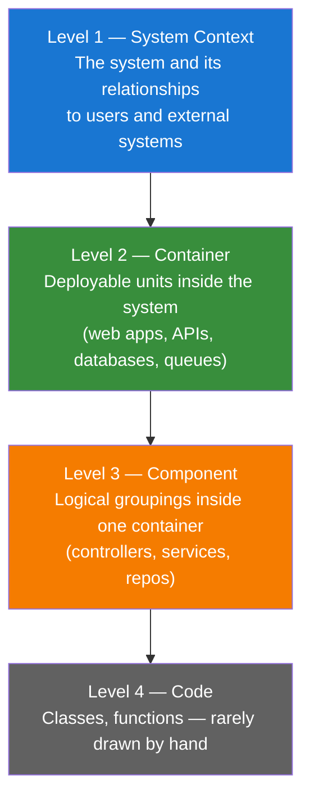
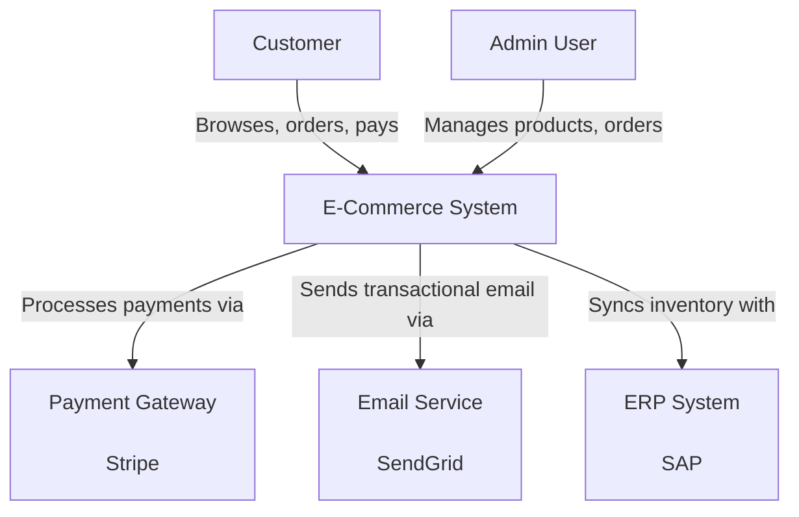
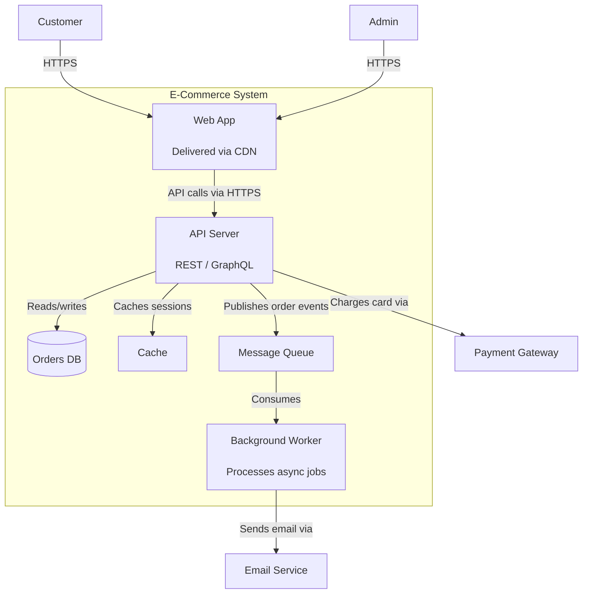
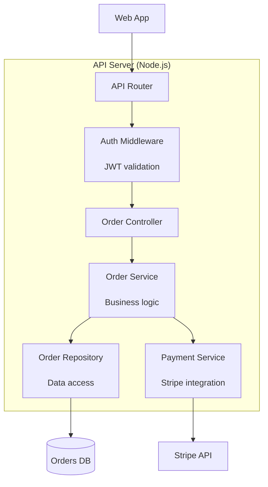

# 02.01 · C4 Model Deep Dive

> **Level:** Practitioner
> **Pre-reading:** [02 · Architecture Diagramming](02-architecture-diagramming.md)

The **C4 Model** (created by Simon Brown) is a hierarchical approach to diagramming software architecture. It gives teams a shared vocabulary and a set of abstraction levels that match different audiences.

---

## Why C4 Exists

Before C4, architecture diagrams were informal box-and-arrow drawings with no consistent meaning. A box might be a service, a database, a team, or a physical server — with no way to tell. C4 solves this by defining a **small, consistent vocabulary** and **four abstraction levels**.

!!! note "The key insight"
    C4 doesn't prescribe a drawing tool or a notation standard — it prescribes a **thinking model**: "Zoom in and out deliberately, and always be explicit about what your diagram represents."

---

## The Four Levels

---

## Level 1: System Context Diagram

**Question it answers:** "What does this system do, who uses it, and what does it depend on?"

**Audience:** Everyone — CTO, product manager, new engineer, external partner.

### Elements

| Element | Visual | Meaning |
|:---|:---|:---|
| **Person** | Rounded box (blue) | A human user or role |
| **Your system** | Box (dark) | The system you are documenting |
| **External system** | Box (grey) | A third-party or internal system outside your scope |
| **Relationship** | Arrow with label | "uses", "sends data to", "receives events from" |

### Example — E-commerce System Context

---

## Level 2: Container Diagram

**Question it answers:** "What are the deployable/runnable pieces and how do they communicate?"

**Audience:** Architects, senior engineers, DevOps.

A **container** in C4 is not a Docker container — it is any independently deployable or runnable unit: a web app, a mobile app, an API, a database, a message queue, a serverless function.

### Example — E-commerce Containers

---

## Level 3: Component Diagram

**Question it answers:** "What are the logical components inside this container?"

**Audience:** Developers working on that specific container.

!!! warning "Don't draw L3 for every container"
    Only draw L3 for containers that are complex enough to benefit from it. A simple CRUD API with 3 endpoints does not need a component diagram.

### Example — API Server Components

---

## Level 4: Code

**Question it answers:** "How is this component implemented at the class/function level?"

In practice, Level 4 is **almost never hand-drawn**. IDEs and documentation generators (e.g., Javadoc, Doxygen) generate this automatically.

!!! tip "When to draw Level 4"
    Only for genuinely complex algorithmic components where the class structure is not obvious — for example, a custom serialisation framework or a complex state machine.

---

## C4 Notation Rules

Every C4 diagram must include:

- [ ] **Title** — "System Context for E-Commerce" not just "Architecture"
- [ ] **Level label** — L1 / L2 / L3 in the title or subtitle
- [ ] **Key/legend** — shapes, colours, and their meanings
- [ ] **Technology labels** on containers and components
- [ ] **Relationship labels** — verbs describing what flows over the arrow

---

## Supplementary Diagrams

C4 is extensible. Two common supplementary diagrams:

| Diagram | Purpose |
|:---|:---|
| **System Landscape** | Shows multiple systems and their relationships — zoom out beyond L1 |
| **Dynamic Diagram** | Shows how elements collaborate for a specific use case — like a sequence diagram |
| **Deployment Diagram** | Maps containers onto infrastructure (Kubernetes nodes, cloud regions, CDN) |

---

## C4 Tooling

| Tool | Approach |
|:---|:---|
| **Structurizr** (Simon Brown's own tool) | Code-as-diagrams; single model, multiple views |
| **draw.io / diagrams.net** | Manual; C4 shape library available |
| **Mermaid** | Code-first; no official C4 support but approximated with flowcharts |
| **PlantUML + C4-PlantUML** | Text-as-diagrams; rich C4 support |
| **Lucidchart** | Manual; C4 templates available |

!!! tip "Structurizr is the gold standard"
    Structurizr enforces a single architecture model from which all four views are derived — preventing inconsistencies between diagrams. It is the tool Simon Brown recommends and uses himself.

