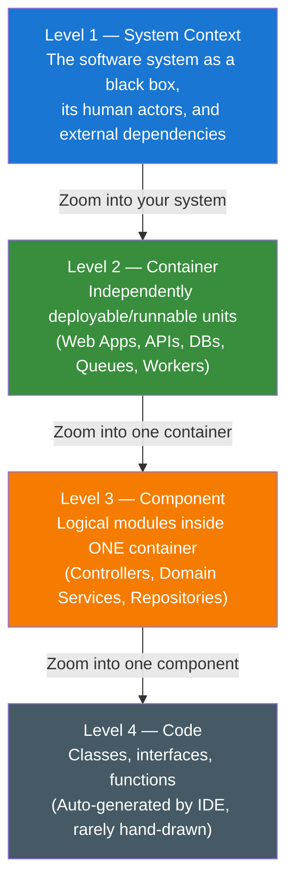
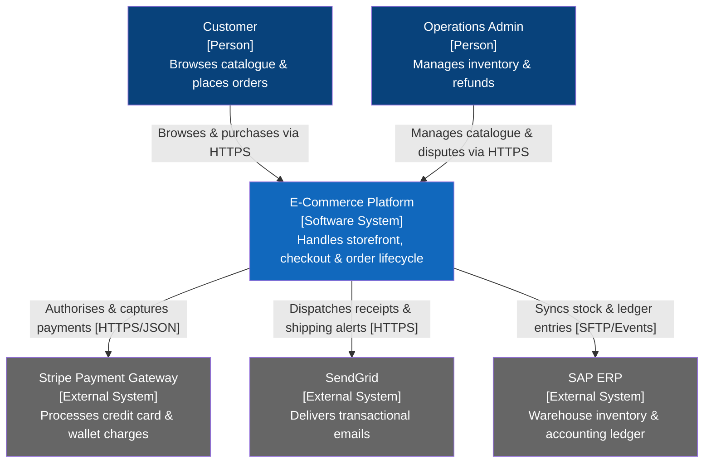
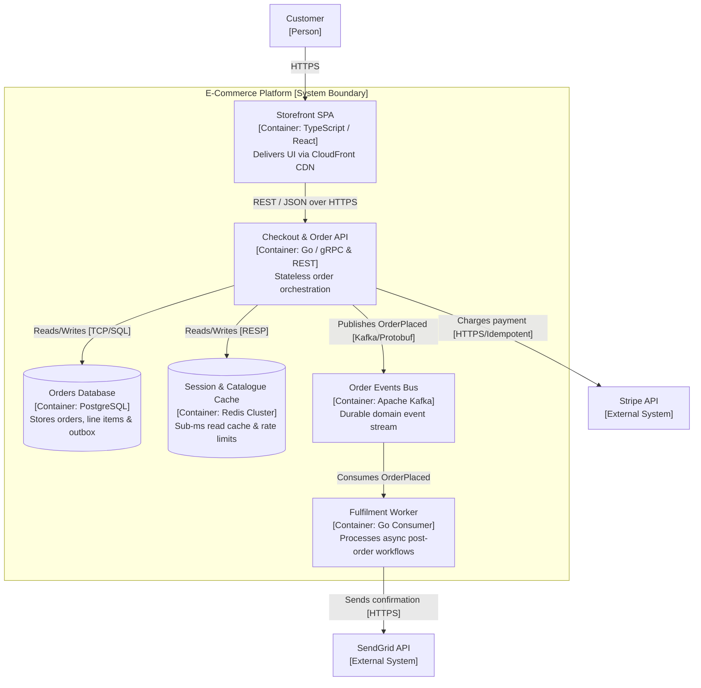
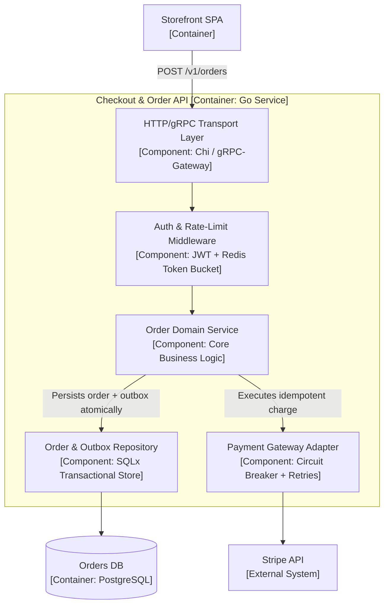

---
tags:
  - C4 Model
  - Software Architecture
  - Diagrams
---

# 02.01 · C4 Model Deep Dive

> **Level:** Practitioner · **Reading Time:** ~8 mins · **Track:** Systems & Architecture
> **Prerequisites:** [02 · Architecture Diagramming](02-architecture-diagramming.md)

The **[C4 Model](https://c4model.com/)** (created by Simon Brown) is a widely used, notation-independent approach to software architecture visualization. Think of it as **Google Maps for your codebase**: start with the system context, zoom into applications and data stores, inspect components only where useful, and rarely hand-draw code-level detail.

!!! abstract "TL;DR — The 30-Second Mental Model"
    - **L1 (System Context):** Your system as a single black box surrounded by users and external systems. (For everyone: CTO, PM, engineers).
    - **L2 (Container):** Deployable/runnable units (APIs, SPAs, workers, databases, queues) and their network protocols. (Your primary system design interview tool).
    - **L3 (Component):** Logical building blocks *inside* a single container. Only draw for complex services.
    - **L4 (Code):** Classes/interfaces — auto-generate from IDE/code; almost never draw by hand.

---

## The Four Zoom Levels

---

## Level 1: System Context Diagram

- **Question Answered:** *"What does this system do, who uses it, and what external systems does it depend on?"*
- **Target Audience:** Everyone — Executives, Product Managers, Security/Compliance, and Engineers.

---

## Level 2: Container Diagram

- **Question Answered:** *"What are the high-level deployable units, data stores, and communication protocols?"*
- **Target Audience:** Architects, Staff/Principal Engineers, Software Engineers, SRE/DevOps.

!!! warning "Terminology Trap: C4 Container ≠ Docker Container"
    In C4, a **Container** is an application or data store (e.g., a Next.js SPA, a Go gRPC service, a PostgreSQL database schema, a Redis cluster, or an S3 bucket). The official [queues-and-topics guidance](https://c4model.com/abstractions/queues-and-topics) also permits a queue or topic to be modeled as a data-store container; for a simpler diagram, omit the intermediary and put the queue/topic name on the relationship. If two pieces of code run together in the same deployable unit, they are **Components (L3)** inside the same Container, not separate Containers.

---

## Level 3: Component Diagram

- **Question Answered:** *"How is a single complex container modularised internally?"*
- **Target Audience:** Engineers working inside that specific service/container.

!!! tip "When to Skip Level 3 and Level 4"
    For many teams, **L1 + L2** (plus a dynamic/sequence view for tricky flows) provides enough value; the official C4 guidance explicitly says not every level is necessary. Hand-drawn L3/L4 diagrams rot quickly unless maintained alongside code or generated from a reliable model.

---

## Supplementary C4 Views

Beyond the core 4 levels, C4 defines three high-value supplementary views:

| Supplementary View | Purpose | When to Use in Practice |
|:---|:---|:---|
| **System Landscape** | Zooms out *above* L1 to show how multiple software systems across an enterprise portfolio interact | Principal/Enterprise architecture reviews spanning multiple product lines |
| **Dynamic Diagram** | Shows numbered runtime interactions between C4 elements (containers or components) for one specific use case | Explaining a specific user journey alongside an L2 Container diagram |
| **Deployment Diagram** | Maps L2 Containers onto physical/cloud infrastructure (Regions, VPCs, EKS Clusters, RDS Multi-AZ) | SRE readiness reviews, blast-radius analysis, and cloud cost estimation |

---

### Primary C4 References

- [C4 Model — core and supporting diagrams](https://c4model.com/diagrams)
- [C4 Model — containers](https://c4model.com/abstractions/container) and [queues/topics](https://c4model.com/abstractions/queues-and-topics)
- [C4 Model — diagram review checklist](https://c4model.com/diagrams/checklist)

---

## Active Recall & Self-Check

??? question "Self-Check 1: You are reviewing a teammate's C4 Container (L2) diagram and see a box labelled `OrderRepository (Java Class)` next to `PostgreSQL Database`. What feedback do you give?"
    **Answer Rubric:**
    - That diagram violates **abstraction level consistency** by mixing an **L3/L4 implementation detail (`OrderRepository`)** into an **L2 Container diagram**.
    - At Level 2, only independently deployable/runnable units (`Order API Service [Container]` and `PostgreSQL [Container]`) belong on the canvas. `OrderRepository` belongs in an L3 Component diagram *inside* the `Order API Service` boundary (or omitted entirely if the service is simple).

??? question "Self-Check 2: What five pieces of metadata must appear on every C4 box and arrow to pass the 'Simon Brown Test'?"
    **Answer Rubric:**
    1. **Element Name** (e.g., `Checkout API`)
    2. **Element Type** (e.g., `[Container]`, `[Person]`, `[External System]`)
    3. **Technology Choice** (for L2/L3, e.g., `Go / gRPC`)
    4. **Brief Responsibility Description** (1 sentence inside the box)
    5. **Action Verb + Protocol on Every Arrow** (e.g., `"Publishes OrderPlaced events [Kafka / Protobuf]"`) plus a **Diagram Title & Legend/Key**.
