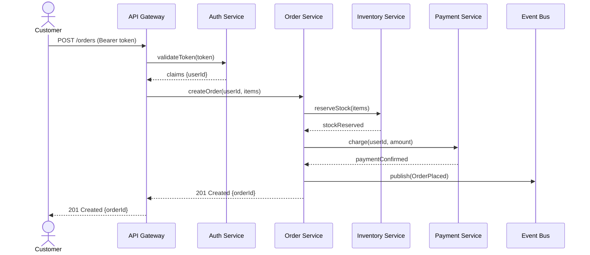
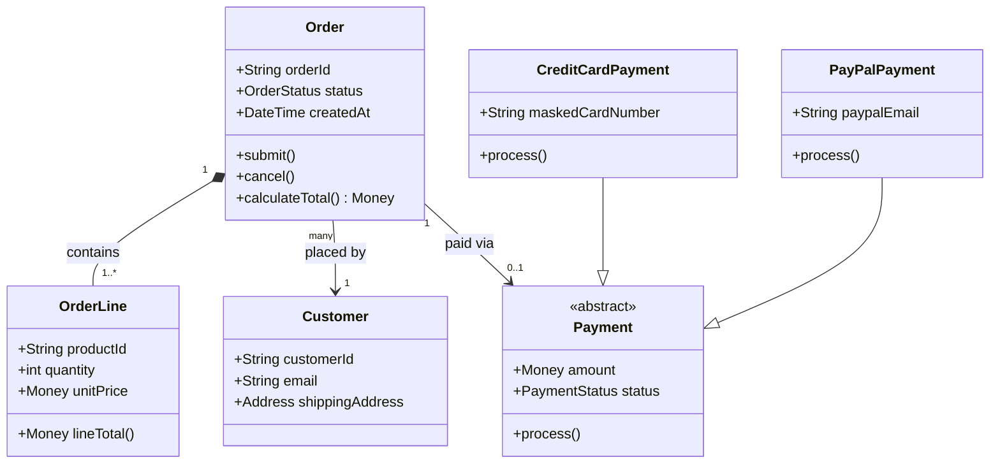
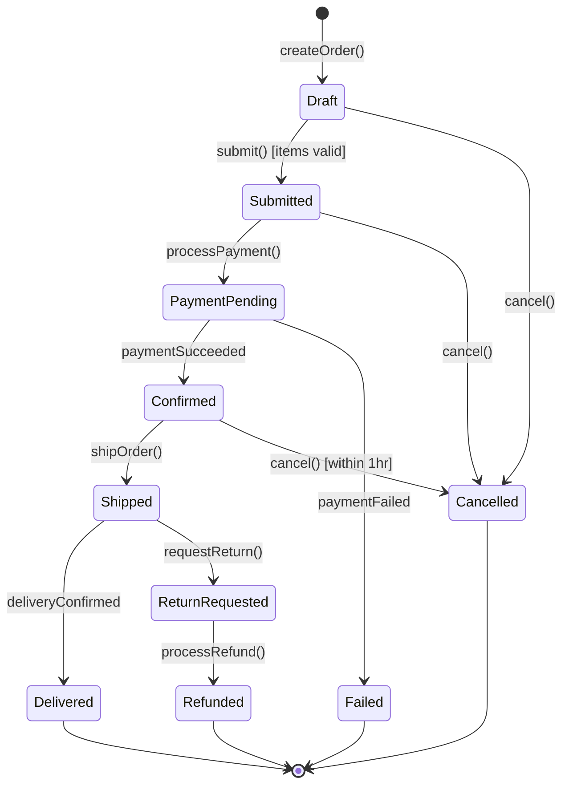
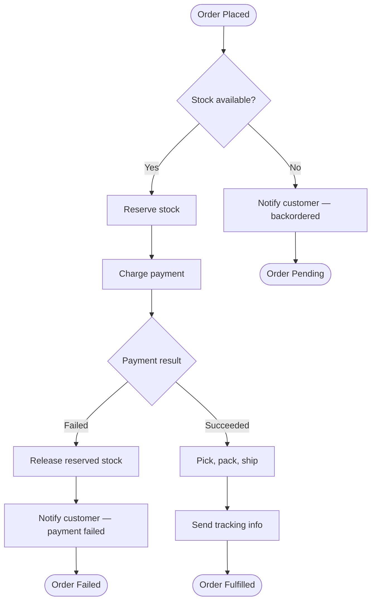

# 02.02 · UML for Architects

> **Level:** Practitioner
> **Pre-reading:** [02 · Architecture Diagramming](02-architecture-diagramming.md)

UML (Unified Modelling Language) is the **ISO-standardised** notation for software models. It defines 14 diagram types. This deep dive focuses on the subset that Architects and Principal Engineers use in practice.

---

## The 14 UML Diagram Types

UML diagrams are divided into two categories:

=== "Structural (the *what*)"
    | Diagram | What it models |
    |:---|:---|
    | **Class** | Types, attributes, relationships |
    | **Object** | Specific instances at a point in time |
    | **Component** | Logical system components and interfaces |
    | **Package** | Namespace/module groupings and dependencies |
    | **Composite Structure** | Internal structure of a classifier |
    | **Deployment** | Physical/virtual deployment topology |
    | **Profile** | UML extensions for specific domains |

=== "Behavioural (the *how*)"
    | Diagram | What it models |
    |:---|:---|
    | **Use Case** | System behaviour from a user perspective |
    | **Sequence** | Time-ordered interactions between objects |
    | **Communication** | Object interactions with message numbering |
    | **Activity** | Workflow / algorithm flow |
    | **State Machine** | Object lifecycle states and transitions |
    | **Timing** | Time-constrained interactions |
    | **Interaction Overview** | High-level sequence of interactions |

---

## The Three UML Diagrams Every Architect Must Master

### 1. Sequence Diagram

**Use when:** Explaining an API flow, a distributed transaction, a debugging scenario, or any time-ordered interaction.

#### Notation Elements

| Element | Notation | Meaning |
|:---|:---|:---|
| **Lifeline** | Vertical dashed line with box at top | A participant (object, service, actor) |
| **Activation** | Narrow rectangle on lifeline | Period during which the participant is executing |
| **Synchronous message** | Solid arrow → | Call that waits for a response |
| **Return message** | Dashed arrow ←- | Response to a synchronous call |
| **Asynchronous message** | Open arrowhead → | Fire-and-forget; no wait |
| **Self-message** | Arrow looping back | A method calling itself or an internal operation |
| **Combined fragment** | Box with operator label | `alt` (if/else), `loop`, `par` (parallel), `opt` (optional) |

#### Example — Order Creation Flow

---

### 2. Class Diagram

**Use when:** Designing a domain model, documenting API contracts, illustrating inheritance hierarchies.

#### Relationship Types

| Relationship | UML notation | Meaning | Example |
|:---|:---|:---|:---|
| **Association** | Solid line with open arrow | "has a" reference | Order → Customer |
| **Aggregation** | Hollow diamond | Whole-part; part can exist without whole | Team ◇── Member |
| **Composition** | Filled diamond | Whole-part; part cannot exist without whole | Invoice ◆── LineItem |
| **Inheritance** | Hollow triangle arrowhead | "is a" | CreditCardPayment ▷ Payment |
| **Realisation** | Dashed + hollow triangle | Implements interface | OrderService ▷ IOrderService |
| **Dependency** | Dashed arrow | "uses" (temporary) | ReportGenerator ╌→ DataExporter |

#### Multiplicity Notation

| Notation | Meaning |
|:---|:---|
| `1` | Exactly one |
| `0..1` | Zero or one |
| `*` or `0..*` | Zero or many |
| `1..*` | One or many |
| `2..5` | Between two and five |

#### Example — Order Domain Model

---

### 3. State Machine Diagram

**Use when:** Documenting the lifecycle of a domain entity (order, payment, user account), designing saga compensation logic, or reasoning about concurrency.

#### Notation Elements

| Element | Meaning |
|:---|:---|
| **Filled circle** | Initial pseudo-state |
| **Circle with ring** | Final state |
| **Rounded rectangle** | State |
| **Arrow with label** | Transition; label is `event [guard] / action` |

#### Example — Order State Machine

!!! tip "State machines in distributed systems"
    Every significant domain entity in a distributed system should have an explicit state machine. The states define what operations are valid, and the transitions define the business rules. Ambiguous state machines lead to race conditions and impossible states.

---

## Activity Diagram

**Use when:** Modelling business processes, workflow orchestration, saga choreography, or parallel processing pipelines.

#### Example — Order Fulfilment Workflow

---

## Deployment Diagram

**Use when:** Mapping containers and services to physical/virtual infrastructure.

Key elements:
- **Node** — a physical or virtual computing resource (server, VM, container, device)
- **Artefact** — a deployable unit (JAR, Docker image, WAR)
- **Communication path** — a connection between nodes with protocol label

---

## When to Use Which UML Diagram

| Situation | Best UML diagram |
|:---|:---|
| Explaining an API call flow | Sequence diagram |
| Designing a domain model | Class diagram |
| Documenting order or payment lifecycle | State machine |
| Modelling a business workflow or saga | Activity diagram |
| Showing infrastructure layout | Deployment diagram |
| Defining module/service boundaries | Component or Package diagram |
| Capturing what users can do with the system | Use case diagram |

