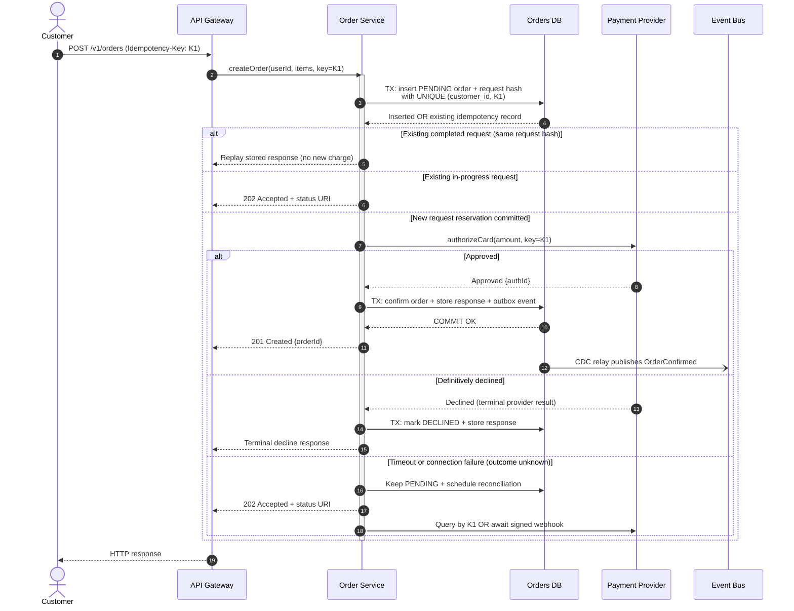
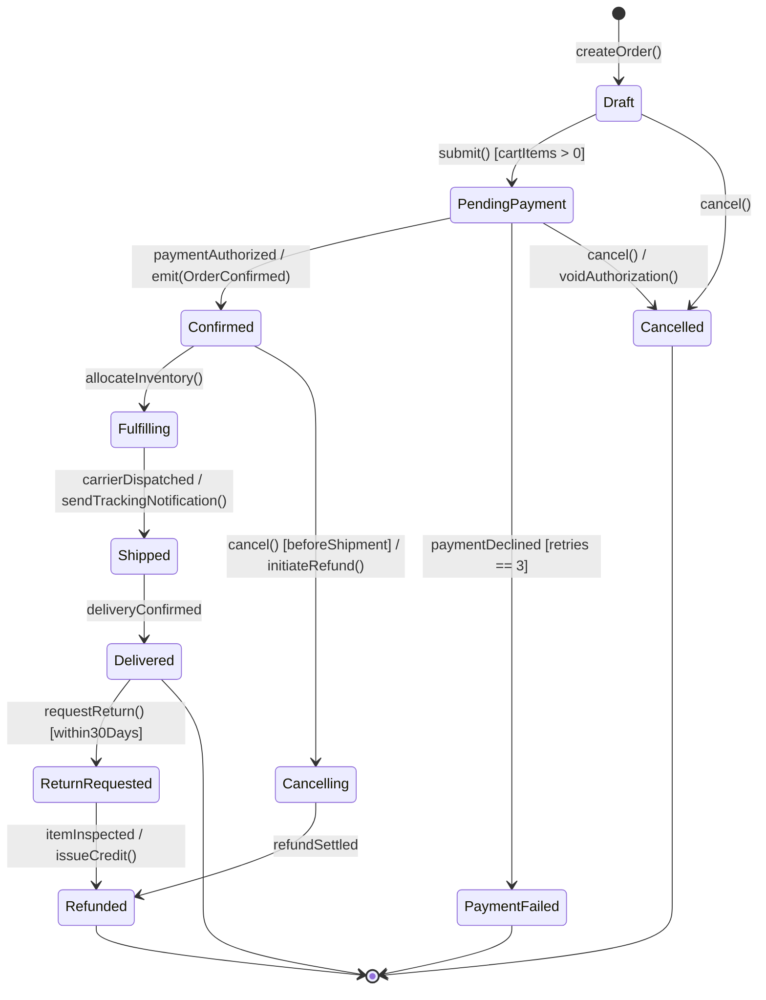
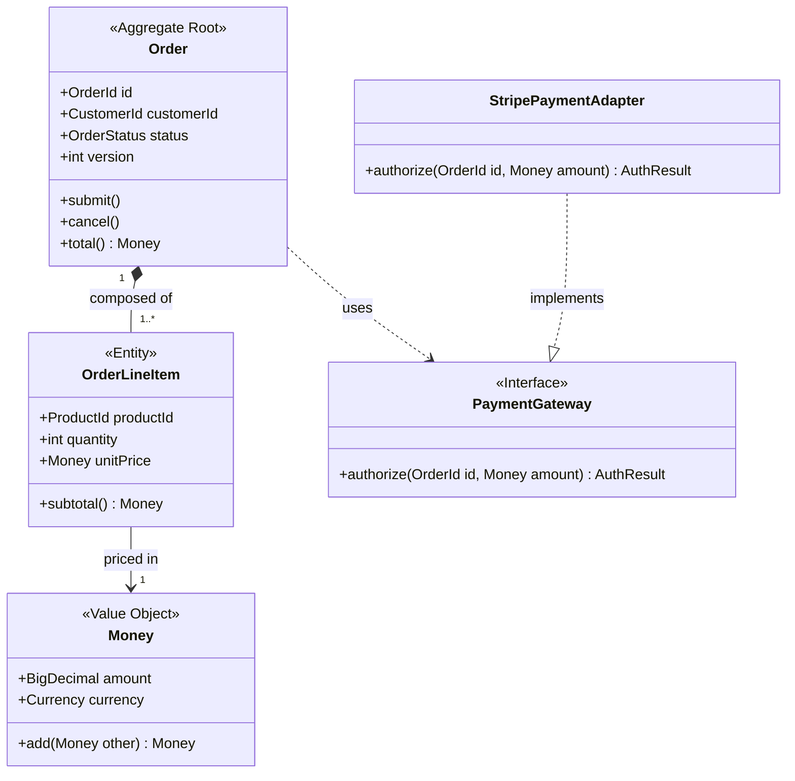
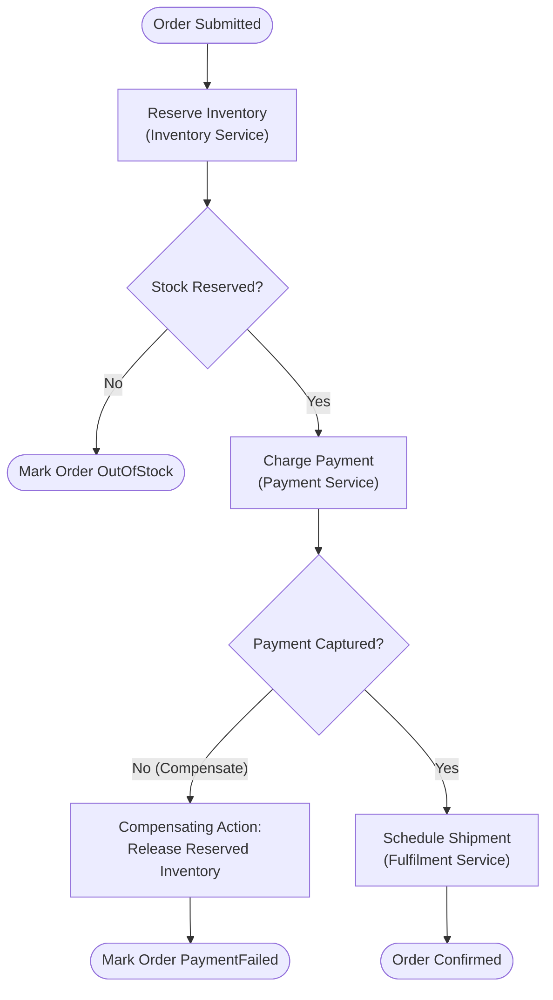

---
tags:
  - UML
  - Software Architecture
  - Diagrams
---

# 02.02 · UML for Architects

> **Level:** Practitioner · **Reading Time:** ~9 mins · **Track:** Systems & Architecture
> **Prerequisites:** [02 · Architecture Diagramming](02-architecture-diagramming.md)

While the **C4 Model** excels at static structural zoom (`Context → Container → Component`), the current [OMG UML 2.5.1 specification](https://www.omg.org/spec/UML/2.5.1) provides precise semantics for **runtime choreography, state invariants, and domain modelling**. Of UML's 14 commonly categorized diagram types, Principal Engineers and Architects often rely on **four high-leverage diagrams**.

!!! abstract "TL;DR — The 30-Second Mental Model"
    - **High-Leverage Subset:** Start with four diagrams that answer common architecture questions; add other UML views only when they improve the decision or contract:
        1. **Sequence Diagram:** Distributed call flows, timeouts, idempotency, and race conditions.
        2. **State Machine Diagram:** Entity lifecycles, valid state transitions, and saga compensation.
        3. **Class Diagram:** Domain-Driven Design (DDD) entities, value objects, and multiplicities.
        4. **Activity / Flowchart Diagram:** Branching business workflows and parallel pipelines.

---

## The 14 UML Diagrams Categorised

=== "Behavioural Diagrams (The *How* — Runtime)"
    | Diagram | What It Models | Principal Engineer Usage Frequency |
    |:---|:---|:---|
    | **Sequence** | Time-ordered message exchange across participants | **Daily / Weekly** — API flows, distributed sagas, auth handshakes |
    | **State Machine** | Valid states, transition guards, and lifecycle events | **Weekly** — Order/payment lifecycles, idempotency state |
    | **Activity** | Step-by-step workflow, branching, and parallel forks | **Frequent** — Complex business pipelines, CI/CD flows |
    | **Use Case** | Actor-to-system goal interactions | Occasional — Early scope boundary definition |
    | **Communication / Timing / Interaction Overview** | Specialized interaction variants | Rare — Sequence diagrams are almost always clearer |

=== "Structural Diagrams (The *What* — Static)"
    | Diagram | What It Models | Principal Engineer Usage Frequency |
    |:---|:---|:---|
    | **Class** | Domain entities, attributes, interfaces, multiplicities | **Frequent** — DDD domain models, data schema design |
    | **Component / Package** | Module boundaries, interfaces, dependency rules | **Moderate** — Often superseded by C4 L2/L3 + ArchUnit |
    | **Deployment** | Infrastructure nodes, VPCs, and runtime artifacts | **Moderate** — Cloud topology & multi-region architecture |
    | **Object / Composite / Profile** | Instance snapshots or metamodel extensions | Rare |

---

## 1. Sequence Diagram — Distributed Interaction & Failure Analysis

**Use when:** Designing multi-service API calls, distributed transactions (Sagas / Transactional Outbox), authentication flows (OAuth2/OIDC), or debugging race conditions.

### Essential Sequence Notation

| Element | Mermaid Syntax | Meaning |
|:---|:---|:---|
| **Synchronous Call** | `A->>B: request()` | Caller blocks waiting for response |
| **Return / Response** | `B-->>A: 200 OK` | Response returning control to caller |
| **Asynchronous Message** | `A-)B: publish(Event)` | Fire-and-forget / queue publish |
| **Activation Bar** | `activate B` / `deactivate B` | Shows execution duration & lock scope |
| **Combined Fragments** | `alt / else`, `opt`, `loop`, `par`, `critical` | Models failure branches, retries, and parallel fan-out |

### Example: Idempotent Checkout with Transactional Outbox & Failure Branch

!!! warning "Timeout Is an Unknown Outcome, Not a Decline"
    Reserve the idempotency key with a **unique constraint before any external side effect**, bind it to a request hash, and use the provider's idempotency key as well. A timeout can occur after the provider authorizes the charge, so keep the operation pending and reconcile by status query or verified webhook. Never retry blindly or record a terminal failure merely because the client stopped waiting.

---

## 2. State Machine Diagram — Enforcing Lifecycle Invariants

**Use when:** Designing any entity that mutates over time (`Order`, `Payment`, `Subscription`, `Deployment`, `Saga`). Explicit state machines eliminate "impossible states" (e.g., an order being both `Refunded` and `Shipped` due to concurrent webhooks).

### Transition Label Grammar
Every state transition arrow follows the standard UML format:
`triggerEvent(params) [guardCondition] / sideEffectAction()`

!!! tip "Principal Pattern: Persist State Transitions as an Append-Only Audit Log"
    In distributed systems, don't just overwrite `status = 'SHIPPED'` in place. Use an optimistic concurrency check (`UPDATE orders SET status = 'SHIPPED', version = version + 1 WHERE id = ? AND status = 'FULFILLING' AND version = ?`) and append a row to `order_state_transitions` for complete auditability.

---

## 3. Class Diagram — Domain Modelling & Multiplicities

**Use when:** Defining **Domain-Driven Design (DDD) Bounded Contexts**, aggregate roots, and entity relationships.

### Relationship Vocabulary (From Weakest to Strongest Coupling)

| Relationship | Symbol | Lifespan Coupling | Meaning & Example |
|:---|:---|:---|:---|
| **Dependency** | `A ..> B` | Transient (method parameter) | `OrderPricingService ..> TaxCalculator` (uses temporarily) |
| **Association** | `A --> B` | Independent lifespans | `Order --> Customer` (references by ID) |
| **Aggregation** | `A o-- B` | Whole-part; child survives parent deletion | `Department o-- Employee` |
| **Composition** | `A *-- B` | Strict whole-part; child deleted with parent | `Order *-- OrderLineItem` (Aggregate Root boundary) |
| **Realisation** | `A ..|> B` | Contract implementation | `StripeGateway ..|> PaymentGateway` |
| **Inheritance** | `A --|> B` | Subtype ("is-a") | `CardPayment --|> PaymentMethod` |

---

## 4. Activity Diagram — Saga & Workflow Orchestration

**Use when:** Explaining business process orchestration, compensating transactions (Saga pattern), or branching decision pipelines.

---

## Active Recall & Self-Check

??? question "Self-Check 1: What is the architectural difference between Aggregation (`o--`) and Composition (`*--`) in a domain model, and how does it map to DDD Aggregate Roots?"
    **Answer Rubric:**
    - **Composition (`*--`)** defines a **whole–part lifecycle constraint**: the composite controls the part's lifetime and a part has at most one composite at a time. It can help illustrate an `Order` / `OrderLineItem` model, but **UML composition is not synonymous with a DDD Aggregate**. A DDD Aggregate is primarily a consistency and transaction boundary; external changes go through its root, and its lifecycle rules must be stated explicitly.
    - **Aggregation (`o--`)** or ID-based **Association (`-->`)** connects entities with **independent lifecycles** (e.g., `Product` and `Order` — deleting an order never deletes the product from the catalogue).

??? question "Self-Check 2: When should a Sequence Diagram include `alt / else` blocks?"
    **Answer Rubric:**
    Include them when they clarify a decision-critical failure path: timeout with unknown outcome, duplicate retry, partial failure requiring compensation, or authorization failure. Do not add every theoretical branch to a simple diagram. The goal is to expose production semantics that change the design, not to maximize notation.
