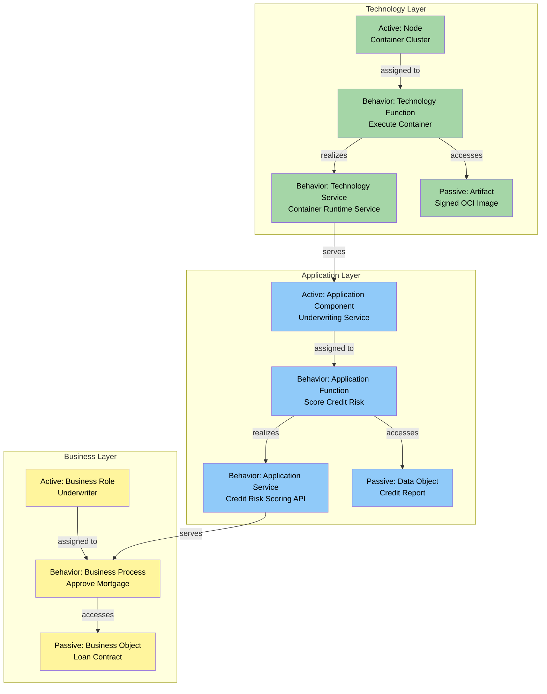
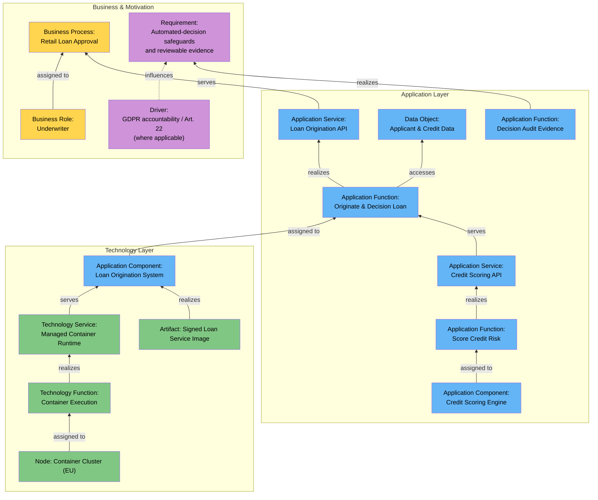

---
tags:
  - Enterprise Architecture
  - ArchiMate
---

# 02.03 · ArchiMate Deep Dive

> **Level:** Practitioner — Enterprise · **Reading Time:** ~9 mins · **Track:** Systems & Architecture
> **Prerequisites:** [02 · Architecture Diagramming](02-architecture-diagramming.md)

**ArchiMate 3.2**, standardized by The Open Group, is an enterprise architecture modelling language. While C4 and UML focus primarily on software systems, ArchiMate connects business strategy, capabilities, processes, applications, technology, physical infrastructure, motivation, and migration.

!!! abstract "TL;DR — The 30-Second Mental Model"
    - **Three Core Layers:** **Business** (organization and processes), **Application** (software behavior and data), and **Technology** (infrastructure behavior and artifacts).
    - **Three Core Aspects:** **Active Structure** (actors/components/nodes), **Behavior** (processes/functions/services), and **Passive Structure** (objects/data/artifacts).
    - **Beyond the 3×3 Core:** The full framework also covers **Strategy**, **Physical**, **Implementation & Migration**, and cross-cutting **Motivation** elements.
    - **Principal Use Case:** Capability/portfolio analysis, legacy decommissioning, M&A consolidation, and compliance traceability across business and technology.

---

## Why ArchiMate Matters for Principal Engineers

C4 and UML are not designed to answer every cross-layer enterprise question on one canvas:

- *"If we decommission legacy billing, which capabilities, processes, and customer journeys are affected?"*
- *"After an acquisition, where do application portfolios duplicate the same business capability?"*
- *"Which controls, applications, data flows, and technology services support a specific regulatory requirement?"*

ArchiMate supplies the model and relationships; it does not itself prove compliance. Keep the traceability model linked to implementation evidence, control ownership, and current legal/compliance interpretation.

---

## The Core ArchiMate 3×3 Matrix (Layers × Aspects)

The **core framework** organizes the Business, Application, and Technology layers using active structure, behavior, and passive structure. The following Mermaid diagram is a learning aid, not a replacement for formally validated ArchiMate notation:

!!! note "Do Not Present 3×3 as the Entire Language"
    **Strategy** adds resources, capabilities, and courses of action; **Physical** adds equipment, facilities, distribution networks, and materials; **Implementation & Migration** models work packages, deliverables, plateaus, and gaps. **Motivation** models stakeholders, drivers, goals, outcomes, principles, requirements, and constraints across the architecture.

---

## Five High-Leverage ArchiMate Relationships

ArchiMate defines structural, dependency, dynamic, and other relationships. These five are frequently useful in Principal-level enterprise views:

|| Relationship | Direction & Meaning | Concrete Example |
|:---|:---|:---|
|| **Realization** | A more concrete element makes a more abstract element real | `Credit Scoring Application Function` **realizes** `Credit Risk Scoring Application Service` |
|| **Serving** | One element provides functionality to another | `Credit Risk Scoring Application Service` **serves** `Loan Approval Business Process` |
|| **Assignment** | Allocates responsibility/performance of behavior, or an actor to a role | `Underwriter Business Role` **is assigned to** `Loan Approval Business Process`; `Application Component` **is assigned to** `Application Function` |
|| **Triggering** | Temporal or causal relationship between behavior elements | `Loan Submitted Event` **triggers** `Credit Assessment Process` |
|| **Access** | Behavior reads, writes, creates, or deletes a passive-structure element | `Loan Origination Application Function` **writes** `Applicant Data Object` |

---

## End-to-End Example: Loan Origination Enterprise View

!!! warning "Relationship and Compliance Review"
    A container cluster is a **Node**, not a Technology Service; a runtime function realizes the service that serves the application. Likewise, Article 22 is not a generic “all automated decisions require the same audit” rule. Model the specific obligation, applicable context, safeguard, owner, and evidence with compliance specialists.

---

## High-Yield ArchiMate Viewpoints

Never dump the entire enterprise model onto one diagram. Use targeted **viewpoints**:

|| Viewpoint | Target Audience | Question It Answers |
|:---|:---|:---|
|| **Capability Map (Strategy)** | CTO, CPO, business leadership | Which capabilities differentiate the business, and which applications/resources support them? |
|| **Application Usage** | Principal Engineers, Solution Architects | Which application services support which business processes, and where are critical dependencies? |
|| **Technology Usage** | Platform / Cloud Architects, FinOps | Which technology services support applications, and where are lifecycle, resilience, or cost risks? |
|| **Implementation & Migration** | Engineering Leadership, TPMs | Which gaps, work packages, deliverables, and plateaus move baseline to target architecture? |

### Primary Specification References

- [The Open Group — ArchiMate 3.2 Specification](https://pubs.opengroup.org/architecture/archimate3-doc/)
- [ArchiMate — relationships between core layers](https://pubs.opengroup.org/architecture/archimate3-doc/ch-Relationships-Between-Core-Layers.html)

---

## Active Recall & Self-Check

??? question "Self-Check 1: How do you decide whether to use ArchiMate vs. C4 Level 1/2 in an executive presentation?"
    **Answer Rubric:**
    - Use **C4 Level 1/2** when the discussion concerns a software system's users, boundary, application/data-store containers, and external integrations.
    - Use **ArchiMate** when the discussion spans business capabilities, strategy, process transformation, application portfolios, technology services, motivation, and migration.
    - Choose the minimum model that answers the audience's question; do not use ArchiMate merely to make a system diagram look more formal.

??? question "Self-Check 2: What is the difference between Serving and Realization in ArchiMate?"
    **Answer Rubric:**
    - **Realization** means a more concrete element makes an abstraction real: an **Application Function** realizes an **Application Service**, or an **Artifact** realizes an **Application Component**.
    - **Serving** means functionality is provided to another element: an **Application Service** serves a **Business Process**, and a **Technology Service** serves an application element. Do not draw “Kubernetes cluster serves application” when the intended model is “container runtime function realizes a technology service, which serves the application.”
