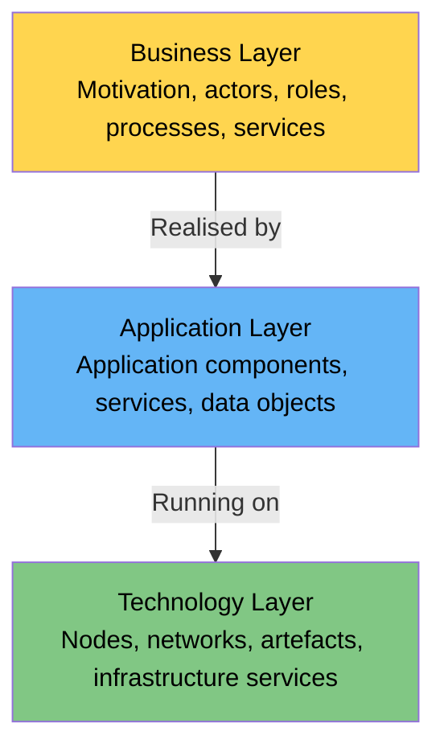
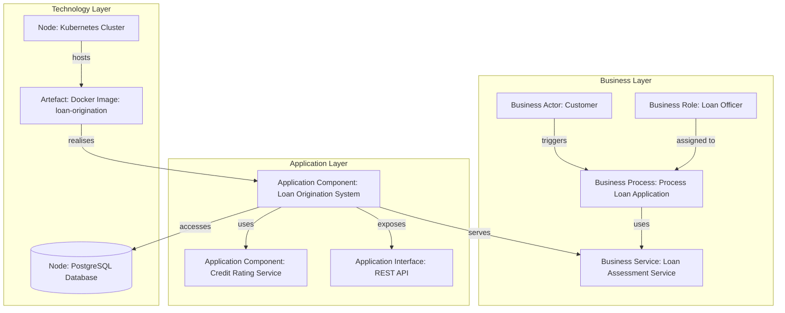
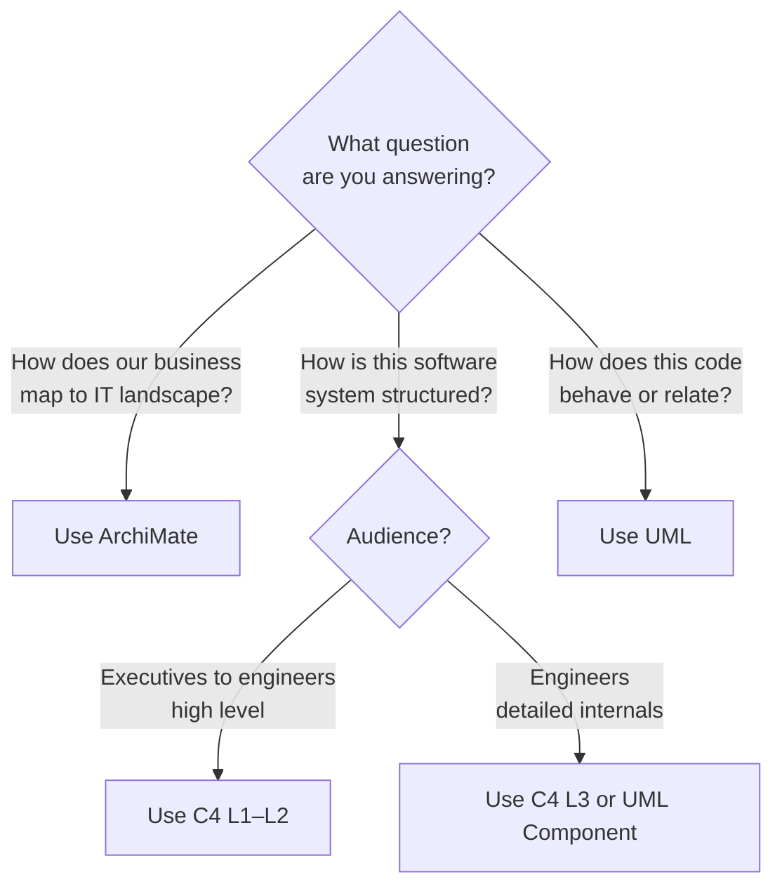

# 02.03 · ArchiMate Deep Dive

> **Level:** Practitioner — Enterprise
> **Pre-reading:** [02 · Architecture Diagramming](02-architecture-diagramming.md)

**ArchiMate** is the enterprise architecture modelling language standardised by The Open Group. It models the entire enterprise landscape — business processes, applications, and technology infrastructure — in a single unified framework.

---

## Why ArchiMate Exists

C4 and UML are software-architecture tools. They are excellent for documenting *how a system is built*. They are poor at answering enterprise-level questions:

- How do our business processes map to the IT systems that support them?
- Which business capabilities depend on which applications?
- If we decommission system X, which business processes are affected?
- How do we trace a regulatory requirement through to the infrastructure that satisfies it?

ArchiMate answers these questions by providing a **cross-layer vocabulary** that spans business, application, and technology.

---

## The Three Layers

| Layer | What it models | Examples |
|:---|:---|:---|
| **Business** | What the organisation does and why | Business process, role, actor, business service, business object |
| **Application** | Software supporting business activities | Application component, application service, data object, interface |
| **Technology** | Infrastructure running the applications | Node, device, network, communication path, technology service, artefact |

---

## Core ArchiMate Element Types

### Business Layer Elements

| Element | Meaning |
|:---|:---|
| **Business Actor** | An entity that performs behaviour (person, organisation, system) |
| **Business Role** | A named set of responsibilities assigned to an actor |
| **Business Process** | A sequence of activities producing a business outcome |
| **Business Function** | A set of behaviours grouped by skill or resource |
| **Business Service** | An externally visible behaviour provided to the environment |
| **Business Object** | A concept important to the business domain |
| **Business Event** | Something that triggers business behaviour |

### Application Layer Elements

| Element | Meaning |
|:---|:---|
| **Application Component** | An autonomous, deployable unit of software |
| **Application Service** | An externally visible behaviour of an application component |
| **Application Interface** | A point of access for application services |
| **Data Object** | Data managed by an application |

### Technology Layer Elements

| Element | Meaning |
|:---|:---|
| **Node** | A computational resource (server, VM, container) |
| **Device** | Physical hardware |
| **Network** | A communication medium |
| **Technology Service** | A service provided by technology (e.g., DNS, load balancing) |
| **Artefact** | A deployable piece of software (Docker image, JAR, WAR) |

---

## ArchiMate Relationships

| Relationship | Arrow | Meaning |
|:---|:---|:---|
| **Association** | Solid line | A generic relationship |
| **Serving** | Solid line with open arrowhead | One element provides services to another |
| **Realisation** | Dashed line with hollow arrowhead | A lower-level element realises a higher-level concept |
| **Assignment** | Solid line with filled circle | Links an active element to behaviour it performs |
| **Composition** | Solid line with filled diamond | Strong whole-part |
| **Aggregation** | Solid line with hollow diamond | Weak whole-part |
| **Triggering** | Solid line with filled arrowhead | Causal/temporal ordering |
| **Flow** | Dashed line with open arrowhead | Transfer of information or material |
| **Influence** | Dashed line with open arrowhead | Affects another element without full causation |
| **Access** | Dashed line | An element reads/writes/uses a data object |

---

## Example: Loan Application Enterprise View

---

## ArchiMate Viewpoints

ArchiMate defines **viewpoints** — purpose-driven selections of elements and relationships for a specific audience.

| Viewpoint | Audience | Focus |
|:---|:---|:---|
| **Organisation** | Business management | Actors, roles, and their relationships |
| **Business Process** | Business analysts | Processes, events, services |
| **Application Usage** | Solution architects | How applications support business processes |
| **Technology** | Infrastructure architects | Nodes, networks, and deployment |
| **Implementation & Migration** | Programme managers | Plateaus, work packages, migration path |
| **Motivation** | Executives, enterprise architects | Stakeholders, drivers, goals, requirements |
| **Strategy** | C-suite | Capabilities, resources, value streams |

---

## ArchiMate vs C4 vs UML — Decision Guide

| Need | Tool |
|:---|:---|
| Trace a GDPR requirement to the database storing PII | ArchiMate (Motivation → Application → Technology) |
| Show the tech stack powering a new microservice to a new engineer | C4 Container diagram |
| Document the class hierarchy of the payment domain | UML Class diagram |
| Show a CTO how a business process depends on IT systems | ArchiMate Application Usage viewpoint |
| Explain the API call flow for a checkout feature | UML Sequence diagram |
| Show the CEO which business capabilities we own vs. outsource | ArchiMate Strategy viewpoint |

---

## ArchiMate in Practice

!!! warning "ArchiMate has a steep learning curve"
    ArchiMate's full notation has 50+ element types and 10+ relationship types. In practice, most enterprise architecture teams use a **subset** of ArchiMate consistently rather than the full language. Knowing the three layers, core element types, and five key relationships is sufficient for most principal-level conversations.

### Tools

| Tool | Notes |
|:---|:---|
| **Archi** | Free, open-source ArchiMate modelling tool |
| **Sparx Enterprise Architect** | Commercial; full ArchiMate + UML support |
| **BiZZdesign HoriZZon** | Enterprise-grade; used by large banks and governments |
| **draw.io** | Manual; ArchiMate shape library available |

