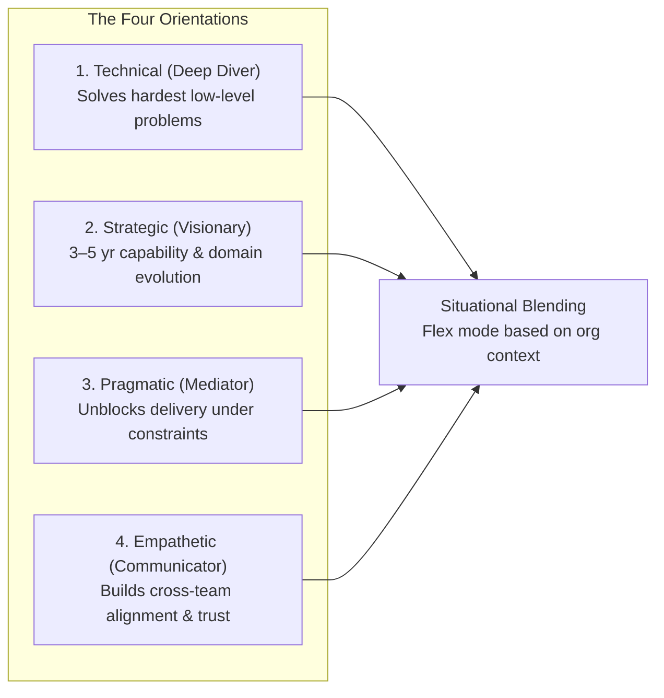
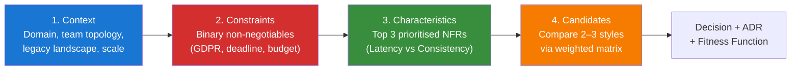

---
tags:
  - Systems Thinking
  - Architecture Decisions
---

# 03 · Architect Thinking

> **Level:** Conceptual — Strategic · **Reading Time:** ~8 mins · **Track:** Systems & Architecture
> **Prerequisites:** [01 · Roles & Responsibilities](01-roles-responsibilities.md) · [02 · Architecture Diagramming](02-architecture-diagramming.md)

Architecture is not a job title or a set of Visio diagrams — it is a **disciplined way of reasoning about complex systems under uncertainty**. As Simon Brown puts it: *"Architecture is about the significant decisions, where significance is measured by the cost of change."*

!!! abstract "TL;DR — The 30-Second Mental Model"
    - **First Law of Software Architecture (Richards & Ford):** *"Everything in software architecture is a trade-off."* If you think you found an architecture with no downsides, you simply haven't discovered the trade-off yet.
    - **Second Law of Software Architecture:** *"Why is more important than how."* Always preserve decision rationale in ADRs.
    - **The 4Cs Decision Sequence:** Never jump to **Candidates** (*"Let's use Kafka"*). Walk strictly through **Context → Constraints → Characteristics (Top-3 NFRs) → Candidates**.
    - **Protect Expensive Decisions:** Lock down high-cost-of-change seams (data models, public contracts, service boundaries) while deferring reversible implementation details to teams.

---

## The Fundamental Mindset Shift: Senior → Principal

| Dimension | Senior Engineer Mindset | Principal / Architect Mindset |
|:---|:---|:---|
| **Primary Question** | *"How do I implement this component cleanly?"* | *"Should we build this at all, and how do we bound its cost of change over 3–5 years?"* |
| **Optimization Target** | Local component correctness & performance | System-wide quality attributes & organizational velocity |
| **Technology Stance** | Champion of a favourite language/framework | Technology-agnostic — evaluates fit against team cognitive load & constraints |
| **Relationship to Uncertainty** | Waits for clear product specs | Surfaces hidden constraints, bounds ambiguity, and creates option value |
| **Primary Output** | Production code & PRs | Trade-off matrices, ADRs, fitness functions, and reference prototypes |

---

## Deep-Dive Modules in This Section

-   :material-account-cog-outline:{ .lg .middle } **03.01 · Architect Personalities**

    ---

    Understand the 4 architect orientations (**Technical**, **Strategic**, **Pragmatic**, **Empathetic**), diagnose your default blind spots, and flex situationally.

    [:octicons-arrow-right-24: Architect Personalities Deep Dive](03.01-architect-personalities.md)

-   :material-filter-check-outline:{ .lg .middle } **03.02 · The 4Cs of Architecture**

    ---

    Master the structured decision funnel (**Context → Constraints → Characteristics → Candidates**) and weighted trade-off matrices for system design interviews.

    [:octicons-arrow-right-24: The 4Cs Deep Dive](03.02-four-cs-architecture.md)

---

## The Two Pillars of Architectural Thinking

### 1. Situational Working-Style Blending (This Guide's Reflection Lens)

Architects naturally gravitate toward one of four orientations across the **Technical Depth ↔ Breadth** and **Individual ↔ Organisational** axes:

- **Startup / Crunch Mode:** Blend **Pragmatic + Empathetic** (ship fast, record deliberate debt, keep teams aligned).
- **Platform / Legacy Modernisation:** Blend **Strategic + Technical** (prove the hardest technical seams via prototypes, map a multi-year strangler migration).
- → **[Full Deep Dive: 03.01 · Architect Personalities](03.01-architect-personalities.md)**

---

### 2. The 4Cs Decision Funnel

Distinct from the C4 diagramming model, **this guide's 4Cs decision framework** prevents premature solutioning. It is a teaching heuristic, not a formal industry standard:

- → **[Full Deep Dive: 03.02 · The 4Cs of Architecture](03.02-four-cs-architecture.md)**

---

## The Architect's Risk Equation: Structure vs. Flexibility

Every architectural decision sits on a tension between **rigidity** (over-specifying upfront) and **chaos** (under-specifying boundaries):

`Architectural risk ≈ probability of change × cost of change`

Use this as a prioritization **heuristic**, not a precise measurement formula. Include uncertainty, detectability, and blast radius when comparing options.

A Principal Engineer minimizes architectural risk by **separating irreversible (Type 1) decisions from reversible (Type 2) decisions**:

| High Cost of Change (Govern Strictly via ADR/RFC) | Low Cost of Change (Delegate to Team Autonomy) |
|:---|:---|
| Public/External API & Webhook contracts | Internal helper libraries within a single service |
| Bounded Context & microservice ownership seams | Internal folder/package layout inside a microservice |
| Primary database engine & partitioning/sharding key | Specific ORM or internal query builder |
| Cross-service event schemas & identity/auth tokens | UI component styling or local logging utilities |
| Data residency & encryption-at-rest architecture | CI test runner parallelisation settings |

!!! tip "The Last Responsible Moment (Lean Architecture)"
    When a decision has both a **high cost of change** and **high uncertainty**, buy information with a spike, benchmark, or bounded rollout. Defer only if waiting preserves a real option and you can name the decision deadline and required evidence. Adding an abstraction seam is itself a cost and can make reversal harder; sometimes an early reversible commitment is cheaper.

---

## Enforcing Decisions: ADRs + Fitness Functions

Architectural thinking only survives contact with reality when paired with two mechanisms covered in [01.01 · Software Architect](01.01-software-architect.md):

1. **[Architecture Decision Records (ADRs)](01.01-software-architect.md#architecture-decision-records-adrs-canonical-reference):** Captures the context, rejected candidates, and accepted trade-offs so future teams don't relitigate settled decisions blindly.
2. **[Architecture Fitness Functions](01.01-software-architect.md#architecture-fitness-functions):** Automated CI/CD checks (`ArchUnit`, `Buf`, `k6`, `OPA`) that turn architectural invariants into executable tests.

---

## Active Recall & Self-Check

??? question "Self-Check 1: In a system design interview, the interviewer asks: 'Would you use microservices or a monolith for this system?' How does a Principal Engineer answer?"
    **Answer Rubric:**
    - Never answer *"Microservices"* or *"Monolith"* unconditionally. Cite the **First Law of Software Architecture** (*everything is a trade-off*) and run through the **4Cs**:
    - Ask about **Context & Conway's Law**: Who owns and operates each boundary? A small team often benefits from a modular monolith, while independently scaling or deploying domains may justify services—but team count alone is not a valid splitting rule.
    - Ask about **Characteristics**: Do specific modules have wildly asymmetrical scaling, security/compliance (e.g., PCI-DSS vault), or deployment cadence requirements?

??? question "Self-Check 2: What is the difference between a 'Constraint' and a 'Characteristic (Quality Attribute)' in the 4Cs framework?"
    **Answer Rubric:**
    - **Constraints** are **binary (pass/fail) hard boundaries** imposed by business, regulation, or org reality (e.g., *"Must launch before Black Friday"*, *"Must not store raw PAN data outside Stripe"*, *"Must run on AWS"*). They eliminate options immediately.
    - **Characteristics (Quality Attributes)** are **continuous spectrums** (*Availability, Latency, Consistency, Cost*) that must be **prioritized and traded off** against one another among the surviving candidates.
