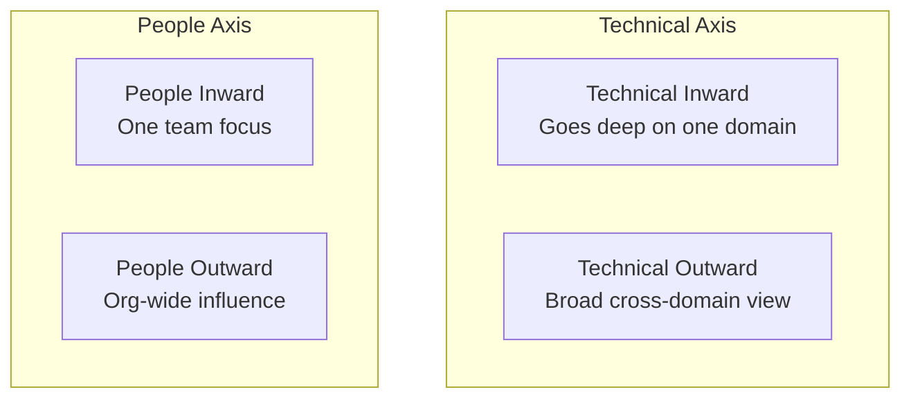
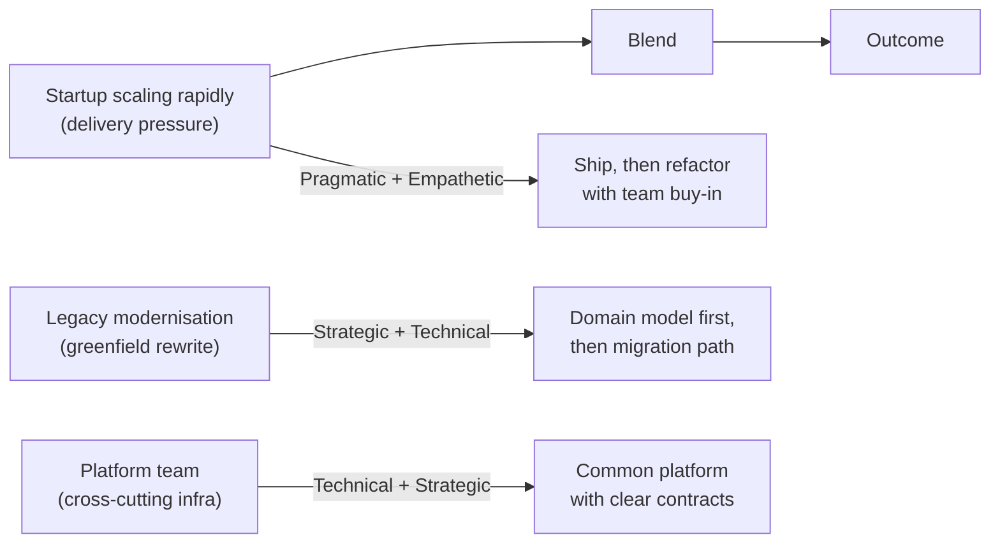

# 03 · Architect Thinking

> **Level:** Conceptual — Strategic
> **Pre-reading:** [01 · Roles & Responsibilities](01-roles-responsibilities.md) · [02 · Architecture Diagramming](02-architecture-diagramming.md)

Architecture is not a job title or a set of deliverables. It is a **way of thinking** — a disciplined approach to reasoning about complex systems under uncertainty. This section covers the mental models, personality archetypes, and conceptual frameworks that define how great architects think.

---

## The Fundamental Mindset Shift

The shift from Senior Engineer to Architect (or Principal Engineer) is a shift in **primary concern**:

| Senior Engineer | Architect / Principal |
|:---|:---|
| "How do I implement this correctly?" | "Is this the right thing to build, and are we building it in a way that will last?" |
| Optimises a specific component | Optimises the system-wide quality attributes |
| Champion of a specific technology | Technology-agnostic (selects based on fit) |
| Focuses on correctness | Focuses on *fitness for purpose* |
| Solves problems with code | Solves problems with decisions, standards, and communication |

!!! note "Simon Brown's key insight"
    "Architecture is about the significant decisions. Significance is defined by the cost of change."

---

## Architect Personalities

The seminal work on architect personalities comes from **Mark Richards and Neal Ford** in *Fundamentals of Software Architecture* (O'Reilly, 2020). They identify distinct orientations that architects naturally fall into.

### The Four Architect Personality Types



#### 1. The Technical Architect (Deep Diver)
- **Orientation:** Technical depth first, breadth secondary
- **Strength:** Can solve the hardest technical problems; earns deep credibility
- **Weakness:** May lose sight of the bigger picture; can over-engineer
- **Risk:** Their solutions are technically perfect but organisationally unimplementable
- **Example:** The person everyone calls when the distributed transaction deadlocks

#### 2. The Strategic Architect (Visionary)
- **Orientation:** Long-horizon thinking; system evolution over 3–5 years
- **Strength:** Connects today's technical decisions to tomorrow's business outcomes
- **Weakness:** Can be too abstract; may lack the credibility of a hands-on practitioner
- **Risk:** Creates beautiful architectures on paper that teams don't adopt
- **Example:** Defines the domain model and service boundaries for the next generation of the platform

#### 3. The Pragmatic Architect (Mediator)
- **Orientation:** Delivery focus; good-enough decisions made fast
- **Strength:** Gets things built; navigates trade-offs without paralysis
- **Weakness:** Accumulates technical debt through expedient decisions
- **Risk:** "Let's just ship it" — forgetting that expedient decisions compound
- **Example:** Unblocks a team by making a call under uncertainty

#### 4. The Empathetic Architect (Communicator)
- **Orientation:** Team and stakeholder relationships first
- **Strength:** Earns trust across engineering and business; aligns people
- **Weakness:** Can avoid necessary conflict; may defer hard technical truths
- **Risk:** Consensus-driven architecture that satisfies everyone but optimises for nothing
- **Example:** Facilitates the architecture review where every team agrees on the API contract

### The Ideal Combination

No single personality type is correct. **Great architects situationally blend all four**:



!!! tip "Interview application"
    When asked "How do you approach architecture?", demonstrate situational awareness — show that you adjust your style to the context rather than defaulting to one mode.

---

## The 4Cs of Architecture Decision Making

The **4Cs** framework (also called the *four concerns of the architect*) provides a structured way to approach any architecture decision. This is distinct from the C4 Model for diagramming.

### Context
*What is the environment in which this system must succeed?*

- Business domain and competitive dynamics
- Regulatory and compliance constraints
- Team size, skill profile, and organisational structure (Conway's Law)
- Existing technology landscape (what must be integrated or replaced)
- Time and budget constraints

!!! warning "Context is the hardest C"
    Most junior architects skip this step and jump to solutions. A principal-level architect spends disproportionate time in context before proposing anything.

### Constraints
*What is non-negotiable?*

Constraints are hard limits — they eliminate options. They come from:
- **Technical constraints**: required integration with legacy system, language mandated by org
- **Regulatory constraints**: GDPR, PCI-DSS, HIPAA data residency rules
- **Organisational constraints**: team structures (Conway's Law), hiring supply
- **Business constraints**: fixed deadlines (e.g., regulatory compliance date)

| Constraint type | Example |
|:---|:---|
| **Technical** | Must use the company's internal authentication service |
| **Regulatory** | EU customer data must not leave EU data centres |
| **Organisational** | Team of 5 engineers — no new hires for 6 months |
| **Business** | Must be live for the holiday season (fixed date) |

### Characteristics (Quality Attributes)
*What properties must the system exhibit?*

Also called **non-functional requirements (NFRs)** or **quality attributes**. These translate business goals into measurable system properties.

| Quality Attribute | Measurable form | Common trade-offs |
|:---|:---|:---|
| **Availability** | 99.99% uptime = <53 min downtime/year | Cost, complexity |
| **Scalability** | 10x traffic spike with < 1% error rate | Consistency, cost |
| **Performance** | p99 latency < 200ms | Cost, consistency |
| **Security** | Zero PII in logs; all APIs authenticated | Development speed |
| **Maintainability** | New feature deployable in < 1 day | Initial complexity |
| **Testability** | 80% unit test coverage; < 10 min CI time | Design constraints |
| **Observability** | Full distributed trace for any user journey | Storage cost |
| **Data Consistency** | Eventual consistency acceptable vs. strong | Performance, complexity |

!!! note "The architect's primary job"
    The architect's primary job is to **prioritise and make trade-offs between quality attributes**. You cannot maximise all of them simultaneously. The business context determines the priority.

### Candidates (Architecture Styles / Options)
*What are the realistic architectural approaches, and what are their trade-offs?*

Every significant architectural decision should have at least 2–3 genuine alternatives considered. An architect who always defaults to the same pattern (e.g., "always microservices") is not exercising architectural judgement — they are applying a habit.

| Architecture Style | Strengths | Weaknesses | Best suited for |
|:---|:---|:---|:---|
| **Monolith** | Simplicity, transactions, low latency | Scaling and deployment coupling | Early-stage, small teams, high cohesion |
| **Modular Monolith** | Domain isolation without distribution | Harder to scale individual components | Medium scale, disciplined teams |
| **Microservices** | Independent scaling, deployment, team autonomy | Operational complexity, distributed transactions | Large orgs, team autonomy needed |
| **Event-Driven** | Decoupling, resilience, audit log | Eventual consistency, debugging complexity | High-throughput, loose coupling needed |
| **Serverless** | Zero ops, auto-scale, pay-per-use | Cold starts, vendor lock-in, limited compute | Sporadic or event-driven workloads |
| **CQRS + Event Sourcing** | Full audit trail, temporal queries | Complexity, eventual consistency | Compliance, complex business domains |

---

## Architectural Fitness Functions

Coined by Neal Ford, Rebecca Parsons, and Patrick Kua in *Building Evolutionary Architectures*, a **fitness function** is an automated test that verifies an architectural characteristic is maintained as the system evolves.

### Why Fitness Functions Matter
Architecture erodes over time — not through malicious intent but through the accumulated weight of expedient decisions. Fitness functions make architectural constraints *machine-checkable*, just as unit tests make business logic *machine-checkable*.

| Fitness Function Category | Example |
|:---|:---|
| **Structural** | No class in layer A may import from layer C (enforced by ArchUnit) |
| **Latency** | p99 response time in CI load test must be < 300ms |
| **Security** | No dependency with a known CVE of HIGH or CRITICAL may be deployed |
| **Modularity** | Service A must not call Service B directly — only via the event bus |
| **Data** | No PII may appear in application log output (regex-checked in CI) |

---

## Architecture Decision Records (ADRs)

An ADR is the **canonical format for documenting significant architecture decisions**. It captures not just the *what* but the *why* — and crucially, the alternatives that were rejected.

### ADR Template

```markdown
# ADR-{number}: {Short Decision Title}

## Status
Proposed | Accepted | Deprecated | Superseded by ADR-{N}

## Context
What situation forced this decision? What are the forces at play?

## Decision
What was decided?

## Consequences
What becomes easier? What becomes harder? What do we give up?

## Alternatives Considered
| Option | Why rejected |
|:-------|:-------------|
| Option A | ... |
| Option B | ... |
```

!!! tip "The most important field in an ADR"
    The **Alternatives Considered** section is what separates a mature ADR from a rubber-stamp. Interviewing engineers can always tell if you genuinely weighed options or simply justified a pre-made decision.

---

## The Architect's Dilemma: Structure vs. Flexibility

Every architecture decision exists on a spectrum between **rigidity** (strong structure, low flexibility) and **fluidity** (high flexibility, hard to reason about):

$$\text{Architectural Risk} = \text{Probability of Change} \times \text{Cost of Change}$$

A good architect minimises architectural risk — not by eliminating all structure (chaos) or by over-specifying everything (ossification), but by **protecting the expensive decisions** (data model, service boundaries, API contracts) while leaving **cheap decisions** to the implementing teams.

| Expensive to change | Cheap to change |
|:---|:---|
| Database schema / data model | Internal implementation of a service |
| Public API contracts | A library used only within one service |
| Service boundaries | Configuration values |
| Authentication model | UI design |
| Message schemas / event format | Logging format |

→ **[Deep Dive: Architect Personalities](03.01-architect-personalities.md)**
→ **[Deep Dive: The 4Cs of Architecture](03.02-four-cs-architecture.md)**
