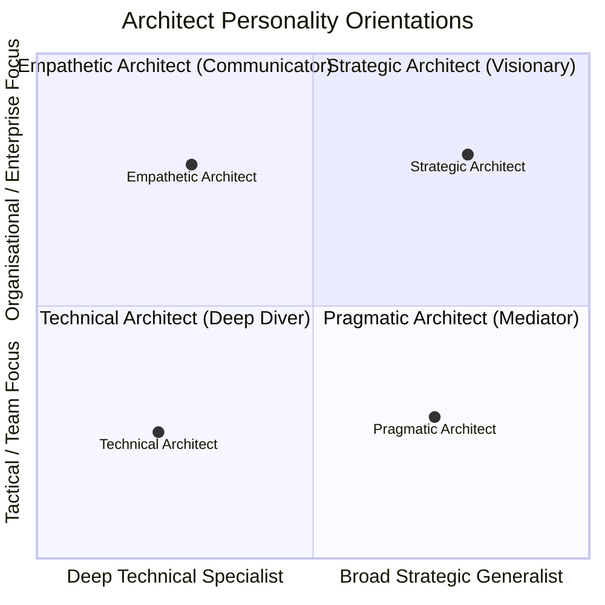

---
tags:
  - Software Architecture
  - Leadership
  - Self-Assessment
---

# 03.01 · Architect Personalities Deep Dive

> **Level:** Conceptual — Behavioural · **Reading Time:** ~8 mins · **Track:** Systems & Architecture
> **Prerequisites:** [03 · Architect Thinking](03-architect-thinking.md)

Understanding your own default architect personality — and recognizing the personalities of your peers and interviewers — is a **meta-skill** for Principal Engineers. It governs how you build credibility, where your blind spots hide under stress, and how you flex your style to match the organizational moment.

!!! abstract "TL;DR — The 30-Second Mental Model"
    - **Four Working Styles (This Guide's Self-Assessment Lens):**
        1. **Technical (Deep Diver):** High technical depth + local/component focus.
        2. **Strategic (Visionary):** Broad technical horizon + multi-year org focus.
        3. **Pragmatic (Mediator):** Delivery-oriented + rapid trade-off resolution.
        4. **Empathetic (Communicator):** People/stakeholder alignment + psychological safety.
    - **Interview Secret:** Every personality has a **shadow failure mode**. Naming your natural orientation *and* the concrete habits you use to counter its blind spot is a top-tier Principal behavioural signal.

---

## The Architect Personality Quadrant

This is **the guide's practical reflection tool**, informed by general architecture writing on technical depth, breadth, communication, and trade-offs. It is not a validated psychometric assessment or a formal four-archetype taxonomy from Richards & Ford:

---

## Deep Dive into the Four Types

=== "1. Technical (Deep Diver)"
    **Core Orientation:** Deep technical mastery first; solves the gnarliest low-level engineering problems.

    | Dimension | Profile |
    |:---|:---|
    | **Superpower** | Debugs kernel/GC stalls, consensus bugs, and lock contention that stump everyone else; instant respect from IC engineers |
    | **Credibility Source** | Code-level and systems-level mastery |
    | **Shadow Failure Mode** | **Over-engineering & Rabbit-Holing** — builds a custom distributed storage engine when managed Postgres would suffice |
    | **Communication Risk** | Drowns executives and PMs in low-level implementation jargon |

    **Countermeasures to Practise:**
    - Force yourself to write a 1-paragraph **Business Impact Summary** at the top of every RFC before touching technical details.
    - Ask *"What is the boring, off-the-shelf technology that solves 80% of this problem?"*

=== "2. Strategic (Visionary)"
    **Core Orientation:** Multi-year horizon; maps how today's technical architecture enables 3–5 year business capabilities.

    | Dimension | Profile |
    |:---|:---|
    | **Superpower** | Connects domain models, capability maps, and industry shifts to long-range platform investments |
    | **Credibility Source** | Track record of foresight — preventing multi-million-dollar architectural dead ends |
    | **Shadow Failure Mode** | **Ivory Tower Architecture** — produces slide decks and target-state diagrams that teams ignore because there is no incremental migration path |
    | **Communication Risk** | Too abstract; engineers ask *"What does this mean for my sprint next Monday?"* |

    **Countermeasures to Practise:**
    - Never publish a 3-year target architecture without defining **Phase 1 (first 6 weeks)** and prototyping the hardest integration seam yourself.
    - Embed with a delivery team once a quarter to feel the friction of your own standards.

=== "3. Pragmatic (Mediator)"
    **Core Orientation:** Execution velocity; cuts through analysis paralysis to make good-enough decisions fast.

    | Dimension | Profile |
    |:---|:---|
    | **Superpower** | Unblocks deadlocked teams; ships high-value outcomes under tight constraints |
    | **Credibility Source** | Relentless delivery track record |
    | **Shadow Failure Mode** | **Death by a Thousand Shortcuts** — accumulates undocumented "Prudent/Reckless Deliberate" technical debt that compounds into an outage |
    | **Communication Risk** | Under-documents rationale; future engineers inherit mysterious workarounds |

    **Countermeasures to Practise:**
    - Enforce a personal rule: **No expedient shortcut without a 10-minute ADR and a linked Tech Debt ticket with a sunset condition/metric.**
    - Distinguish **Type 2 (reversible)** shortcuts from **Type 1 (one-way door)** data/contract decisions.

=== "4. Empathetic (Communicator)"
    **Core Orientation:** Sociotechnical harmony; aligns cross-functional teams, EMs, and stakeholders around shared ownership.

    | Dimension | Profile |
    |:---|:---|
    | **Superpower** | Resolves cross-org turf wars; facilitates RFC reviews where everyone feels heard and committed |
    | **Credibility Source** | Relational trust, facilitation skill, and organizational savvy |
    | **Shadow Failure Mode** | **Design by Committee** — compromises between Option A and Option B to keep everyone happy, producing a muddled hybrid with the downsides of both |
    | **Communication Risk** | Avoids necessary technical conflict; delays hard calls waiting for 100% consensus |

    **Countermeasures to Practise:**
    - Separate **Psychological Safety** (everyone is heard respectfully) from **Consensus** (everyone agrees). Use **Disagree and Commit** once all evidence is on the table.
    - Anchor debates in objective SEI Quality Attribute metrics rather than compromise.

---

## Situational Blending Playbook

Great Principal Engineers do not have a fixed personality — they **diagnose what the situation lacks** and supply that mode:

| Organizational Scenario | Mode to Activate | Concrete Action |
|:---|:---|:---|
| **SEV-1 Production Outage / Latency Crisis** | **Technical + Pragmatic** | Dive into flamegraphs/traces, ship the tactical mitigation now, defer the philosophical redesign to the post-mortem |
| **Post-M&A Platform Consolidation** | **Strategic + Empathetic** | Map overlapping capabilities objectively while building trust with the acquired engineering leaders |
| **Warring Teams Deadlocked on API Contract** | **Empathetic + Pragmatic** | Facilitate a 4Cs weighted matrix session, time-box the benchmark spike, and drive a Disagree-and-Commit call |
| **Greenfield Core Ledger / Multi-Year Platform** | **Strategic + Technical** | Define strict domain boundaries and prototype the consistency/partitioning model hands-on |

---

## Active Recall & Self-Check

??? question "Self-Check 1: Why is 'Design by Committee' (the Empathetic Architect's failure mode) often worse than picking either competing option outright?"
    **Answer Rubric:**
    When Team A wants a synchronous REST call for simplicity and Team B wants an event-driven Kafka pipeline for decoupling, compromising by building an un-monitored custom DB-polling bridge gives you the tight schema coupling of Option A *plus* the operational latency of Option B. A Principal Engineer ensures all voices are heard (**Consulted**), but insists that one coherent architectural option wins based on prioritized quality attributes.

??? question "Self-Check 2: How would you answer the behavioural question: 'What is your biggest weakness or blind spot as a technical leader?'"
    **Answer Rubric:**
    Use the **Personality + Countermeasure** structure:
    1. **Name your natural default honestly:** e.g., *"My natural default is the Technical/Pragmatic mode — when I see a hard problem, my instinct is to jump in, prototype a fix, and unblock the team immediately."*
    2. **Name the historical cost at Principal scope:** *"Early in my Staff tenure, that meant I sometimes solved the problem for the team instead of coaching a senior engineer through it, or I moved faster than cross-team stakeholders were socialized."*
    3. **Show the system/habit you built to counter it:** *"Now I use a deliberate checklist: before writing code on a cross-team issue, I ask who I can pair with as a growth opportunity, and I pre-wire a 1-page RFC summary with adjacent tech leads."*
