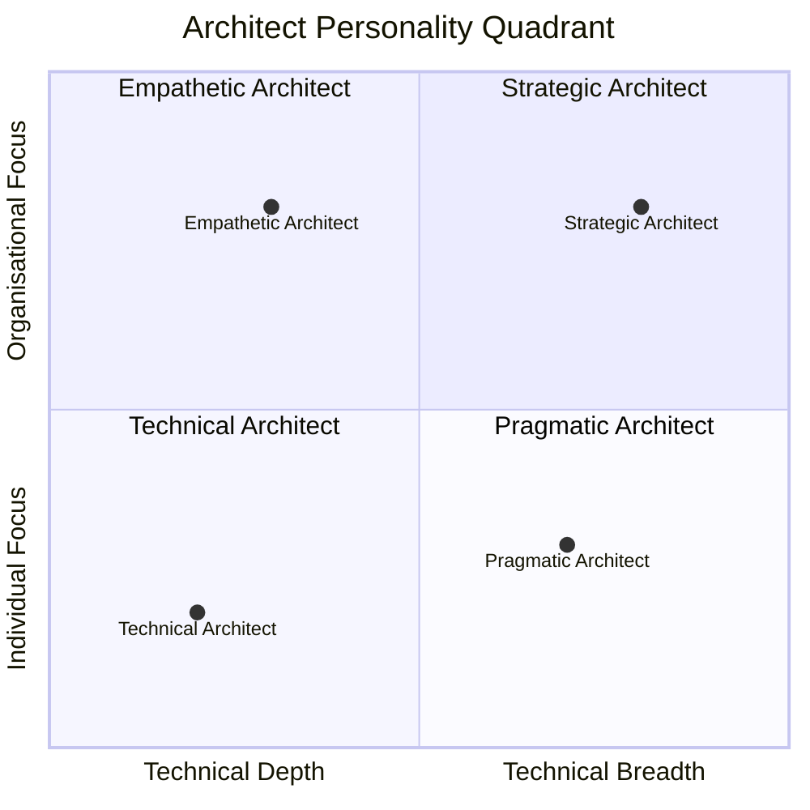
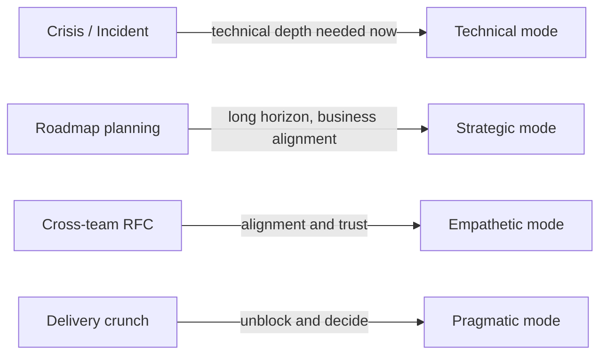

# 03.01 · Architect Personalities Deep Dive

> **Level:** Conceptual — Behavioural
> **Pre-reading:** [03 · Architect Thinking](03-architect-thinking.md)

Understanding your own architect personality — and the personalities of others — is a **meta-skill** for principal-level roles. It determines how you communicate, where your blind spots are, and how you build credibility.

---

## Source: Richards & Ford — Fundamentals of Software Architecture

The architect personality model comes from **Mark Richards and Neal Ford** (*Fundamentals of Software Architecture*, O'Reilly 2020). Their core claim: architects are not a monolith — they fall into distinct orientations that affect how they work, what they excel at, and where they fail.

---

## The Four Personality Types

---

### Type 1: The Technical Architect (Deep Diver)

**Core orientation:** Technical depth first.

| Dimension | Detail |
|:---|:---|
| **Strength** | Solves the hardest problems; earns deep credibility with engineers |
| **Working style** | Prefers 1:1 technical deep-dives; most comfortable in design sessions |
| **Credibility source** | Demonstrable mastery of a technical domain |
| **Failure mode** | Over-engineers; produces architectures that are technically perfect but organisationally unimplementable |
| **Communication risk** | Uses too much jargon; loses non-technical stakeholders |

**Signs you are this type:**
- You have strong opinions about database indexing strategies
- You can debug a JVM garbage collection issue at 2 AM
- You are the last person to leave a whiteboarding session

**What to develop:**
- Practise explaining technical decisions in business terms
- Deliberately seek breadth — spend time in domains outside your specialty
- Learn to say "good enough" when the cost of perfection is too high

---

### Type 2: The Strategic Architect (Visionary)

**Core orientation:** Long-horizon thinking; system evolution over 3–5 years.

| Dimension | Detail |
|:---|:---|
| **Strength** | Connects today's technical decisions to tomorrow's business outcomes |
| **Working style** | Whiteboard sessions, roadmap planning, executive presentations |
| **Credibility source** | Track record of correct long-range technical predictions |
| **Failure mode** | Creates beautiful architectures on paper that teams never adopt |
| **Communication risk** | Too abstract; loses engineers who need concrete, actionable guidance |

**Signs you are this type:**
- You think in terms of capability maps and multi-year migration paths
- You read architecture books for fun
- You often find yourself saying "in three years, we'll regret this decision if..."

**What to develop:**
- Stay close to code — prototype the riskiest parts of your architectures
- Develop execution discipline: a vision without a migration path is just a dream
- Practice making your strategies concrete with milestones and success metrics

---

### Type 3: The Pragmatic Architect (Mediator)

**Core orientation:** Delivery focus; good-enough decisions made fast.

| Dimension | Detail |
|:---|:---|
| **Strength** | Unblocks teams; navigates trade-offs without paralysis |
| **Working style** | In the thick of delivery; close to product and engineering managers |
| **Credibility source** | Track record of shipping things that work |
| **Failure mode** | Accumulates technical debt through expedient decisions; "we'll fix it later" |
| **Communication risk** | Under-documents; decisions not recorded for future teams |

**Signs you are this type:**
- You default to "let's just ship it and see"
- You are energised by solving blockers and removing impediments
- You are the person everyone calls when a project is stuck

**What to develop:**
- Build the habit of writing ADRs — even brief ones — for expedient decisions
- Create explicit tech debt tickets at the moment of the expedient decision
- Develop a personal rule: "I will not make a trade-off without recording it"

---

### Type 4: The Empathetic Architect (Communicator)

**Core orientation:** Team and stakeholder relationships first.

| Dimension | Detail |
|:---|:---|
| **Strength** | Earns trust across engineering and business; aligns people around a decision |
| **Working style** | Facilitation, workshops, 1:1 conversations, written RFCs |
| **Credibility source** | Relationships, track record of good facilitated decisions |
| **Failure mode** | Avoids necessary conflict; consensus-driven architecture that optimises for nothing |
| **Communication risk** | Over-communicates to the point of diluting technical substance |

**Signs you are this type:**
- You read the room before presenting a technical proposal
- You feel responsible for how people *feel* about an architecture decision
- You are the person who gets cross-team alignment done

**What to develop:**
- Practise making and defending a controversial technical call
- Develop a framework for knowing when consensus is the right tool vs. a decision made
- Don't confuse being liked with being effective

---

## Situational Blending

No context calls for a single personality type. Great architects **read the room** and adjust:

| Context | Dominant personality | Why |
|:---|:---|:---|
| Startup scaling rapidly | Pragmatic + Empathetic | Ship fast; keep the team aligned |
| Legacy modernisation | Strategic + Technical | Deep understanding of what exists; long-horizon migration plan |
| Platform team building | Technical + Strategic | Deep platform expertise; multi-year roadmap |
| Post-incident architecture review | Technical + Empathetic | Rigorous analysis; blameless, trust-preserving facilitation |
| Executive architecture presentation | Strategic + Empathetic | Business-aligned vision; stakeholder trust |

---

## Diagnosing Your Own Personality

!!! tip "Self-assessment questions"
    - "What energises you in an architecture engagement — deep technical analysis, long-range planning, getting to consensus, or unblocking delivery?"
    - "What do colleagues come to you for first — technical advice, strategic direction, stakeholder alignment, or removing blockers?"
    - "What is the last piece of feedback you received that stung a bit — too abstract, too in the weeds, too conflict-averse, too fast?"

Your failure mode is the best clue to your dominant personality type.

---

## In the Interview

Interviewers probe personality fit in questions like:
- "How do you approach architecture — top-down or bottom-up?"
- "Tell me about a time you had to convince a sceptical engineering team to adopt your architectural approach."
- "How do you handle disagreement on a technical decision?"

**The answer that works:** Demonstrate that you **know your default** and can **flex to the situation**. Say something like:
> "My natural orientation is [X], but I've learned to recognise when the situation calls for [Y] and shift deliberately. For example..."

