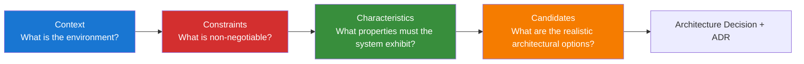

# 03.02 · The 4Cs of Architecture Deep Dive

> **Level:** Practitioner — Decision Making
> **Pre-reading:** [03 · Architect Thinking](03-architect-thinking.md)

The **4Cs framework** is a structured approach to reasoning about any architecture decision. It ensures you consider the environment, constraints, and trade-offs *before* proposing a solution.

---

## The 4Cs at a Glance



!!! warning "The most common failure"
    Engineers at every level jump directly to **Candidates** — "let's use Kafka and Kubernetes" — before understanding Context and Constraints. This produces architecturally correct but organisationally wrong solutions.

---

## C1 — Context

*What is the environment in which this system must succeed?*

Context shapes everything. Two systems with identical functional requirements may need radically different architectures because their contexts differ.

### Context Dimensions

| Dimension | Questions to ask |
|:---|:---|
| **Business domain** | What industry? What are the competitive dynamics? What defines success for the business? |
| **Regulatory environment** | GDPR, PCI-DSS, HIPAA, SOX — what compliance obligations exist? |
| **Conway's Law** | How are the teams structured? The architecture will mirror the org chart. |
| **Existing landscape** | What must be integrated? What is the technical debt? What is the current stack? |
| **Team capability** | What technologies does the team know? What is the hiring supply for alternatives? |
| **Time horizon** | Is this a 6-month MVP or a 10-year platform? |
| **Scale trajectory** | 1,000 users today — what is the 3-year projection? |

### Example — Two Identical Requirements, Different Contexts

**Requirement:** "Build a payment processing system."

=== "Context A: Regulated bank, 200 engineers"
    - PCI-DSS Level 1 compliance mandatory
    - Existing mainframe must be integrated
    - 20+ teams, each owning a service domain
    - 99.999% availability required
    - → **Architecture:** Event-driven microservices with strict data residency, saga pattern for distributed transactions, extensive audit logging

=== "Context B: Seed-stage fintech startup, 5 engineers"
    - PCI-DSS compliance via Stripe (outsourced)
    - No legacy integration
    - Single team, 5 engineers
    - 99.9% availability acceptable for now
    - → **Architecture:** Monolith using Stripe's APIs, PostgreSQL, simple REST API — scale later

---

## C2 — Constraints

*What is non-negotiable?*

Constraints **eliminate options**. They are different from quality attributes — constraints are binary (met or not met), while quality attributes are continuous (better or worse).

### Constraint Categories

| Category | Examples |
|:---|:---|
| **Technical** | Must integrate with legacy SAP system; must use Java (org policy) |
| **Regulatory** | EU customer data must not leave EU; must retain financial records for 7 years |
| **Organisational** | Team of 4 — no new hires approved; no new cloud vendor approvals |
| **Business** | Must be live for Q4 launch (fixed deadline); must not require customer re-registration |

### Constraint Discovery Questions

- "What existing systems must this integrate with?"
- "What regulatory requirements govern this data or process?"
- "What is the team size, and is it changing?"
- "Are there approved technology lists we must stay within?"
- "Are there fixed deadlines that cannot move?"

!!! tip "Constraints are a gift"
    Constraints reduce the solution space. An architect facing no constraints has an infinite number of options — paralysing. An architect with 5 hard constraints may have only 2–3 realistic architecture candidates. Constraints enable faster, more defensible decisions.

---

## C3 — Characteristics (Quality Attributes)

*What properties must the system exhibit?*

Quality attributes (also called non-functional requirements or NFRs) are the measurable properties the system must have. They do not describe *what* the system does — they describe *how well* it does it.

### Prioritising Quality Attributes

Not all quality attributes can be maximised simultaneously. The architecture must **explicitly prioritise** them based on business context.

!!! warning "The top-3 rule"
    Architects who say "we need all of these" are not making trade-offs — they are deferring them. Force yourself to pick the top 3 quality attributes for the system. Every significant architectural decision should be evaluated against those 3.

### Quality Attribute Scenarios (SEI Format)

| Field | Description |
|:---|:---|
| **Source** | Who or what initiates the stimulus |
| **Stimulus** | The event or condition |
| **Environment** | Normal / peak / degraded operation |
| **Artifact** | Which part of the system is stimulated |
| **Response** | How the system responds |
| **Response Measure** | How we verify the response is acceptable |

### Example QA Scenario: Scalability

| Field | Value |
|:---|:---|
| Source | End users |
| Stimulus | Traffic spike — 10× normal load during flash sale |
| Environment | Peak operation |
| Artifact | Product catalogue service |
| Response | All requests processed within normal SLA |
| Response Measure | p99 latency < 200ms at 10× normal load; 0% error rate |

### Quality Attribute Trade-off Matrix

| If you optimise for... | You trade off... |
|:---|:---|
| **Performance** | Consistency (caching = stale data), Cost (more compute) |
| **Availability** | Consistency (CAP theorem), Cost (redundancy) |
| **Security** | Developer velocity, User experience (friction) |
| **Scalability** | Consistency (eventual consistency), Complexity |
| **Maintainability** | Initial delivery speed, Runtime performance |
| **Cost** | Performance, Availability, Security |

---

## C4 — Candidates (Architecture Styles)

*What are the realistic architectural options?*

Every architecture decision should have at least **2–3 genuine alternatives** with explicit trade-offs documented. An architect who always defaults to the same pattern is applying a habit, not exercising judgement.

### Architecture Style Comparison

| Style | Strengths | Weaknesses | Best context |
|:---|:---|:---|:---|
| **Monolith** | Simplicity, ACID transactions, low latency | Scaling coupling, deployment coupling | Early-stage, small teams, high cohesion |
| **Modular Monolith** | Domain isolation without distribution | Can't scale components independently | Medium scale, disciplined teams |
| **Microservices** | Independent scaling, deployment, team autonomy | Distributed systems complexity, operational overhead | Large orgs, team autonomy needed |
| **Event-Driven** | Decoupling, resilience, natural audit trail | Eventual consistency, debugging complexity | High throughput, loose coupling |
| **Serverless** | Zero ops, auto-scale, pay-per-use | Cold starts, vendor lock-in, limited compute | Sporadic or event-driven workloads |
| **CQRS + Event Sourcing** | Full audit trail, temporal queries | Complexity, eventual consistency | Compliance-heavy, complex business domains |

### Making the Candidate Decision

Use a decision matrix:

| Quality Attribute | Weight | Monolith | Microservices | Event-Driven |
|:---|:---|:---|:---|:---|
| Scalability | 30% | 4/10 | 9/10 | 8/10 |
| Operational simplicity | 25% | 9/10 | 3/10 | 5/10 |
| Team autonomy | 20% | 3/10 | 9/10 | 7/10 |
| Delivery speed (now) | 15% | 9/10 | 4/10 | 5/10 |
| Long-term maintainability | 10% | 5/10 | 8/10 | 7/10 |
| **Weighted score** | | **6.0** | **6.8** | **6.7** |

!!! tip "The decision matrix is a thinking tool, not a verdict"
    A decision matrix forces you to be explicit about weights and scores — both of which are debatable. The value is in the **conversation** the matrix generates, not the final number.

---

## Applying the 4Cs in an Interview

When given a system design question, use the 4Cs as a structured preamble before proposing any solution:

```
1. "Before I propose anything, let me understand the context..."
   → Ask about domain, team size, existing systems, timeline

2. "Are there any hard constraints I should know about?"
   → Regulatory, technology, team, deadline

3. "Which quality attributes are most critical for this system?"
   → Force a priority ranking — availability vs. consistency vs. cost

4. "Given all that, I see two or three realistic architectural approaches..."
   → Present candidates with explicit trade-offs
```

This structure demonstrates that you think like an architect — not just a developer who has memorised patterns.

