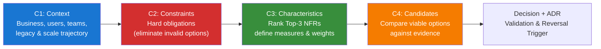

---
tags:
  - Architecture Decisions
  - System Design
  - Decision Frameworks
---

# 03.02 · The 4Cs of Architecture Deep Dive

> **Level:** Practitioner — Decision Making · **Reading Time:** ~10 mins · **Track:** Systems & Architecture
> **Prerequisites:** [03 · Architect Thinking](03-architect-thinking.md)

**This guide's 4Cs Decision Framework** (**Context → Constraints → Characteristics → Candidates**) is a structured reasoning funnel for architectural problems. It is a rehearsal heuristic—not a formal industry standard—designed to prevent jumping directly to a favorite technology.

!!! abstract "TL;DR — The 30-Second Mental Model"
    1. **Context:** What business, users, teams, legacy landscape, and growth trajectory shape the problem?
    2. **Constraints:** Which genuine pass/fail obligations eliminate invalid options?
    3. **Characteristics:** Which **Top 3 Quality Attributes** win when trade-offs collide, and how are they measured?
    4. **Candidates:** Compare viable alternatives—including the status quo where useful—then record evidence, consequences, and reversal triggers.

---

## The 4Cs Decision Funnel

---

## C1 — Context: Same Requirement, Radically Different Architectures

Two systems with identical functional requirements (*"Process customer payments"*) can need different architectures:

|| Context Dimension | Diagnostic Questions |
|:---|:---|
|| **Business Stage & Domain** | Is the priority rapid product discovery, strict ledger integrity, or regulatory evidence? What is the cost of being wrong? |
|| **Team Topology (Conway's Law)** | Who builds, operates, secures, and supports each boundary? How much distributed-systems cognitive load can they sustain? |
|| **Brownfield Landscape** | Which legacy ledgers, identity providers, data contracts, and migration windows are real? |
|| **Scale Trajectory** | What are current and credible peak load, data growth, regional distribution, and burst patterns? Which assumptions need validation? |

=== "Context A: Regulated Global Bank"
    - **Context:** Explicit data-location/transfer obligations, legacy ledger integration, many autonomous teams, and high auditability requirements.
    - **Possible Direction:** Regionally isolated data planes, event-driven integration, transactional outbox + Saga, strong key management, and automated control/fitness checks. Cell-based microservices are an option, not an automatic answer.

=== "Context B: Seed-Stage B2B SaaS Startup"
    - **Context:** Small team, limited runway, and a short validation milestone.
    - **Possible Direction:** Modular monolith on managed infrastructure, hosted payment pages/components to **reduce—not eliminate—PCI DSS scope**, and a managed multi-AZ relational database. Confirm the applicable SAQ and responsibilities under the current [PCI DSS documentation](https://www.pcisecuritystandards.org/standards/pci-dss/).

---

## C2 — Constraints: Binary Option Filters

Constraints are pass/fail boundaries. Do not disguise preferences as constraints, and do not treat every legal framework as a blanket data-residency mandate.

|| Constraint Category | Real-World Examples | Architectural Consequence |
|:---|:---|:---|
|| **Regulatory, Legal & Contractual** | GDPR Chapter V transfer safeguards, contractual EU storage, HIPAA-covered vendor arrangements, FedRAMP boundary, PCI DSS scope | Validate approved transfer/storage paths and vendors; GDPR itself permits several third-country transfer mechanisms rather than imposing universal EU residency |
|| **Organisational & Skill** | Small Go/Python team with no platform operations capacity | Rules out options the team cannot safely build and operate, unless capability/support changes |
|| **Financial (FinOps)** | Maximum cost to serve per tenant/transaction at a target margin | Eliminates options whose measured unit economics cannot meet the constraint |
|| **Time / Market Window** | Regulatory effective date or contractual launch | Requires a phased migration or narrower scope rather than an unfinishable rewrite |

For GDPR transfer context, use the European Commission's primary guidance on [international data transfers](https://commission.europa.eu/law/law-topic/data-protection/international-dimension-data-protection/rules-international-data-transfers_en) and involve privacy/legal specialists for the actual data and jurisdictions.

---

## C3 — Characteristics: The Top-3 Quality Attribute Rule

You cannot maximize every quality attribute for every operation under every failure condition. Prioritize the few attributes that change the decision and express them as measurable scenarios.

!!! warning "The Top-3 Rule"
    If a stakeholder says *"Everything is P0"*, ask scenario-specific questions: *"For this write during a partition, should the system reject the operation or accept a divergent result for later reconciliation? For this read, is a five-second-old answer preferable to an error? Which regional RTO/RPO and unit-cost ceiling are acceptable?"* Three is a focus heuristic, not a ban on additional decision-critical attributes.

### Quality Attribute Trade-Off Matrix

|| If You Prioritise... | You Often Pay With... | Typical Architectural Mechanism |
|:---|:---|:---|
|| **Strong Transactional Consistency & Auditability** | Coordination latency, partition-time write availability, and harder write scaling | Serializable ACID transactions, consensus/synchronous replication where required, idempotency records |
|| **Ultra-Low Read Latency** | Freshness/staleness risk, invalidation complexity, and memory cost | CDN + distributed + local caches with explicit freshness semantics |
|| **High Team Autonomy & Deployment Independence** | Operational overhead, network serialization, and cross-domain eventual consistency | Well-bounded services with independent data ownership and async contracts |
|| **Low Operational Overhead & Fast Discovery** | Coarser scaling and a shared deployment blast radius | Modular monolith + managed backing services |

Serializable transactions and linearizable operation ordering are different guarantees; define which one each API and invariant needs.

---

## C4 — Candidates: Weighted Decision Matrix

For consequential choices, compare **genuinely viable candidates** against the C3 measures. A matrix makes assumptions inspectable; it does not turn subjective scores into objective truth.

### Example: Choosing an Order & Inventory Architecture for a Mid-Stage Scale-Up

*Context: 35 engineers across 5 teams; growing 3× year over year; occasional flash sales; near-term market deadline treated as a C2 constraint.*

|| Prioritised Quality Attribute (C3) | Weight | Option 1: Shared-DB Monolith | Option 2: Modular Monolith + Read Replicas | Option 3: Event-Driven Services |
||:---|:---:|:---:|:---:|:---:|
|| **1. Flash-Sale Read/Write Elasticity** | **30%** | 3 / 10 | 7 / 10 | 9 / 10 |
|| **2. Team Autonomy (5 teams)** | **35%** | 3 / 10 | 8 / 10 | 9 / 10 |
|| **3. Operational Simplicity** | **35%** | 9 / 10 | 8 / 10 | 3 / 10 |
|| **Weighted Total Score** | **100%** | **5.10** | **7.70 (Tentative Leader)** | **6.90** |

**Architectural Verdict:** Option 2 leads under these weights, so validate its highest-risk assumptions with a prototype and operational review. Run sensitivity analysis: if another reasonable stakeholder weighting flips the winner, the decision is not robust. Hard constraints must never be “scored away” by a high total.

Define evidence-based **evolution triggers**—for example sustained SLO failure, write-lock contention that cannot be optimized away, independent scaling needs, or repeated cross-team deployment conflicts—rather than splitting automatically at a particular headcount or RPS.

---

## Interview Script: How to Run the 4Cs in 5 Minutes

1. **Context (1 min):** *"Who uses and operates this, what customer/business outcome matters, and what current and peak scale should I assume?"*
2. **Constraints (1 min):** *"Which regulatory, data-location/transfer, legacy, deadline, and operating-capability boundaries are genuinely non-negotiable?"*
3. **Characteristics (1.5 min):** *"I propose these top three measurable drivers. When two conflict, which scenario should win?"*
4. **Candidates (1.5 min):** *"Here are two or three viable options and the status quo. I recommend this one because it best satisfies the drivers; here are its downsides and the evidence that would reverse my choice."*

---

## Active Recall & Self-Check

??? question "Self-Check 1: Why should an ADR include an evolution or reversal trigger?"
    **Answer Rubric:**
    Context and constraints change. A trigger such as *“reassess partitioning when p99 write latency exceeds the SLO for two review periods despite index/query remediation, or when a new region introduces incompatible residency requirements”* turns re-architecture into evidence-driven evolution rather than a reactive rewrite. Use a threshold as a review prompt, not proof that a particular replacement architecture is required.

??? question "Self-Check 2: A candidate proposes CQRS + Event Sourcing for a simple internal employee directory. Which step did they skip?"
    **Answer Rubric:**
    They jumped to **Candidates** without establishing **Context**, **Constraints**, and **Characteristics**. A small low-change CRUD workload with a simple audit requirement may be served better by a relational schema, audit table, and managed backups. The candidate should first identify which measurable problem CQRS/Event Sourcing solves and whether its operational and cognitive cost is justified.
