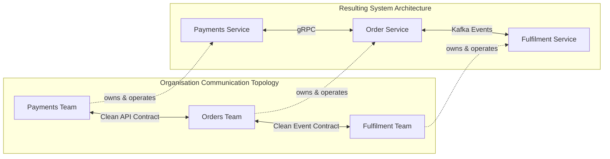

---
tags:
  - Team Effectiveness
  - Org Design
  - Engineering Leadership
---

# 04 · Team Effectiveness

> **Level:** Conceptual — Organisational · **Reading Time:** ~10 mins · **Track:** Org & Leadership
> **Prerequisites:** [01 · Roles & Responsibilities](01-roles-responsibilities.md) · [03 · Architect Thinking](03-architect-thinking.md)

Software architecture is a **sociotechnical discipline**: the structure of a software system and the structure of the teams that build it influence one another. Principal Engineers who ignore organizational topology can design systems that are difficult to build, operate, or evolve.

!!! abstract "TL;DR — The 30-Second Mental Model"
    - **Conway's Law & The Inverse Conway Manoeuvre:** System boundaries often mirror team communication paths. Evolve teams and architecture together rather than treating the org chart as fixed.
    - **Cognitive Load (Team Topologies):** Reduce **extraneous load** (manual deploys, brittle infra, unclear APIs) through self-service platforms so stream-aligned teams can focus on the business domain.
    - **Counter Diffusion of Responsibility:** Combine collective stewardship with **named coordination**, actionable on-call ownership, and explicit decision accountability inside a psychologically safe culture.
    - **Measure Systemic Flow:** Combine the current **five DORA metrics** (throughput + instability) with **SPACE / Developer Experience (DevEx)** signals; never reduce productivity to activity counts.

---

## Conway's Law & The Inverse Conway Manoeuvre

> *"Any organization that designs a system (defined broadly) will produce a design whose structure is a copy of the organization's communication structure."*
> — Melvin E. Conway (1967)

### The Inverse Conway Manoeuvre
Instead of accepting the org chart as fixed, **deliberately evolve team boundaries and interaction modes to support the target architecture**:

|| Desired System Architecture | Supporting Team Structure |
|:---|:---|
|| Decoupled services with independent deployments | Small, cross-functional **stream-aligned teams** owning end-to-end bounded contexts and their data |
|| Standardized cloud/CI/observability foundations | Product-minded **platform team** exposing reliable self-service paved roads (**X-as-a-Service**) |
|| Modular monolith with clean internal boundaries | One or a small number of teams enforcing module boundaries through ownership and automated architecture checks |
|| Separate UI + Backend + DBA functional silos | *Risk:* Every customer feature can require a three-team handoff and coordinated release |

Conway's Law is a diagnostic tendency, not an excuse for deterministic design. Team APIs, platform ergonomics, and deliberate cross-team collaboration also shape the resulting system.

---

## Deep-Dive Modules in This Section

-   :material-account-alert-outline:{ .lg .middle } **04.01 · Diffusion of Responsibility**

    ---

    Learn how ambiguous ownership contributes to PR rubber-stamping, unacknowledged alerts, and orphaned services—and how to fix it with **named coordination**.

    [:octicons-arrow-right-24: Diffusion of Responsibility Deep Dive](04.01-diffusion-responsibility.md)

-   :material-vector-combine:{ .lg .middle } **04.02 · Team Topologies**

    ---

    Master Skelton & Pais's **4 Team Types** (Stream-Aligned, Platform, Enabling, Complicated Subsystem), **3 Interaction Modes**, and **Cognitive Load sizing**.

    [:octicons-arrow-right-24: Team Topologies Deep Dive](04.02-team-topologies.md)

---

## Core Sociotechnical Pillars

### 1. Cognitive Load Management
Human working memory is finite. **Team Topologies** uses three categories to reason about team cognitive load:

|| Cognitive Load Type | Definition & Examples | Principal Engineer Action |
|:---|:---|:---|
|| **Intrinsic** | Fundamental complexity of the problem, language, algorithms, and technology | Keep the default stack understandable; build capability through coaching and enabling teams |
|| **Extraneous** | Avoidable friction: flaky CI, manual configuration, ticket queues, unclear deploy steps | **Reduce systematically** through self-service internal developer platforms and better interfaces |
|| **Germane** | Domain reasoning: customer workflows, edge cases, and business invariants | **Create bandwidth for this**—this is where much of the differentiated business value lives |

### 2. Psychological Safety (Google Project Aristotle)

Google's Project Aristotle studied 180 teams and identified five dynamics associated with effective teams. It did not prove a universal causal recipe, and the source itself presents the findings in their original research context:

1. **Psychological Safety:** Team members can take interpersonal risks, admit mistakes, challenge a Principal Engineer's RFC, or flag a security concern without humiliation or retaliation.
2. **Dependability:** Teammates deliver quality work and communicate early when commitments change.
3. **Structure & Clarity:** Goals, roles, and execution plans are understandable.
4. **Meaning:** The work matters personally to team members.
5. **Impact:** The team sees how its work affects customers and organizational outcomes.

!!! tip "How Principal Engineers Build (or Accidentally Destroy) Psychological Safety"
    A dismissive comment from a senior leader (*"That obviously won't scale"*) can silence useful dissent. Build safety deliberately:
    - **Say "I don't know" publicly** when something is outside your domain.
    - **Praise engineers who find flaws in your RFCs.**
    - **Critique invariants and failure modes, never the author.**

### 3. Countering Diffusion of Responsibility
Classic bystander research shows how ambiguity can reduce individual intervention in a laboratory emergency. Do not convert those experiment-specific percentages into engineering-team benchmarks. The useful design lesson is narrower:

- Avoid assigning an alert, decision, or remediation item to an unspecified group with no coordinator.
- Pair **collective code stewardship** with a named on-call rotation, service-owning team, decision approver, and action-item DRI.
- Make escalation and backup explicit so named accountability does not become a bus-factor or blame mechanism.
- → **[Full Deep Dive: 04.01 · Diffusion of Responsibility](04.01-diffusion-responsibility.md)**

---

## Measuring Engineering Effectiveness: DORA + SPACE

Principal Engineers use evidence to improve systems—not "lines of code" or "commits per developer" to rank people.

### The Current Five DORA Metrics (Throughput & Instability)

DORA expanded the original “four keys” to **five metrics in 2024**. Failed deployment recovery time is now part of **throughput**, while change fail rate and deployment rework rate measure **instability**.

|| Metric | Current Category | What to Measure | Systemic Lever a Principal Engineer Pulls |
|:---|:---|:---|:---|
|| **Change Lead Time** | Throughput | Commit to successful production deployment | Smaller PRs, faster feedback, automated checks, fewer handoffs |
|| **Deployment Frequency** | Throughput | Production deployments per period or time between them | Independent releases, trunk-based delivery, feature flags |
|| **Failed Deployment Recovery Time** | Throughput | Time to recover from a deployment requiring immediate intervention | Progressive delivery, tested rollback/roll-forward, clear ownership |
|| **Change Fail Rate** | Instability | Deployments requiring immediate intervention after release | Contract tests, canaries, pre-production verification |
|| **Deployment Rework Rate** | Instability | Unplanned deployments caused by production incidents | Reduce batch size, address recurring failure modes, improve test fidelity |

!!! warning "Use Trends, Not Universal 'Elite' Targets"
    Compare an application or service **with its own baseline over time**, in its business and regulatory context. Do not rank engineers or dissimilar teams against a generic deployment-frequency, recovery-time, or change-fail-rate target. DORA explicitly warns against turning the metrics into goals, blending unlike services, and using one metric in isolation.

### Complementing DORA with SPACE & DevEx
While DORA measures delivery outcomes, the **SPACE Framework** prevents a narrow pipeline-only view:

- **S**atisfaction & Well-being (developer surveys and sustainable-workload signals)
- **P**erformance (system reliability, quality, and customer outcomes)
- **A**ctivity (design, review, and incident work—never an individual productivity score)
- **C**ommunication & Collaboration (review flow, knowledge sharing, onboarding support)
- **E**fficiency & Flow (interruptions, handoffs, wait time, and context switching)

Use a small constellation across **at least three SPACE dimensions**, include a **perceptual measure**, and interpret the measures together rather than optimizing a single number.

### Primary Measurement Sources

- [DORA — current software delivery performance metrics](https://dora.dev/guides/dora-metrics/) and [metric history](https://dora.dev/insights/dora-metrics-history/)
- [Forsgren et al. — *The SPACE of Developer Productivity*](https://dl.acm.org/doi/fullHtml/10.1145/3453928)
- [Google re:Work — team effectiveness and Project Aristotle](https://rework.withgoogle.com/intl/en/guides/understand-team-effectiveness)

---

## Principal Engineer's Team Health Audit Checklist

When joining a slow or struggling engineering domain, establish a baseline across these areas:

- [ ] **Bounded Context & Cognitive Load:** Can engineers explain the team's services, data flows, and operational responsibilities? Where does onboarding stall?
- [ ] **Dependency Autonomy:** Which routine roadmap items require synchronous changes, approvals, or tickets from another team, and how long do they wait?
- [ ] **Named Coordination:** Does every repo, SLO dashboard, and post-mortem action item have an accountable owner and a backup/escalation path?
- [ ] **Paved-Road Friction:** What is the **time to first safe production deploy** for a new service and a new hire? Where do engineers wait on manual fulfillment?
- [ ] **Outcome Balance:** Are delivery, reliability, customer, cost, and perceptual DevEx signals improving together, or is one being optimized at the expense of the others?

---

## Active Recall & Self-Check

??? question "Self-Check 1: Leadership wants to split a 60-person engineering org into a 'Frontend Dept', 'Backend Dept', and 'Database/Infra Dept' to improve specialization. Using Conway's Law and Team Topologies, how do you advise them?"
    **Answer Rubric:**
    - Show the likely handoff cost: each customer feature may require three backlogs, three release schedules, and coordinated database changes, increasing wait time and integration risk.
    - Recommend evaluating **stream-aligned teams** around business flows such as *Checkout* or *Onboarding*, supported by a self-service **platform team** for shared infrastructure and specialist **enabling teams** where capability gaps exist.
    - Do not prescribe an org chart from team count alone. Map actual work flows, domain boundaries, operational ownership, and regulatory constraints first.

??? question "Self-Check 2: Why should Deployment Frequency be interpreted with the other four DORA metrics rather than optimized alone?"
    **Answer Rubric:**
    - Deployment frequency without change lead time can hide long queues; without recovery time it can hide slow incident mitigation; without change fail rate and deployment rework rate it can reward unstable, unplanned delivery.
    - Heavy approval gates may reduce visible deployments without improving customer outcomes, while tiny risky deployments may increase frequency and instability together.
    - Establish a service-level baseline, identify the current constraint, and improve the whole system through small batches, reliable automation, progressive delivery, and fast recovery—not by chasing a universal daily-deployment quota.
