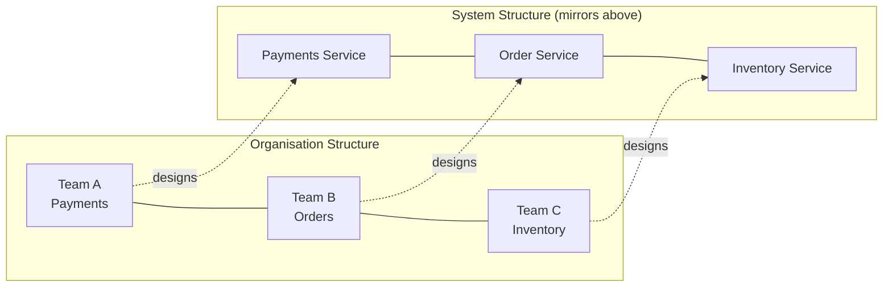
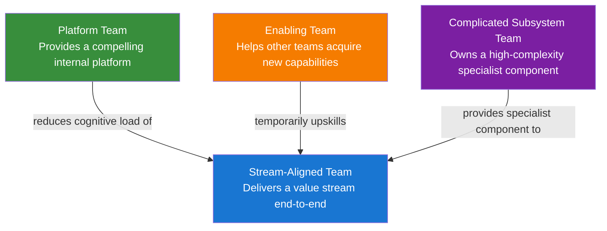
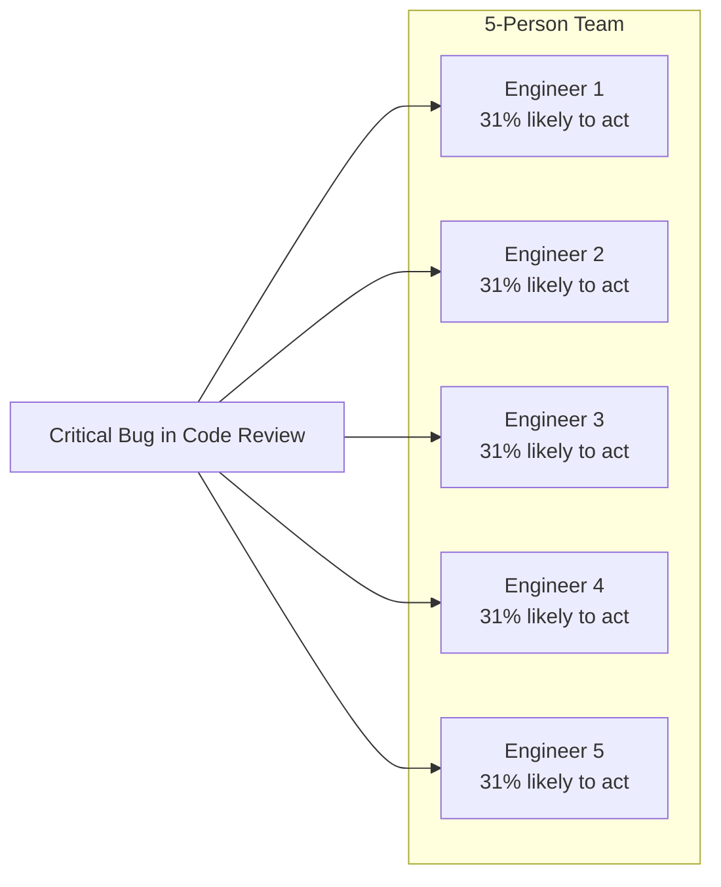

# 04 · Team Effectiveness

> **Level:** Conceptual — Organisational
> **Pre-reading:** [01 · Roles & Responsibilities](01-roles-responsibilities.md) · [03 · Architect Thinking](03-architect-thinking.md)

Architecture is a **sociotechnical** discipline. The structure of a system and the structure of the teams that build it are inseparable. Principal Engineers and Architects who ignore organisational design produce architectures that don't get built — or get built incorrectly.

---

## Conway's Law — The Foundational Principle

> *"Any organisation that designs a system (defined broadly) will produce a design whose structure is a copy of the organisation's communication structure."*
> — Melvin Conway, 1967

### What this actually means

The communication pathways between people determine the interfaces between software components. If Team A and Team B rarely communicate, the boundary between their services will be poorly defined and prone to coupling accidents.

### The Inverse Conway Manoeuvre

**If you want a particular system structure, design the organisation for it.** This is the Inverse Conway Manoeuvre — deliberately structure teams to produce the architecture you want.

| Target Architecture | Required Team Structure |
|:---|:---|
| Microservices with independent deployment | Small, autonomous, product-aligned teams |
| Shared platform with standard interfaces | Platform team + consumer product teams |
| Modular monolith | Disciplined team with strong internal boundaries |
| Event-driven, loosely coupled | Teams aligned to domains, minimal shared ownership |

!!! warning "The Conway trap"
    If you redesign the architecture without redesigning the organisation, the organisation will fight back and rebuild what it knows. You cannot sustainably change the system without changing the team structure.

---

## Cognitive Load and Team Design

**Cognitive load** is the total amount of mental effort required to work with and understand a system. It is the central concept in **Team Topologies** (Skelton & Pais, 2019).

### Three Types of Cognitive Load

| Type | Description | Goal |
|:---|:---|:---|
| **Intrinsic** | The complexity of the problem itself | Minimise by skill development |
| **Extraneous** | Accidental complexity — how the work is done | Eliminate entirely |
| **Germane** | Learning that builds lasting capability | Optimise — this is the good kind |

An effective principal engineer continuously identifies **extraneous cognitive load** and removes it: through better tooling, internal platforms, clearer documentation, and reduced inter-team dependencies.

---

## Team Topologies — The Framework

Team Topologies defines four fundamental team types and three interaction modes.

### Four Team Types

| Team Type | Purpose | Example |
|:---|:---|:---|
| **Stream-Aligned** | Deliver end-to-end customer value in a given domain | "Orders team", "Payments team" |
| **Platform** | Provide self-service internal capabilities | "Developer Platform team" (CI/CD, infra, observability) |
| **Enabling** | Temporarily help stream-aligned teams adopt new capabilities | "Security enablement team" |
| **Complicated Subsystem** | Own a highly specialist, complex component | "ML model serving team", "Real-time recommendations engine" |

### Three Interaction Modes

| Mode | Description | Duration | Example |
|:---|:---|:---|:---|
| **Collaboration** | Two teams work closely together | Temporary | New service co-built by Platform + Stream-aligned |
| **X-as-a-Service** | One team consumes another's well-defined API | Long-term | Stream-aligned team uses Platform team's CI/CD |
| **Facilitating** | One team helps another grow capability | Temporary | Enabling team runs a security workshop |

!!! note "The Platform Team is not a shared service team"
    A **shared service team** blocks others by requiring requests and tickets. A **Platform team** provides a self-service product that other teams consume without waiting. The difference is in the interaction model, not the technology.

---

## Psychological Safety — The Foundation of Effective Teams

Google's **Project Aristotle** (2015) studied 180 teams over 2 years and found that **psychological safety** was the single most important predictor of team effectiveness — more than individual talent, team composition, or management quality.

### What Psychological Safety Is

> *"A shared belief held by members of a team that the team is safe for interpersonal risk-taking."*
> — Amy Edmondson, Harvard Business School

Psychological safety means team members believe they will **not be punished or humiliated** for speaking up with ideas, questions, concerns, or mistakes.

### The Five Dynamics (Project Aristotle)

| Rank | Dynamic | Description |
|:---|:---|:---|
| **1** | **Psychological Safety** | Can I take a risk without being punished? |
| **2** | **Dependability** | Can I count on my teammates to deliver? |
| **3** | **Structure & Clarity** | Do I know what is expected of me? |
| **4** | **Meaning of Work** | Am I doing something that matters to me personally? |
| **5** | **Impact of Work** | Does my work contribute to something meaningful? |

### How a Principal Engineer Creates Psychological Safety

- **Model vulnerability**: openly admit uncertainty and mistakes in technical discussions
- **Reward challenge**: visibly thank people who challenge your technical proposals
- **Separate ideas from identity**: critique the design, never the designer
- **Run blameless post-mortems**: the system failed; let's understand why, not who
- **Create a "yes, and…" review culture**: build on ideas before critiquing them

---

## Diffusion of Responsibility

**Diffusion of Responsibility** (also called the **Bystander Effect** in psychology) is the social phenomenon where individuals feel less personal responsibility for acting when others are present.

### Origin: The Latané & Darley Experiment (1968)

Bibb Latané and John Darley discovered that as group size increases, individual responsibility for action decreases. In an emergency, a single bystander intervenes 85% of the time. With 5 bystanders, each individual's intervention probability drops to 31%.

### How Diffusion of Responsibility Manifests in Software Teams

| Pattern | How it shows up |
|:---|:---|
| **Code review rubber-stamping** | "Someone else will catch it" — everyone approves without reading |
| **Monitoring alert fatigue** | "Someone else must be handling that alert" — alerts go unacknowledged |
| **Shared ownership = no ownership** | Components owned by "the team" get no maintainer, accumulate debt |
| **Architecture vacuum** | "Someone on the architecture team will think about that" — no one does |
| **Security debt** | "Security will review it" — security has 50 PRs per day |

### Countermeasures for Principal Engineers

| Countermeasure | Mechanism |
|:---|:---|
| **Named ownership** | Every service, component, and ADR has a named owner — not a team |
| **On-call rotation with personal accountability** | One named engineer is responsible for the system's health in a given window |
| **Designated reviewer** | Code reviews assigned to specific engineers, not "team" |
| **Explicit RACI on architectural decisions** | R (Responsible), A (Accountable), C (Consulted), I (Informed) — no ambiguity |
| **SLO ownership** | Each service's SLO is owned by a named engineer, not a team |
| **Blameless post-mortems with named action items** | Every action item has one owner and a deadline |

!!! warning "The "Collective Code Ownership" trap"
    Extreme Programming (XP) advocates collective code ownership — everyone owns everything and can change anything. This is powerful for a small, co-located, highly disciplined XP team. It is **catastrophic** at scale in a large organisation where it becomes a rationalisation for nobody owning anything.

→ **[Deep Dive: Diffusion of Responsibility](04.01-diffusion-responsibility.md)**
→ **[Deep Dive: Team Topologies](04.02-team-topologies.md)**

---

## The DORA Metrics — Measuring Team Effectiveness

The **DevOps Research and Assessment (DORA)** metrics are the industry-standard measures of software delivery performance.

| Metric | What it measures | Elite performers |
|:---|:---|:---|
| **Deployment Frequency** | How often code is deployed to production | Multiple times per day |
| **Lead Time for Changes** | Time from code commit to production | Less than 1 hour |
| **Change Failure Rate** | % of deployments causing incidents | 0–15% |
| **Time to Restore Service** | Time to recover from a production failure | Less than 1 hour |

!!! note "Why DORA matters for Principal Engineers"
    Principal Engineers are expected to move the needle on DORA metrics for their engineering organisation — not by working harder themselves, but by reducing systemic impediments (slow CI, cumbersome review processes, missing feature flags, poor observability) that affect all teams.

---

## Making Effective Engineering Teams — Checklist

A Principal Engineer evaluating or building a team should check:

### Team Structure
- [ ] Team is sized by the **2-pizza rule** (6–8 engineers max for stream-aligned work)
- [ ] Team is **cross-functional**: can deliver end-to-end without external dependencies for routine work
- [ ] Cognitive load of the domain is appropriate for the team size
- [ ] Team has a **named technical lead** (not just a manager) responsible for architectural decisions

### Definition of Done & Quality
- [ ] **Definition of Done** is explicit and agreed — not just "PR merged"
- [ ] **Code review standards** are written and enforced, not just assumed
- [ ] **SLOs are defined** and the team receives alerts when they are breached
- [ ] **Runbooks** exist for every significant failure mode

### Communication & Collaboration
- [ ] Team has a regular **architecture/design session** (not just sprint planning)
- [ ] **ADRs are written** for significant decisions and accessible to all
- [ ] Cross-team **interfaces are documented** (API contracts, event schemas)
- [ ] Post-mortems are **blameless** and action items are tracked

### Growth & Learning
- [ ] Engineers have **20% time** (or equivalent) for learning and platform improvements
- [ ] **Technical debt is tracked** visibly — not buried in backlogs
- [ ] Career ladders are **explicit** about what Principal-level contribution looks like
