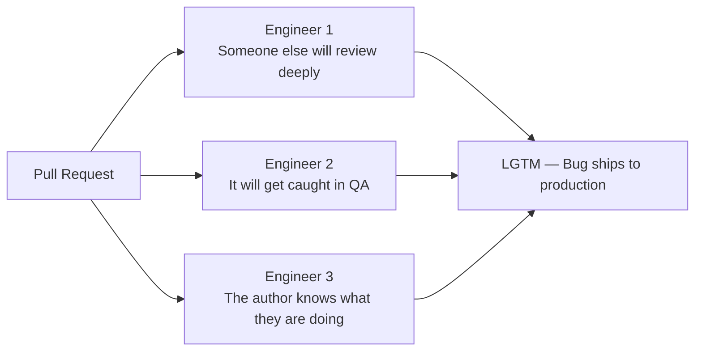
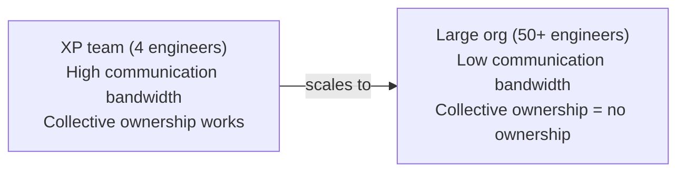

# 04.01 · Diffusion of Responsibility Deep Dive

> **Level:** Conceptual — Behavioural
> **Pre-reading:** [04 · Team Effectiveness](04-team-effectiveness.md)

**Diffusion of Responsibility** is one of the most damaging and least discussed forces in software engineering organisations. Understanding it — and actively countering it — is a mark of principal-level thinking.

---

## The Psychology

The phenomenon was identified by **Bibb Latané and John Darley** following the 1964 murder of Kitty Genovese in New York, where 38 witnesses reportedly failed to call police.

Their experimental findings:

| Group size | Probability of an individual intervening |
|:---|:---|
| 1 person (alone) | **85%** |
| 2 people | 62% |
| 5 people | **31%** |

**The core mechanism:** As group size increases, each individual's felt sense of personal responsibility decreases. "Someone else will handle it."

!!! note "This is not about bad people"
    Diffusion of responsibility is not a character flaw — it is a universal cognitive phenomenon. Humans are wired to distribute responsibility in groups. The solution is not to find "more responsible people" — it is to **design systems and structures that counter the effect**.

---

## How It Manifests in Software Teams

### Code Reviews



**Symptom:** Large PRs with 3 approvals in 10 minutes, no comments.
**Root cause:** When everyone reviews, nobody reviews.

### On-Call and Incident Response

| Scenario | What happens |
|:---|:---|
| Alert fires at 3 AM — the whole team is in the on-call rotation | Each person assumes another is handling it |
| Slack message: "Is anyone seeing issues with payments?" | 12 people read it; nobody responds for 20 minutes |
| Post-mortem action item: "The team will improve monitoring" | Six weeks later, nothing has changed |

### Shared Ownership

> "The payments service is owned by the Platform team."

When a service is owned by a team of 8, it is effectively owned by nobody. No single person feels accountable for its SLO, its technical debt, or its on-call runbooks.

### Architecture and Technical Direction

| Pattern | Diffusion manifestation |
|:---|:---|
| "The architecture guild will review this RFC" | 12 people on the mailing list; 2 read it |
| "We should all take ownership of security" | No specific engineer integrates security tooling |
| "The team should decide on the database choice" | Decision deferred indefinitely |

---

## Countermeasures

### 1. Named Ownership — The Single Throat to Choke

Every service, component, ADR, runbook, and SLO must have **one named owner** — not a team.

| Artifact | Named owner |
|:---|:---|
| Payments service | **Alice** (backed up by Bob for on-call) |
| ADR-012: Database selection | **Alice** (author, accountable for outcome) |
| Payments SLO (99.95% p99 < 200ms) | **Alice** (notified when breached) |
| Payments runbook: card processor timeout | **Alice** (updates it after incidents) |

!!! tip "Named ownership is not blame"
    Named ownership means: "If something is wrong, Alice is the first person we talk to — to understand, fix, or escalate." It does not mean "Alice is personally blamed when the system fails." Blamelessness and named ownership coexist.

### 2. Designated Reviewer — Not "The Team"

Never assign a code review to "the team". Always assign to a specific named engineer.

| Practice | Mechanism |
|:---|:---|
| **CODEOWNERS file** | GitHub/GitLab automatically assigns reviewers based on changed files |
| **Round-robin rotation** | Review assignments cycle through the team — no optionality |
| **Pair review for critical paths** | Two named reviewers required for payments, auth, data migrations |

### 3. RACI for Architecture Decisions

For every significant decision, explicitly define:

| Role | Meaning | Applied to architecture |
|:---|:---|:---|
| **Responsible** | Does the work | The architect or tech lead who writes the ADR |
| **Accountable** | Owns the outcome | The principal engineer or VP Eng who signs off |
| **Consulted** | Input is required | Domain experts, security, affected teams |
| **Informed** | Notified of decision | All engineering; wider stakeholders |

### 4. SLO Ownership Tied to an Individual

| Without SLO ownership | With SLO ownership |
|:---|:---|
| Alert fires → nobody acknowledges it | Alert fires → Alice's phone rings |
| SLO breach goes unnoticed for a week | Alice gets a daily budget-burn report |
| Post-mortem: "The team will improve" | Post-mortem: Alice owns 3 named action items with deadlines |

### 5. Blameless Post-Mortems with Named Action Items

The post-mortem template must produce **named, deadline-bound action items**:

```markdown
## Action Items

| Action | Owner | Due date |
|:---|:---|:---|
| Add circuit breaker to payment processor calls | **Alice** | 2024-02-15 |
| Add alert for payment processor latency > 500ms | **Bob** | 2024-02-10 |
| Update runbook with new escalation path | **Charlie** | 2024-02-12 |
```

Generic action items like "the team will improve observability" are diffusion of responsibility in writing.

---

## The Collective Code Ownership Tension

**Extreme Programming (XP)** advocates **Collective Code Ownership** — any engineer can change any part of the codebase at any time. This is powerful for a small, co-located, highly disciplined XP team operating at high communication bandwidth.

At scale, it becomes a rationalisation for nobody owning anything.



The solution is not to eliminate collective ownership entirely — it is to **layer named accountability on top of collective access**:

- Anyone **can** change any service
- One named engineer **is accountable** for each service's health

---

## Interview Application

When asked about engineering culture or team health, demonstrating awareness of diffusion of responsibility signals principal-level thinking:

> "One of the patterns I actively watch for is diffusion of responsibility — the tendency for collective ownership to become no ownership. In my experience, the most effective countermeasure is named ownership: every service, SLO, and ADR has one accountable person, even if the whole team contributes. I've used CODEOWNERS files, explicit RACI on architectural decisions, and single-owner on-call rotations to make this concrete."

