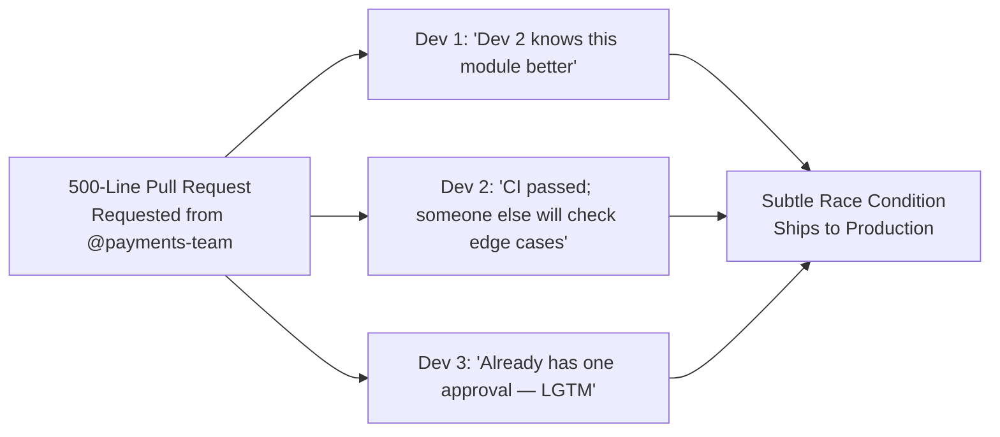

---
tags:
  - Team Effectiveness
  - Ownership
  - Incident Response
---

# 04.01 · Diffusion of Responsibility Deep Dive

> **Level:** Conceptual — Behavioural · **Reading Time:** ~8 mins · **Track:** Org & Leadership
> **Prerequisites:** [04 · Team Effectiveness](04-team-effectiveness.md)

**Diffusion of responsibility** is a useful lens for understanding why ambiguous group ownership can delay action. In engineering organizations, the answer is not to abandon collective stewardship; it is to make coordination, escalation, and decision accountability explicit.

!!! abstract "TL;DR — The 30-Second Mental Model"
    - **Ambiguity Delays Action:** A review or alert assigned to an unspecified group makes the next action and escalation path unclear.
    - **System Design Matters:** Alert routing, ownership metadata, review assignment, and decision rights can either reduce or amplify the problem.
    - **Named Coordination, Shared Stewardship:** Pair an accountable owning team and named coordinator/rotation with backups, psychological safety, and broad contribution rights.

---

## The Psychological Foundation (Latané & Darley, 1968)

In the classic [Darley and Latané experiment](https://doi.org/10.1037/h0025589), participants overheard a simulated seizure and believed either that they were the only witness or that one or four unseen others were present. The presence of other bystanders reduced personal responsibility and slowed reporting.

Do not quote the experiment-specific percentages as universal intervention rates for modern engineering teams. The study used a particular emergency scenario and group design; its defensible application here is to ask how **ambiguity, social cues, and perceived responsibility** affect action.

Three mechanisms to watch for:

1. **Audience Inhibition:** *"What if I ask a naive question on this RFC or escalate a false alarm?"*
2. **Social Influence / Pluralistic Ignorance:** *"Other senior engineers have not commented or acknowledged the alert, so perhaps it is fine."*
3. **Diffused Obligation:** *"Someone on the team alias will pick it up."*

---

## How Diffusion of Responsibility Breaks Engineering Orgs

|| Engineering Domain | Symptom | Structural Failure |
|:---|:---|:---|
|| **Code Reviews** | PRs wait for days or receive instant approvals with no substantive review | Group review request without assigned reviewers, domain routing, or SLA/escalation |
|| **Alerting & On-Call** | Warnings scroll in a channel while production degrades | No actionable page, primary on-call rotation, backup, or escalation timer |
|| **Shared Libraries / Commons** | Shared code accumulates vulnerabilities and incompatible changes | No accountable maintainer team, review bar, release ownership, or support model |
|| **Post-Mortems** | “The team will improve tests” remains unfinished | No DRI, due/review date, resources, or completion evidence |
|| **RFC Governance** | Broad review request stalls without a decision | No named approver, decision deadline, or distinction between input and veto |

---

## Four Structural Countermeasures for Principal Engineers

### 1. Named Service & Artifact Coordination

Every production service, shared library, datastore, and SLO should have an **accountable owning team** and a **named coordinator or rotation**, backed by secondary ownership and documented escalation. Avoid making one person a permanent bus factor.

|| Artifact | Anti-Pattern (Diffused) | Principal Pattern (Clear Coordination) |
|:---|:---|:---|
|| **Service Catalog** | `owner: engineering` | `owning_team: payments`, `service_coordinator: rotation`, `oncall_schedule: payments-primary` |
|| **SLO Burn Alert** | Posts only to `#eng-general` | Pages primary on-call; escalates after a defined interval; owning team reviews error-budget trends |
|| **Post-Mortem Action Item** | *"Checkout team to add a circuit breaker"* | *"Implement and verify the client resilience policy — DRI: `@charlie`; review: `2027-02-15`; evidence: linked test and rollout"* |

!!! tip "Named Coordination ≠ Blame Culture or Solo Ownership"
    The coordinator ensures the next action happens; they are not punished for failures and do not perform all work alone. The owning team retains shared operational responsibility, and the backup path is tested.

### 2. Designated Reviewers with Real Assignment

- Use [GitHub CODEOWNERS](https://docs.github.com/en/repositories/managing-your-repositorys-settings-and-features/customizing-your-repository/about-code-owners) to route relevant paths to individuals or teams and, where required, enforce owner approval.
- `CODEOWNERS` alone does **not** round-robin individual reviewers. Enable GitHub's separate [team code-review auto-assignment](https://docs.github.com/en/organizations/organizing-members-into-teams/managing-code-review-settings-for-your-team) for round-robin or load-balanced routing, or provide the equivalent automation on your platform.
- Keep required high-risk reviews focused on genuine expertise; too many mandatory approvers recreate diffusion and wait time.

### 3. RACI for Cross-Team Architecture Decisions

Include a short responsibility header in consequential RFCs:

|| Role | Definition | Rule |
|:---|:---|:---|
|| **R — Responsible** | People doing the design and implementation work | Usually one or a small named group |
|| **A — Accountable** | The final decision owner after required input | Exactly one accountable role/person, with a delegation path |
|| **C — Consulted** | Domain experts whose input is obtained before the decision | Named and time-boxed; consultation is not automatically a veto |
|| **I — Informed** | People who need the decision, rationale, and migration impact | Async distribution with a durable link |

RACI does not replace an ADR or decision deadline. If every consulted person must approve, you have created a consensus gate rather than a clear RACI.

### 4. Reconcile Collective Code Ownership with Maintainer Stewardship

Extreme Programming's **collective code ownership** encourages anyone on the team to improve any code. At broader organizational scope, unrestricted contribution without maintainer responsibility can degrade interfaces and operational quality—but large size alone does not make collective ownership impossible.

A useful **InnerSource** synthesis is:

- **Universal read and PR access:** Any authorized engineer can propose a fix without waiting for a separate team ticket.
- **Named maintainer stewardship:** Owning teams maintain architectural invariants, review standards, releases, security response, and SLOs.
- **Fast contribution paths:** Contributor docs, automated checks, review-time objectives, and escalation prevent maintainer ownership from becoming a bottleneck.

---

## Active Recall & Self-Check

??? question "Self-Check 1: A post-mortem action item says, 'Engineering teams should be more careful when running database migrations.' How do you improve it?"
    **Answer Rubric:**
    Replace human-vigilance language and unspecified ownership with a systemic control and verification:
    - *"Add a migration safety check to shared CI that flags dangerous lock behavior and requires an explicit reviewed exception — DRI: `@dana`; due: Sprint 42; evidence: blocking test, exception audit, and staged rollout."*
    - Define who maintains the check, how teams request an exception, and how effectiveness is reviewed. Do not claim that a linter alone prevents every unsafe migration.

??? question "Self-Check 2: Why should the Accountable (A) role have one final decision owner?"
    **Answer Rubric:**
    A single accountable owner makes the escalation and final decision path unambiguous. That owner still needs evidence, consultation, and a documented rationale; “one A” is not permission for unilateral or uninformed decisions. Use a named delegate for absence rather than multiple competing approvers.
