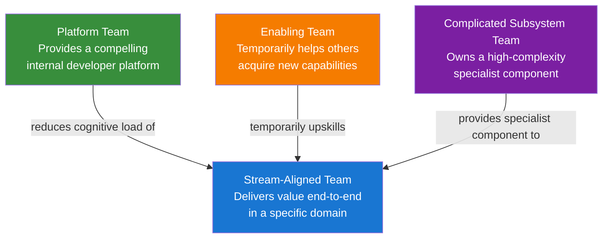
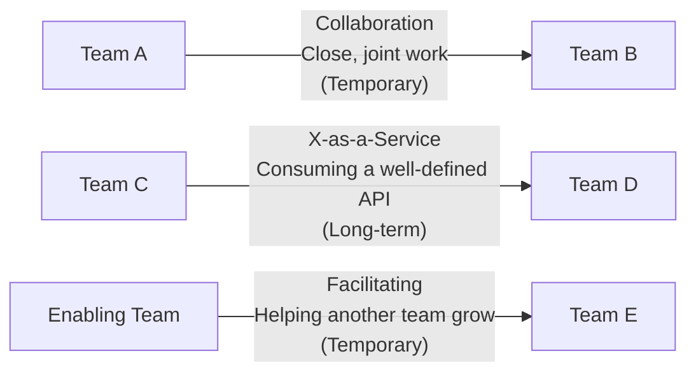
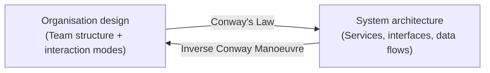

# 04.02 · Team Topologies Deep Dive

> **Level:** Practitioner — Organisational
> **Pre-reading:** [04 · Team Effectiveness](04-team-effectiveness.md)

**Team Topologies** (Matthew Skelton & Manuel Pais, 2019) is the definitive framework for designing software engineering organisations. It gives architects and principal engineers a vocabulary and model for aligning team structure with the architecture they want to produce.

---

## The Core Premise

> *"The goal of any team structure should be to minimise cognitive load on stream-aligned teams while maximising their ability to deliver value independently."*

Team Topologies is built on two foundations:

1. **Conway's Law** — system architecture mirrors team communication structure
2. **Cognitive Load** — teams can only own what they can fit in their heads

If a team's cognitive load exceeds their capacity, delivery slows, quality drops, and burnout follows.

---

## The Four Team Types

---

### Stream-Aligned Team

A stream-aligned team is **the primary delivery unit** in a healthy organisation. It is aligned to a flow of work — a product, a customer journey, or a business capability.

| Attribute | Detail |
|:---|:---|
| **Purpose** | Deliver end-to-end customer value in a defined domain |
| **Ownership** | Full ownership of build, test, deploy, operate for their stream |
| **Size** | 5–9 engineers (Dunbar's inner circle; 2-pizza rule) |
| **Dependencies** | Should be able to deliver without waiting on other stream-aligned teams |
| **Success metric** | Flow of value to the customer; DORA metrics |

**Examples:**
- "Checkout team" — owns the checkout experience end-to-end
- "Payments team" — owns payment capture, processing, and reconciliation
- "Search team" — owns product search and ranking

!!! warning "Stream-aligned ≠ feature team"
    A feature team delivers features. A stream-aligned team delivers and **operates** a continuous stream of value. The difference is operational ownership — stream-aligned teams are on-call for what they build.

---

### Platform Team

A platform team provides a **self-service internal product** that reduces cognitive load for stream-aligned teams.

| Attribute | Detail |
|:---|:---|
| **Purpose** | Abstract away infrastructure, tooling, and operational complexity |
| **Product mindset** | Treats stream-aligned teams as customers; measures developer satisfaction |
| **Interaction mode** | X-as-a-Service — stream-aligned teams consume without waiting on tickets |
| **Success metric** | Reduction in cognitive load for stream-aligned teams; platform adoption rate |

**Examples:**
- **Developer Platform team** — CI/CD pipelines, container orchestration, secrets management
- **Observability team** — centralised logging, tracing, metrics, alerting
- **Data Platform team** — data pipeline tooling, feature store, ML infrastructure

!!! danger "Platform team anti-pattern: the ticket queue"
    A platform team that requires stream-aligned teams to raise tickets and wait for delivery is a **shared services team**, not a platform team. The defining characteristic of a true platform team is **self-service** — teams can provision infrastructure, configure pipelines, and deploy without human intervention from the platform team.

---

### Enabling Team

An enabling team is **temporary** — it exists to help other teams acquire a new capability, then steps back.

| Attribute | Detail |
|:---|:---|
| **Purpose** | Close a skill or capability gap in stream-aligned teams |
| **Duration** | Temporary — weeks to months, not permanent |
| **Mode** | Embedded in the target team, or running workshops/pairing sessions |
| **Success metric** | Stream-aligned teams no longer need them |
| **Anti-pattern** | Becoming a permanent dependency |

**Examples:**
- Security enabling team — embeds with product teams to establish secure coding practices
- SRE enabling team — helps teams instrument services and write runbooks
- Architecture enabling team — helps teams apply patterns like event-driven architecture

!!! tip "Enabling vs. consulting"
    An enabling team **transfers capability** — after they leave, the stream-aligned team can do it themselves. A consulting team delivers an output and leaves the team no more capable than before. Enabling is harder and more valuable.

---

### Complicated Subsystem Team

A complicated subsystem team owns a component that is **too complex** for a stream-aligned team to maintain alongside their regular delivery work.

| Attribute | Detail |
|:---|:---|
| **Purpose** | Own and evolve a high-complexity specialist component |
| **Justification** | Component requires specialist knowledge (e.g., PhD-level mathematics, real-time DSP) |
| **Interaction mode** | Provides a well-defined API or service to stream-aligned teams |
| **Risk** | Can become an ivory tower; must maintain a product mindset toward consumers |

**Examples:**
- Real-time recommendations engine (ML/statistics expertise)
- Video transcoding pipeline (codec and FFmpeg expertise)
- Fraud detection model serving (low-latency inference infrastructure)

---

## The Three Interaction Modes

How teams work together is as important as how they are structured.

| Mode | Duration | Bandwidth | When to use |
|:---|:---|:---|:---|
| **Collaboration** | Temporary (weeks–months) | High — daily interaction | Discovering new patterns; building a novel capability together |
| **X-as-a-Service** | Long-term | Low — API-mediated | Stable capability with clear interface; scale without coupling |
| **Facilitating** | Temporary | Medium — coaching sessions | Capability transfer; enabling a team to become self-sufficient |

!!! note "Interaction modes change over time"
    A healthy organisation evolves interaction modes. Platform + Stream-aligned teams might start in **Collaboration** mode while the platform is nascent, then transition to **X-as-a-Service** once the platform is stable. Staying in Collaboration mode permanently is a sign of unclear interfaces.

---

## Cognitive Load and Team Sizing

Team Topologies uses **cognitive load** as the primary sizing constraint for teams and their domain ownership.

### Three Types of Cognitive Load

| Type | Description | Goal |
|:---|:---|:---|
| **Intrinsic** | Inherent complexity of the domain | Minimise through expertise development |
| **Extraneous** | Accidental complexity — tools, processes, dependencies | **Eliminate entirely** |
| **Germane** | Learning that builds lasting capability | **Optimise** — this is the productive kind |

### Cognitive Load Symptoms

| Symptom | Likely cause |
|:---|:---|
| Team misses sprint commitments regularly | Domain too large for team size |
| Engineers say they don't understand how their service works end-to-end | Domain too broad |
| Long on-call runbooks that nobody maintains | Extraneous cognitive load from operational complexity |
| Engineers resistant to taking on new services | Already at cognitive capacity |

**Rule of thumb:** If a team cannot describe their entire domain in a 30-minute onboarding session, their cognitive load is too high.

---

## Team Topologies and Conway's Law

The framework is explicitly built on the **Inverse Conway Manoeuvre** — design your teams to produce the architecture you want:

| Desired architecture | Required team structure |
|:---|:---|
| Microservices with independent deployments | Small, stream-aligned teams each owning 1–3 services |
| Shared internal platform | Platform team + stream-aligned consumers |
| Event-driven, loosely coupled | Domain-aligned teams; platform team owns event bus |
| Modular monolith | One stream-aligned team with strong internal domain discipline |

---

## Applying Team Topologies as a Principal Engineer

Principal Engineers use Team Topologies to:

1. **Diagnose slow delivery** — Is a team's cognitive load too high? Are they collaborating when they should be consuming an X-as-a-Service?
2. **Propose org changes** — "We need a platform team to own CI/CD, or every product team will keep building their own."
3. **Design the migration path** — "Move from Collaboration to X-as-a-Service as the platform API stabilises."
4. **Resist accidental coupling** — "These two teams are coupling their services because they're collaborating — we need to define the interface contract."

---

## Common Interview Questions

=== "Team Design"
    - "How would you structure the engineering organisation for a new product with 4 teams?"
    - "We have 8 product teams all building their own CI/CD pipelines. What would you do?"
    - "How do you decide when a component is complex enough to warrant its own team?"

=== "Cognitive Load"
    - "How do you know when a team has taken on too much?"
    - "What is the most effective way to reduce cognitive load on a delivery team?"

=== "Conway's Law"
    - "How does Conway's Law affect your architecture decisions?"
    - "Tell me about a time when team structure caused a system design problem — and what you did about it."

!!! tip "Key answer framework"
    When answering Team Topologies questions: name the **problem** (cognitive overload, coupling, missing platform), identify the **team type and interaction mode** needed, describe the **transition path**, and quantify the **expected outcome** (DORA metrics, deployment frequency, incident rate).

