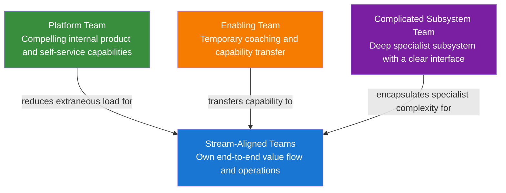
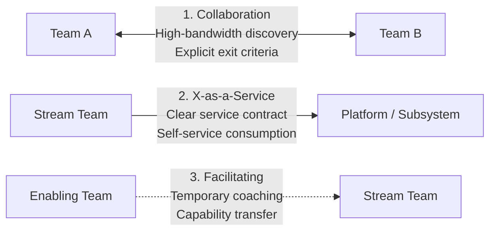

---
tags:
  - Team Topologies
  - Org Design
  - Cognitive Load
---

# 04.02 · Team Topologies Deep Dive

> **Level:** Practitioner — Organisational · **Reading Time:** ~9 mins · **Track:** Org & Leadership
> **Prerequisites:** [04 · Team Effectiveness](04-team-effectiveness.md)

[Team Topologies](https://teamtopologies.com/key-concepts) (Matthew Skelton & Manuel Pais) is a widely used **pattern language for fast flow**, not a universal org-chart recipe. It gives Principal Engineers and Engineering Managers vocabulary for diagnosing dependencies, cognitive load, team boundaries, and interaction modes.

!!! abstract "TL;DR — The 30-Second Mental Model"
    - **4 Fundamental Team Types:** **Stream-Aligned**, **Platform**, **Enabling**, and **Complicated Subsystem**.
    - **3 Interaction Modes:** **Collaboration** for discovery, **X-as-a-Service** for clear service consumption, and **Facilitating** for temporary capability building.
    - **Platforms Are Products:** Start with the **Thinnest Viable Platform** that reduces user friction; measure adoption, reliability, and flow rather than platform feature count.

---

## The Four Fundamental Team Topologies

Most delivery capacity normally sits in stream-aligned teams; the other types help those teams deliver and operate with lower cognitive load. Avoid imposing a fixed percentage or mapping teams by label without examining real work.

---

## Detailed Breakdown of the Four Team Types

=== "1. Stream-Aligned Team"
    Aligned to a flow of customer or business value—a product, journey, domain, or other coherent stream.

    - **Ownership:** Design, build, test, deploy, operate, and improve its services, with explicit support and escalation.
    - **Sizing:** Small enough for shared context and effective communication; use observed cognitive load rather than a universal headcount rule.
    - **Design Goal:** Minimal blocking handoffs for routine value delivery.
    - **Anti-Pattern:** A feature factory that throws code to separate QA, operations, or release teams and owns no production outcome.

=== "2. Platform Team"
    Builds and operates a compelling internal product that accelerates stream-aligned teams. A platform may itself contain multiple team types.

    - **Ownership:** Reliable self-service capabilities such as delivery workflows, compute, secrets, observability, and data provisioning.
    - **Thinnest Viable Platform:** Start with the smallest thing that solves user friction—even a curated standard or documented service catalog may be enough before building a large IDP.
    - **Product Signals:** Voluntary adoption, time to first safe deploy, task success, support burden, reliability, unit cost, and perceptual DevEx—not NPS alone.
    - **Anti-Pattern:** A manual shared-services queue rebranded as a platform, or a large platform built without validated internal user needs.

=== "3. Enabling Team"
    Helps stream-aligned teams overcome obstacles and acquire missing capabilities, then moves on.

    - **Ownership:** Capability transfer in areas such as OpenTelemetry, contract testing, threat modelling, accessibility, or AI evaluation.
    - **Engagement Horizon:** Defined by explicit independence/exit criteria rather than a universal number of weeks.
    - **Success Metric:** The receiving team can perform the capability sustainably without the enabling team.
    - **Anti-Pattern:** Permanently implementing or operating the stream team's services.

=== "4. Complicated Subsystem Team"
    Owns a subsystem whose specialist mathematics, algorithms, or technical depth would create excessive cognitive load for stream-aligned teams.

    - **Justification Bar:** Demonstrate genuine specialist complexity and a clean consumable interface; ordinary legacy CRUD complexity does not qualify.
    - **Examples:** Real-time media codecs, specialized pricing engines, cryptographic infrastructure, or foundational model training.
    - **Anti-Pattern:** Recreating a component silo for ordinary code and forcing every consumer through synchronous coordination.

---

## The Three Team Interaction Modes

Team interaction modes should be explicit and revisited as boundaries mature:

|| Interaction Mode | Coordination Profile | Expected Evolution | Danger Signal |
|:---|:---|:---|:---|
|| **Collaboration** | High-bandwidth joint discovery; valuable but expensive | End when the API, boundary, or capability is understood and exit criteria are met | Permanent collaboration hides unresolved ownership or a poor boundary |
|| **X-as-a-Service** | Lower coordination through documented APIs, support, SLOs, and predictable changes | Mature consumption with measured reliability and low user friction | Consumers still need routine tickets or absorb undocumented breaking changes |
|| **Facilitating** | Temporary coaching, workshops, pairing, and feedback | End when the receiving team demonstrates independence | Enabling team becomes the permanent owner of production work |

“X-as-a-Service” does not mean zero communication. Providers still need user research, support, deprecation policy, incident response, and contract evolution.

---

## Evolution of Team Topologies Over Time

A Principal Engineer uses interaction modes dynamically:

1. **Discovery — Collaboration:** Platform engineers work with a representative stream team to solve a real delivery problem and discover the smallest useful interface.
2. **Stabilization — Move Toward X-as-a-Service:** Harden the workflow, docs, SLOs, security controls, migration path, and support model into a reliable paved road.
3. **Scale — X-as-a-Service + Facilitating:** Other teams self-serve; an enabling team briefly helps with capability gaps while adoption and operational evidence guide product improvements.
4. **Reassess:** Reopen short collaboration when assumptions change, rather than treating the initial team boundary as permanent.

### Primary Team Topologies References

- [Team Topologies — key concepts](https://teamtopologies.com/key-concepts)
- [Team Topologies — core team types](https://teamtopologies.com/key-concepts-content/what-are-the-core-team-types-in-team-topologies)
- [Team Topologies — Thinnest Viable Platform](https://teamtopologies.com/key-concepts-content/what-is-a-thinnest-viable-platform-tvp)

---

## Active Recall & Self-Check

??? question "Self-Check 1: Eight product teams maintain separate CI/Terraform setups. How do you charter a platform team without creating a ticket queue?"
    **Answer Rubric:**
    1. **Start with user pain and collaboration:** Build the first paved road with one representative team; do not standardize eight workflows by committee before understanding them.
    2. **Make routine fulfillment self-service:** Provide tested modules, templates, documentation, policy checks, and observable operations. Keep an expert support path for exceptions and incidents.
    3. **Treat the platform as a product:** Measure task completion, adoption, support burden, reliability, unit cost, and change lead time; deprecate unused capabilities.
    4. **Separate guardrails from preference:** Teams may deviate for documented needs, but security, privacy, and regulatory controls remain explicit and enforceable. “Opt-in” is not a valid model for mandatory controls.

??? question "Self-Check 2: How do you diagnose excessive cognitive load, and which three levers can reduce it?"
    **Answer Rubric:**
    - **Diagnose with evidence:** Onboarding friction, excessive context switching, unclear ownership, high unplanned work, operational anxiety, and repeated mistakes across too many domains.
    - **Reduce extraneous load:** Move undifferentiated infrastructure/workflow friction into a reliable platform or automation.
    - **Repartition germane load:** Split an overly broad business stream along a coherent domain and ownership boundary; do not split merely to hit a team-size target.
    - **Build missing capability:** Use an enabling team or focused coaching when unfamiliar technology or practices create intrinsic load; define independence as the exit criterion.
