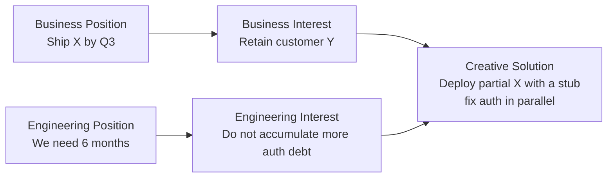
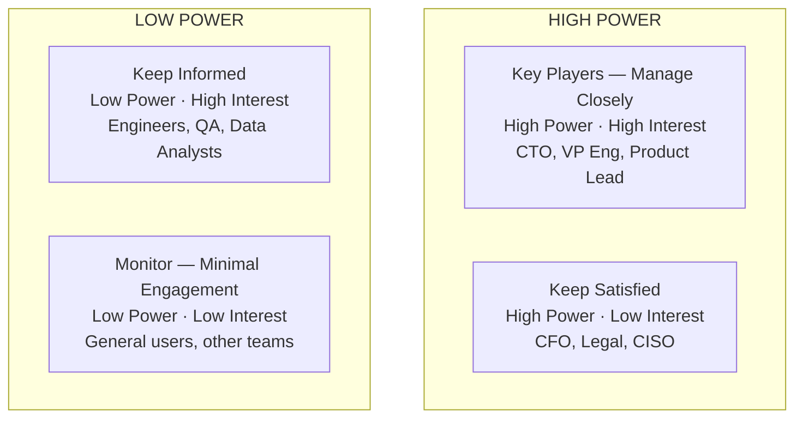

# 05 · Negotiation & Stakeholder Management

> **Level:** Conceptual — Strategic
> **Pre-reading:** [01 · Roles & Responsibilities](01-roles-responsibilities.md) · [04 · Team Effectiveness](04-team-effectiveness.md)

A principal engineer who cannot negotiate effectively with business stakeholders is a *technical expert in a bubble*. The ability to translate technical concerns into business language, hold ground on important constraints, and find creative trade-off solutions is what separates senior engineers from principal engineers.

---

## The Fundamental Communication Challenge

Business and engineering think in fundamentally different mental models:

| Business stakeholder | Engineering |
|:---|:---|
| Outcomes, revenue, customers | Correctness, reliability, maintainability |
| Speed to market | Stability and quality |
| "Just add a feature" | "Every feature increases complexity" |
| "Our competitor has this" | "We need to understand the scope before committing" |
| Cost centre mindset | Investment mindset for platforms and tooling |
| Now — quarterly milestones | Later — compounding technical interest |

!!! note "The principal engineer's translation role"
    You are not just an engineer who talks to business. You are a **translator between two different epistemologies** — you must be fluent in both, and you must help each side understand the legitimate concerns of the other.

---

## The Architecture of Business Negotiation

Technical decisions are always also business decisions. Understanding negotiation theory is not optional for a principal engineer.

### Principled Negotiation (Fisher & Ury — *Getting to Yes*)

The canonical negotiation framework with four principles:

#### 1. Separate the People from the Problem
Do not let the relationship with a stakeholder become entangled with the technical disagreement. A business leader pushing for a shortcut is not your enemy — they have a legitimate business concern. Attack the problem together; do not attack each other.

#### 2. Focus on Interests, Not Positions
A **position** is what someone says they want: "Ship this feature by Q3."
An **interest** is why they want it: "We need to retain this customer who is threatening to churn."

If you argue positions, you deadlock. If you explore interests, you find creative solutions:
- Maybe a *partial* feature satisfies the customer retention need
- Maybe a configuration flag deployed in 2 weeks serves the immediate need while the full feature follows in Q4
- Maybe the customer concern is actually about something else entirely



#### 3. Invent Options for Mutual Gain
Never arrive at a negotiation with a single option. Always bring a **menu**:

| Option | Business value delivered | Technical risk incurred |
|:---|:---|:---|
| Full feature, Q3 | High | High — requires cutting corners on auth |
| Partial feature, Q3 + full, Q4 | Medium-high | Medium |
| Full feature, Q4 (done right) | High (delayed) | Low |
| No-build: configure existing system | Low | None |

#### 4. Insist on Objective Criteria
When agreement is hard, move to objective criteria:
- "Our SLO commitment requires 99.9% availability. The proposed shortcut reduces it to 99.5%. That means we're contractually obligated to SLA penalties."
- "Our security policy — agreed at exec level — requires encryption at rest. We cannot waive this for this feature."

Objective criteria remove the argument from personalities and put it into the domain of shared commitments.

---

## Stakeholder Mapping

Before any significant architectural decision or negotiation, map your stakeholders:



| Quadrant | Strategy |
|:---|:---|
| **High power, high interest** | Collaborate deeply; get them early; handle their concerns personally |
| **High power, low interest** | Keep satisfied with executive summaries; never surprise them |
| **Low power, high interest** | Keep informed; they amplify your message to key players |
| **Low power, low interest** | Monitor; minimal investment |

---

## The Business Case for Technical Investment

One of the most important skills of a principal engineer is **quantifying technical debt and making the business case for engineering investment**.

### The Technical Debt Model

Technical debt behaves like financial debt:
- **Principal**: the cost to fix the issue properly
- **Interest**: the ongoing drag on velocity caused by the issue existing

$$\text{Technical Debt Cost} = \text{Probability of Fix Needed} \times \text{Cost of Fix} + \text{Interest Rate} \times \text{Time Carried}$$

### Framing Technical Work for Business Stakeholders

Never say: *"We need to refactor the auth module."*

Instead say:
- *"Our auth module is causing 3 engineer-days per sprint of unplanned work. Over a year that is 78 engineer-days — roughly $X in lost velocity. A 3-sprint investment now eliminates this permanently."*
- *"Our current database schema cannot support multi-tenancy. If we win enterprise deal Y (which requires multi-tenancy), we cannot deliver it without this change. The deal is worth $Z. The investment is $W."*

| Technical request | Business translation |
|:---|:---|
| Refactor the authentication module | Reduce unplanned work, eliminate recurring security audit findings |
| Implement observability stack | Reduce MTTR from hours to minutes — fewer SLA penalties |
| Migrate to Kubernetes | Reduce infrastructure cost by X%; enable 10x scale with no re-architecture |
| Decommission legacy system | Eliminate $Y/month maintenance cost; reduce onboarding time from 2 weeks to 2 days |
| Write architecture documentation | Reduce senior engineer bus factor from 2 to 8; cut onboarding time |

---

## The Developer's Dilemma vs. The Architect's Dilemma

Developers and architects face structurally different dilemmas in business negotiation:

### The Developer's Dilemma
Developers are measured on **feature delivery velocity**. Every engineering investment that does not directly ship a user-facing feature is invisible to their performance metric. This creates pressure to accumulate technical debt — because the reward system does not penalise it until the debt is catastrophic.

### The Architect's Dilemma
Architects are measured on **system longevity and reliability**. They must advocate for investment the business cannot immediately see the value of. This is the central tension:

> *"If the architecture is great, nothing ever goes wrong — which looks like the architecture wasn't needed. If the architecture is bad, everything goes wrong — which looks like engineering is incompetent."*

### The resolution
Frame architectural quality in leading indicators, not lagging ones:

| Lagging indicator (after disaster) | Leading indicator (before disaster) |
|:---|:---|
| Production outage caused by poor design | Change failure rate trending upward |
| Customer data breach | Security test coverage dropping below threshold |
| Feature delivery grinding to halt | Lead time for change growing quarter over quarter |
| Key engineer departure causes system mystery | Bus factor below 3 for critical systems |

---

## Saying No — The Most Underrated Skill

Principal engineers must be able to say **no** — or **not yet, and here is why** — to business, to product, and to other engineers, without destroying relationships.

### The Three-Part Refusal Framework

1. **Acknowledge the legitimate intent** — "I understand the customer urgency here, and I want to find a way to serve this need."
2. **State the constraint clearly with evidence** — "This specific approach would require bypassing our authentication flow. Our security audit two months ago flagged this exact pattern as a high-risk vulnerability. We cannot deploy it."
3. **Offer an alternative or a path** — "Here's what I think we *can* do: [alternative]. It achieves [X% of the intent] by [date]. Would that work?"

!!! tip "The 'Yes, and' technique from improv"
    When possible, reframe "no" as "yes, and". Instead of "No, we can't do that", try "Yes, we can get to that outcome, and here is the path that doesn't compromise security: ..."

---

## Managing Up — Communicating Technical Risk to Executives

| Situation | Wrong approach | Right approach |
|:---|:---|:---|
| Complex technical risk | Detailed technical explanation | One-page risk summary with business impact and options |
| System outage | Technical post-mortem in all-hands | "We had an incident, here's what customers experienced, here's what we've done, here is our prevention plan" |
| Asking for engineering investment | "We need 2 sprints for refactoring" | "This investment reduces time-to-market by ~20% for the next 3 quarters, and eliminates our top security risk" |
| Architecture decision | "We chose microservices because..." | "We chose approach X because it allows us to [business outcome]; the trade-off was [Y]; we mitigated it by [Z]" |

---

## RFC Culture — The Architecture of Written Negotiation

An **RFC (Request for Comments)** is a written proposal for a significant technical decision that is distributed for peer review before being adopted. It is a **structured form of asynchronous negotiation**.

### Why RFCs matter
- Create a written record of reasoning and alternatives considered
- Allow all affected parties to critique before commitment
- Force precision in thinking — vague ideas cannot survive a well-written RFC
- Build organisational alignment without requiring synchronous meeting time

### RFC Structure

```markdown
# RFC-{number}: {Title}

## Summary
One paragraph: what are we proposing and why?

## Motivation
What problem does this solve? What happens if we do nothing?

## Detailed Design
Technical specification of the proposed solution.

## Drawbacks
What are the downsides? Why might we *not* do this?

## Alternatives
What other approaches were considered? Why were they rejected?

## Unresolved Questions
What do we still need to decide or learn?

## Implementation Plan
Phases, milestones, rollout strategy.
```

!!! note "RFC ≠ Permission"
    An RFC is not a bureaucratic approval process. It is a tool for building distributed understanding and catching problems early. Great engineering organisations treat RFCs as a gift to the organisation, not a gatekeeping mechanism.
