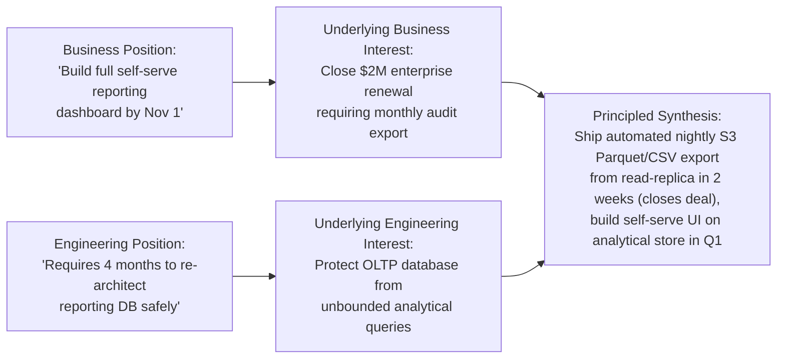
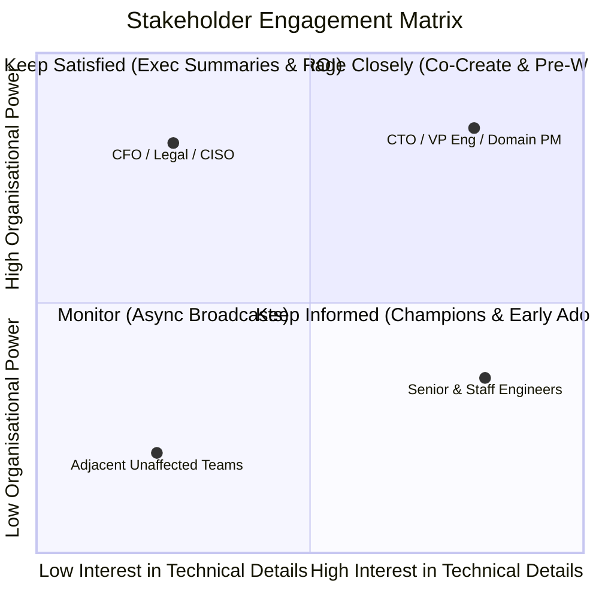

---
tags:
  - Negotiation
  - Stakeholder Management
  - Technical Debt
---

# 05 · Negotiation & Stakeholder Management

> **Level:** Conceptual — Strategic · **Reading Time:** ~9 mins · **Track:** Org & Leadership
> **Prerequisites:** [01 · Roles & Responsibilities](01-roles-responsibilities.md) · [04 · Team Effectiveness](04-team-effectiveness.md)

A Principal Engineer who cannot negotiate effectively with Product, Executive, and Security stakeholders is a *technical expert in a bubble*. At L7+, your impact depends on translating deep technical realities into **business risk, revenue velocity, and unit economics (FinOps)** — holding firm on non-negotiable invariants while finding creative paths to say *"Yes, and here is how we do it safely."*

!!! abstract "TL;DR — The 30-Second Mental Model"
    - **Interests > Positions (Fisher & Ury):** Never argue over *positions* (*"Ship by Q3"* vs. *"We need 6 months"*). Uncover the underlying *interests* (*"Retain enterprise customer Y"* vs. *"Prevent unauthenticated tenant data leakage"*).
    - **Always Bring a 3-Option Menu:** Never walk into an executive trade-off discussion with a binary ultimatum. Present 3 viable options with explicit **Business Value vs. Technical/Operational Risk** profiles.
    - **Translate Tech Debt into Dollars & Velocity:** Executives don't buy "clean code" — they buy **reduced Change Failure Rate, faster Time-to-Market, lower cloud COGS, and unblocked enterprise deals**.

---

## Bridging the Two Epistemologies: Business vs. Engineering

Product/Executive leaders and Engineers optimize for different variables unless a Principal Engineer acts as the **bilingual translator**:

| Dimension | Business / Product Mental Model | Engineering Mental Model | Principal Engineer Translation Bridge |
|:---|:---|:---|:---|
| **Primary Currency** | Revenue, customer retention, market window, gross margin | Correctness, maintainability, low coupling, operational sanity | **Risk-adjusted velocity & Cost of Delay** |
| **View of Architecture** | Invisible overhead until something breaks | Foundational prerequisite for sustainable speed | **Leading indicators** (Lead Time, Error Budget, Bus Factor) |
| **Time Horizon** | Current quarter / annual ARR targets | 1–5 year compounding system complexity | **Phased delivery** (Tactical wedge in Q3 + architectural foundation in Q4) |

---

## Principled Negotiation Framework (Fisher & Ury — *Getting to Yes*)

Apply the four rules of Harvard's Principled Negotiation to every architectural or roadmap conflict:

### 1. Separate the People from the Problem
A VP of Product pushing for an aggressive deadline is not attacking engineering quality — they are responding to board or market incentives. Attack the constraint together on the same side of the whiteboard.

### 2. Focus on Interests, Not Positions
- **Position:** What someone demands (*"We must add custom multi-tenant SQL reporting by November 1st"*).
- **Interest:** Why they want it (*"Our largest enterprise prospect won't sign their $2M renewal unless their compliance officer can export monthly audit logs"*).



### 3. Invent Options for Mutual Gain (The 3-Option Menu)
Never bring a single proposal or a flat *"No"*. Present a **calibrated 3-option menu** so stakeholders choose the risk/value point openly:

| Option | Delivery Timeline | Business Outcome | Technical & Operational Risk |
|:---|:---|:---|:---|
| **Option A: Tactical Wedge (Recommended)** | 2 weeks | Unblocks enterprise renewal via automated signed S3 audit export | **Bounded** — isolated analytical export with measured source/replication impact, access controls, and monitoring |
| **Option B: Full Architectural Target** | 12 weeks | Full self-serve real-time analytics UI for all tenants | **Low technical risk**, but **high business risk** (misses Nov 1 renewal window) |
| **Option C: Rush Full UI on Primary OLTP DB** | 4 weeks | Full UI by Nov 1 | **Unacceptable (Red)** — risks noisy-neighbor OLTP outage breaching 99.95% SLO for all customers |

### 4. Insist on Objective Criteria
Replace opinion battles with objective, agreed-upon baselines:
- **SLO / Error Budget Policy:** *"Our customer contracts carry financial SLA penalties below `99.9%`. Our load test shows Option C drops availability to `99.2%` under peak load."*
- **Documented Security / Compliance Criterion:** *"Our data-handling policy prohibits unmasked authentication tokens in logs. Link that control to the current, applicable PCI DSS and contractual requirements with the compliance owner rather than inventing a generic SOC 2 control number."*

---

## Stakeholder Mapping: Power × Interest Grid

Before launching a major RFC or platform initiative, map your stakeholders and tailor your engagement cadence:



---

## Quantifying Technical Debt & FinOps ROI

To secure roadmap capacity for refactoring, platform migrations, or reliability work, separate the **cost of carrying debt** from the **cost and risk of remediation**. Use ranges and a stated time horizon rather than false precision:

```text
Expected carry cost over horizon H =
  measured delivery/rework drag
  + expected incident loss (probability × impact)
  + delayed business capability

Expected net benefit of remediation =
  avoided carry cost
  − implementation and migration cost
  − expected change-related loss
```

Validate the baseline with delivery data, incident history, support effort, and cloud/unit costs. Include uncertainty, migration risk, and the option of doing nothing; a large legacy component that rarely changes may have high remediation cost but low ongoing “interest.” See the [FinOps unit economics capability](https://www.finops.org/framework/capabilities/unit-economics/) for cost-per-transaction, tenant, workload, and token measures.

### Translation Cheat Sheet: Engineering Speak → Executive Speak

The figures below are **illustrative placeholders**, not expected results. Replace them with measured baselines, ranges, assumptions, and validation plans; present projected savings as estimates rather than guarantees.

=== "What Engineers Often Say (Ignored)"
    - *"Our legacy billing service is spaghetti code and uses an outdated framework. We need 2 sprints to rewrite it."*
    - *"We want to migrate our REST APIs to gRPC and Protobuf."*
    - *"We need to implement OpenTelemetry across all services."*

=== "What a Principal Engineer Says (Approved)"
    - *"Every pricing change in legacy billing currently takes **14 engineer-days** instead of **2 days** due to tight coupling (**Interest**), and caused **3 SEV-2 incidents** last quarter. Investing **4 engineer-weeks** now to extract the pricing rules module pays for itself within 2 quarters and unblocks Q4 dynamic bundling."*
    - *"Switching our internal high-volume tier from JSON/REST to gRPC reduces serialization CPU by **35%**, cutting our AWS EC2/EKS bill by **$180k/year** while dropping checkout p99 latency by **45ms**."*
    - *"Our measured median time to isolate this incident class is **42 minutes** because trace context breaks across queues. We estimate that context propagation and queue-linked runbooks can reduce isolation time; we will validate the target on the next incident drills before claiming an SLA benefit."*

---

## Saying "No" Without Losing Trust: The 3-Step Refusal

When you must push back on an unsafe requirement or unrealistic timeline:

1. **Validate the Business Goal:** *"I completely agree that winning Enterprise Customer X before end-of-quarter is critical."*
2. **Name the Objective Constraint + Consequence:** *"However, disabling tenant isolation to hit Friday's date exposes our existing 500 enterprise tenants to cross-tenant data leakage, which violates our SOC2 attestation."*
3. **Pivot to the Safe Alternative ("Yes, And..."):** *"Here is what we can ship by Friday: a dedicated single-tenant sandbox instance for Customer X's trial, while we complete the multi-tenant RBAC migration over the next 3 weeks."*

---

## RFC Culture — Canonical Template for Written Negotiation

An **RFC (Request for Comments)** is structured asynchronous negotiation at scale. It forces clarity of thought and creates durable consensus without 20-person meetings.

```markdown
# RFC-{number}: {Title}

- **Author(s) (R):** @principal-eng, @senior-eng
- **Approver (A):** @vp-eng-or-domain-lead
- **Consulted (C):** @security-lead, @data-platform-lead, @product-manager
- **Status:** Draft | In Review (Closes YYYY-MM-DD) | Accepted | Rejected

## 1. Executive Summary & Business Impact
3–4 sentences: What are we proposing, what business/customer problem does it solve, and what is the quantified ROI?

## 2. Motivation & Why Now?
What is broken today (metrics, incidents, velocity drag)? What happens if we do nothing for 12 months?

## 3. Non-Goals (Explicit Scope Boundaries)
What problems are we intentionally *not* solving in this RFC?

## 4. Detailed Architecture & Design
- C4 Container / Component diagram
- UML Sequence diagram (including failure/retry branches)
- Data model, API/Protobuf contracts, and state transitions

## 5. Cross-Cutting Concerns (Security, Observability, FinOps, Rollout)
- How is this monitored (SLIs/SLOs)?
- What is the cloud cost impact (unit economics)?
- How do we roll this out safely (feature flags, shadow traffic, rollback plan)?

## 6. Drawbacks & Accepted Risks
Why might we regret this? What are the honest downsides of our chosen design?

## 7. Alternatives Considered (Weighted Trade-Off Matrix)
What other 2–3 options were evaluated, and why did they lose against our top quality attributes?

## 8. Open Questions & Phased Milestones
What remains unresolved, and what are the concrete delivery phases?
```

---

## Active Recall & Self-Check

??? question "Self-Check 1: A VP of Sales promises a major prospect a custom feature in 3 weeks that would require bypassing your platform's multi-tenant security model. How do you handle the meeting?"
    **Answer Rubric:**
    1. **Apply Fisher & Ury (Interests over Positions):** Ask what specific business capability the prospect needs to see in 3 weeks (e.g., a live pilot with sample data vs. full production cutover).
    2. **Hold the line on Objective Criteria:** Explain calmly that bypassing multi-tenant security violates SOC2/ISO controls and puts 100% of existing ARR at risk — so that specific implementation path is off the table.
    3. **Present a 3-Option Menu:** Offer (A) an isolated single-tenant pilot environment in 2 weeks, (B) a scoped phase-1 integration using existing secure APIs in 3 weeks with phase-2 following in 6 weeks, or (C) reprioritizing 2 engineers from another stream if executive leadership agrees to slip Feature Y.

??? question "Self-Check 2: Why is 'Non-Goals (What We Are Explicitly Not Doing)' one of the most important sections in a Principal Engineer's RFC?"
    **Answer Rubric:**
    Without explicit **Non-Goals**, RFC reviews derail into scope creep ("bikeshedding" adjacent problems) and stakeholders form conflicting assumptions about what Phase 1 will deliver. Naming Non-Goals bounds cognitive load and keeps review feedback focused on the core architectural trade-offs.
