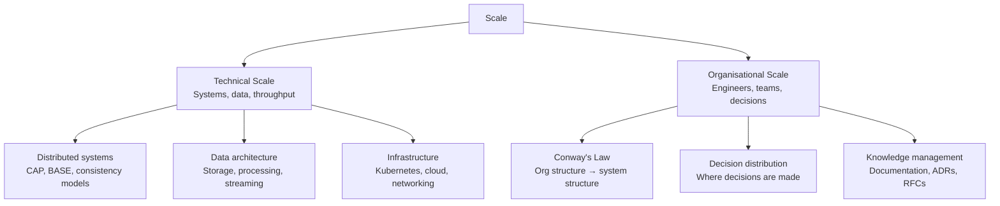

# 06 · Engineering at Scale

> **Level:** Advanced — Organisational & Systems
> **Pre-reading:** [03 · Architect Thinking](03-architect-thinking.md) · [04 · Team Effectiveness](04-team-effectiveness.md)

"Scale" in a principal engineering context means two things simultaneously: **technical scale** (systems handling millions of users and petabytes of data) and **organisational scale** (hundreds of engineers working on interdependent systems). Both must be reasoned about together.

---

## The Two Dimensions of Scale

---

## Distributed Systems Fundamentals

### The CAP Theorem

Eric Brewer's CAP Theorem (2000) states that a distributed data system can guarantee at most **two** of three properties simultaneously:

| Property | Definition |
|:---|:---|
| **Consistency (C)** | Every read receives the most recent write or an error |
| **Availability (A)** | Every request receives a (non-error) response — but it might not be the most recent data |
| **Partition Tolerance (P)** | The system continues operating despite network partitions |

!!! warning "The critical nuance"
    In any real distributed system, **network partitions are not optional** — they happen. Therefore, every distributed system **must** choose P, and the real trade-off is between C and A. The question is: when a network partition occurs, do you return an error (C) or a potentially stale result (A)?

| System Type | CAP Choice | Example |
|:---|:---|:---|
| Traditional RDBMS | CA (single node) | PostgreSQL, MySQL (no partition tolerance) |
| Distributed relational | CP | Google Spanner, CockroachDB |
| Key-value store | AP | Cassandra, DynamoDB (default), Riak |
| Document store | CP or AP configurable | MongoDB |

### BASE vs. ACID

| Property | ACID (Traditional) | BASE (Distributed) |
|:---|:---|:---|
| **A** | Atomic | Basically Available |
| **C** | Consistent | Soft-state |
| **I** | Isolated | Eventually consistent |
| **D** | Durable | |

**Eventual consistency** means: given no new updates, all replicas will *eventually* converge to the same value. The question architects must answer is: **how long is "eventually" acceptable for this use case?**

| Use case | Consistency model required |
|:---|:---|
| Bank account balance | Strong consistency (ACID) |
| Social media "like" count | Eventual consistency |
| Shopping cart | Session consistency (user sees their own writes) |
| Recommendation engine | Eventual consistency |
| Inventory reservation | Strong consistency (or optimistic locking) |
| Distributed configuration | Eventual consistency with low-latency convergence |

---

## The Eight Fallacies of Distributed Computing

Peter Deutsch (Sun Microsystems, 1994) identified the assumptions engineers incorrectly make when building distributed systems:

| # | Fallacy | Reality |
|:---|:---|:---|
| 1 | **The network is reliable** | Networks fail: packets drop, connections reset, routing changes |
| 2 | **Latency is zero** | Every network hop adds latency; cross-region is 100ms+ |
| 3 | **Bandwidth is infinite** | Serialisation, payload size, and network throughput all cost |
| 4 | **The network is secure** | Assume a hostile network; encrypt in transit, authenticate everything |
| 5 | **Topology doesn't change** | Services move, IPs change, Kubernetes restarts pods |
| 6 | **There is one administrator** | In cloud, many teams own different parts of the network |
| 7 | **Transport cost is zero** | Serialisation, compression, and network calls all have CPU and time cost |
| 8 | **The network is homogeneous** | Mixed protocols, versions, and data centres are normal |

!!! tip "Interview application"
    When designing a distributed system in an interview, explicitly call out which fallacies you are designing against. This signals architectural maturity.

---

## Scalability Patterns

### Horizontal vs. Vertical Scaling

| Approach | How | When |
|:---|:---|:---|
| **Vertical (Scale-Up)** | Add more CPU/RAM to existing machines | Simple; no code change; has a hard ceiling; single point of failure |
| **Horizontal (Scale-Out)** | Add more machines; distribute load | No ceiling; stateless services required; more operational complexity |

A principal engineer designs for **horizontal scalability by default** — vertical scaling is a stopgap, not an architecture.

### Stateless vs. Stateful Services

| | Stateless | Stateful |
|:---|:---|:---|
| **Definition** | Each request is fully self-contained | Server maintains data between requests |
| **Scalability** | Trivially horizontal — any instance handles any request | Hard — requires affinity or shared external state |
| **Resilience** | Instance failure is transparent | Instance failure requires recovery/handover |
| **Design principle** | Move state to external store (database, cache, queue) | Necessary for streams, leader election, sessions |

**The key principle**: push state down to dedicated state stores (databases, caches, message queues) and keep application services stateless.

### Caching — The Architect's Primary Scaling Tool

Caching is the most impactful single scaling tool available. The art is in knowing *what* to cache, *where*, and *for how long*.

| Cache Level | Technology | Latency | Best for |
|:---|:---|:---|:---|
| **CPU L1/L2/L3** | Hardware | nanoseconds | JVM / OS handled |
| **In-process** | `ConcurrentHashMap`, Guava Cache | microseconds | Computed values, short-lived config |
| **Distributed** | Redis, Memcached | < 1ms | Session data, hot query results, rate limiting |
| **CDN** | CloudFront, Fastly | < 10ms (edge) | Static assets, cacheable API responses |
| **Database query cache** | PostgreSQL, MySQL | Varies | Repeated identical queries |

#### Cache Invalidation Strategies

> *"There are only two hard things in Computer Science: cache invalidation and naming things."*
> — Phil Karlton

| Strategy | How | Trade-off |
|:---|:---|:---|
| **TTL-based expiry** | Cache entries expire after N seconds | Simple; allows brief staleness |
| **Write-through** | Write to cache and DB simultaneously | Always consistent; write latency doubles |
| **Write-behind (write-back)** | Write to cache; async flush to DB | Lower write latency; risk of data loss |
| **Cache-aside (lazy loading)** | On miss, application loads from DB + populates cache | Simple; initial miss is slow; thundering herd risk |
| **Event-driven invalidation** | DB write event triggers cache eviction | Consistent; more complex infrastructure |

### Database Scaling Patterns

| Pattern | Mechanism | Trade-off |
|:---|:---|:---|
| **Read replicas** | Primary handles writes; replicas serve reads | Replication lag — replicas may be slightly stale |
| **Sharding (horizontal partitioning)** | Partition rows across multiple DB instances by shard key | Complex queries across shards; shard key design is critical |
| **Vertical partitioning** | Split columns across tables/databases | Reduces row width; joins become cross-database |
| **CQRS** | Separate read model from write model | Eventual consistency between models; powerful for complex queries |
| **Connection pooling** | Pool DB connections to amortise connection cost | PgBouncer, HikariCP; configured correctly prevents DB overload |

---

## Rate Limiting and Throttling

| Pattern | Description | Use case |
|:---|:---|:---|
| **Token Bucket** | N tokens added per second; each request consumes one | Allows bursts up to bucket size |
| **Leaky Bucket** | Requests enter a bucket; processed at constant rate | Smooth output rate; excess discarded or queued |
| **Fixed Window Counter** | Count requests per time window | Simple; susceptible to burst at window boundary |
| **Sliding Window Log** | Track timestamps of all requests in window | Accurate; memory-intensive at high scale |
| **Sliding Window Counter** | Weighted combination of two fixed windows | Good approximation; memory-efficient |

---

## API Design at Scale

### Versioning Strategy

| Strategy | Example | Trade-off |
|:---|:---|:---|
| **URI versioning** | `/api/v1/orders` | Simple; cacheable; pollutes URL |
| **Header versioning** | `Accept: application/vnd.company.v2+json` | Clean URIs; harder to test in browser |
| **Query param** | `/orders?version=2` | Simple; caching complications |
| **Content negotiation** | `Accept` header, standard | RESTful; requires client sophistication |

### Backward Compatibility Rules (Postel's Law)
> *"Be conservative in what you send, liberal in what you accept."*

- **Safe to add**: new optional fields, new endpoints, new enum values (if client ignores unknown)
- **Breaking to change**: field type changes, field removal, required field addition, URL structure change

---

## Organisational Scale: Governance Without Bureaucracy

### The Decision Distribution Problem

As organisations grow, the question becomes: **who makes which decisions?**

| Decision type | Who decides | Governance mechanism |
|:---|:---|:---|
| **Reversible, local** (e.g., internal algorithm) | Team | None needed — team autonomy |
| **Reversible, cross-team** (e.g., shared library version) | Teams + Principal | RFC with short review window |
| **Irreversible, local** (e.g., data schema) | Team + Architect | ADR required; review optional |
| **Irreversible, cross-team** (e.g., API contract change) | Architect + Principal | ADR + RFC + formal approval |
| **Irreversible, org-wide** (e.g., platform migration) | CTO + Principal + Architects | Architecture Board decision |

Jeff Bezos's **Type 1 / Type 2 decision framework**:
- **Type 1**: Irreversible — "walk through a one-way door". Require careful deliberation.
- **Type 2**: Reversible — "walk through a two-way door". Make fast; adjust if wrong.

!!! tip "The governance anti-pattern"
    The most common governance failure is treating Type 2 decisions like Type 1 — creating heavy process for reversible decisions and grinding velocity to a halt. Principal Engineers must identify and protect Type 2 decision-making speed.

---

## Twelve-Factor App Principles at Scale

The **12-Factor App** methodology (Heroku, 2011) defines 12 principles for building cloud-native, scalable applications. Principal Engineers are expected to have mastered and applied all 12.

| Factor | Principle | Why it matters at scale |
|:---|:---|:---|
| I. Codebase | One codebase, tracked in version control, many deploys | Enables consistent deployment pipeline |
| II. Dependencies | Explicitly declare and isolate dependencies | No implicit system-level dependencies |
| III. Config | Store config in environment variables | Secrets never in code; environment-aware apps |
| IV. Backing services | Treat backing services as attached resources | Swap DB, queue, cache without code changes |
| V. Build/Release/Run | Strictly separate build, release, and run stages | Enables blue-green, canary deploys |
| VI. Processes | Execute app as stateless processes | Horizontal scalability |
| VII. Port binding | Export services via port binding | Service-to-service calls, container networking |
| VIII. Concurrency | Scale out via process model | Horizontal processes, not threads |
| IX. Disposability | Fast startup, graceful shutdown | Pod eviction, rolling deploys |
| X. Dev/Prod parity | Keep dev, staging, prod as similar as possible | Reduces configuration drift bugs |
| XI. Logs | Treat logs as event streams | Centralised log aggregation |
| XII. Admin processes | Run admin tasks as one-off processes | Database migrations, data fixes |
