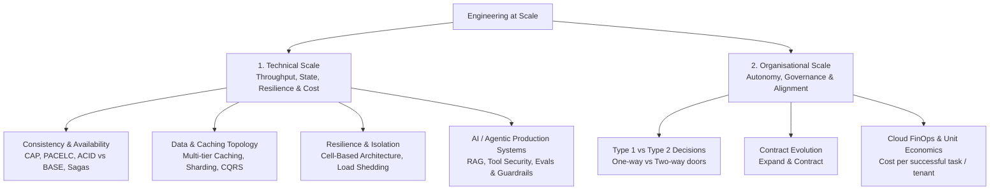
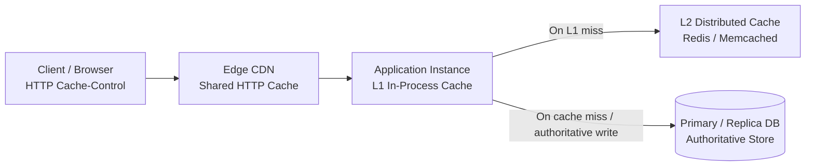
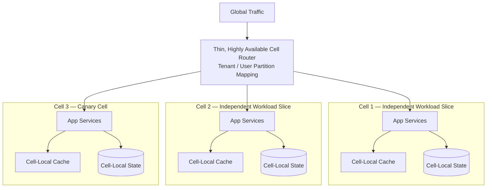
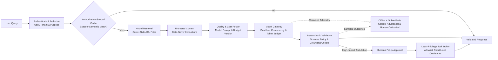

---
tags:
  - Distributed Systems
  - System Design
  - AI Architecture
---

# 06 · Engineering at Scale

> **Level:** Advanced — Organisational & Systems · **Reading Time:** ~15 mins · **Track:** Systems & Architecture
> **Prerequisites:** [03 · Architect Thinking](03-architect-thinking.md) · [04 · Team Effectiveness](04-team-effectiveness.md)

"Scale" in a Principal Engineer interview operates on **two coupled axes**:
1. **Technical Scale:** Request throughput, state size, geographic latency, failure containment, and unit cost.
2. **Organisational Scale:** Autonomous teams delivering safely without creating unbounded coordination or operational complexity.

!!! abstract "TL;DR — The 30-Second Mental Model"
    - **CAP + PACELC, Used Precisely:** CAP constrains linearizability and CAP-availability during partitions; PACELC also highlights normal-operation latency/consistency trade-offs. Neither is a product label or a substitute for workload semantics.
    - **Blast-Radius Isolation:** Cells cap impact only when state, deployments, and critical dependencies are genuinely isolated; the router and control plane still need explicit resilience.
    - **Modern AI / Agentic Scale:** Design for indirect prompt injection, least-privilege tools, authorization-scoped retrieval and caches, calibrated evaluations, and cost per successful task.
    - **Governance by Cost of Reversal:** Give high-cost-of-change contracts and data decisions deeper review while letting reversible implementation details remain autonomous.

---

## The Two Dimensions of Scale

---

## 1. Distributed Systems Consistency: CAP & PACELC

### The CAP Theorem & The PACELC Extension

In the formal CAP model, **Consistency means linearizability** for a read/write object, and **Availability means every request received by a non-failing node eventually receives a response**—not a latency SLO or general service uptime. During a partition, a replicated read/write design cannot guarantee both properties for every request. See Gilbert and Lynch's [formal proof and definitions](https://groups.csail.mit.edu/tds/papers/Gilbert/Brewer2.pdf).

Daniel Abadi's [PACELC formulation](https://dl.acm.org/doi/10.1109/MC.2012.33) adds the normal-operation trade-off:

> **If there is a Partition (P)**, choose between Availability (A) and Consistency (C); **Else (E)**, choose between Latency (L) and Consistency (C).

PACELC is a useful reasoning lens, not a “complete picture.” Durability, read-your-writes, transaction isolation, conflict resolution, failover, and application invariants still require separate analysis.

|| Illustrative Design Profile | During a Partition | Normal Operation | Suitable Workload Example |
|:---|:---|:---|:---|
|| **PC / EC** | Preserve linearizability; reject or stall requests that cannot meet it | Synchronous coordination/quorum where required | Ledger mutation, inventory reservation, distributed lock |
|| **PA / EL** | Accept divergent work where the business can reconcile it | Asynchronous replication and potentially stale reads | Activity feed, view count, reconnectable cart |
|| **PA / EC** | Favor availability and allow divergence during the partition | Use stronger coordination when healthy | A conflict-tolerant workflow with stronger normal-operation reads |

!!! warning "Do Not Assign PACELC Labels to a Whole Product"
    Consistency varies by operation and configuration: read concern, write concern, quorum, leader placement, transaction scope, and failover state all matter. Classify the **workload path and invariant**, not the database logo.

### Choosing the Right Consistency Model by Workload Tier

|| Business Operation | Required Semantics | Architectural Pattern |
|:---|:---|:---|
|| **Wallet / Ledger Debit-Credit** | **Serializable multi-record transaction**, plus linearizable/recency guarantees where the API requires them | Atomic double-entry transaction, idempotency record, deterministic lock ordering or consensus-backed store |
|| **Multi-Service Order Checkout** | Per-step durability with explicit intermediate states and compensation | **Saga** + **Transactional Outbox** + reconciliation; do not claim global ACID |
|| **User Profile / Cart Update** | **Read-your-writes** and conflict policy appropriate to the client session | Primary/session routing, consistency token, or version/fencing check before replica reads |
|| **Video View / Like Counter** | Eventual convergence with commutative updates | Sharded counters or CRDT-style merge + asynchronous aggregation |

**Linearizable and serializable are not synonyms:** linearizability concerns real-time ordering of operations on an object; serializability concerns equivalent ordering of transactions, potentially across multiple objects.

---

## 2. The Eight Fallacies of Distributed Computing

Use the eight fallacies commonly associated with Peter Deutsch and James Gosling as a failure-mode checklist:

|| # | Fallacy | Production Reality | Principal Architectural Defense |
|:---|:---|:---|:---|
|| 1 | **The network is reliable** | Packets drop, routes change, and TLS handshakes time out | Deadlines, bounded retries with full jitter, idempotency, circuit breakers, reconciliation |
|| 2 | **Latency is zero** | Latency varies by path, congestion, queueing, and tail behavior | Measure actual paths; co-locate chatty logic; batch carefully; avoid N+1 RPCs |
|| 3 | **Bandwidth is infinite** | Payloads consume NIC capacity and can incur transfer charges | Payload projection, efficient encoding, compression where beneficial, backpressure |
|| 4 | **The network is secure** | Network location is not an identity or authorization boundary | Workload identity, least privilege, encryption in transit, short-lived credentials, policy enforcement |
|| 5 | **Topology doesn't change** | Instances evict, autoscale, and receive new addresses | Service discovery, health-checked load balancing, graceful drain, reconnection logic |
|| 6 | **There is one administrator** | Cloud providers, SaaS vendors, and internal teams control different seams | Explicit contracts and SLOs, contract tests, synthetic probes, escalation ownership |
|| 7 | **Transport cost is zero** | Serialization, proxy hops, and cross-zone/region traffic consume money and CPU | Measure cost per path; zone-aware routing where safe; remove unnecessary chatty calls |
|| 8 | **The network is homogeneous** | Clients, proxies, protocols, and MTUs differ | Explicit compatibility policy, edge translation, negotiated protocol versions, contract tests |

---

## 3. Caching & Data Scaling Patterns

### Multi-Tier Caching & Failure Defenses

A complete cache-aside answer addresses **three classic failure modes**:

|| Cache Failure Mode | What Happens | Principal Defense Pattern |
|:---|:---|:---|
|| **1. Cache Stampede (Thundering Herd)** | A hot key expires and many requests rebuild it concurrently | Request coalescing at the appropriate scope, per-key distributed lease where needed, probabilistic early expiration, stale-while-revalidate, and bounded origin concurrency. Process-local singleflight alone does not coordinate other pods. |
|| **2. Cache Penetration** | Traffic repeatedly requests absent keys and reaches the database | Short-TTL negative caching plus input validation. A Bloom filter rejects only keys definitely absent; false positives still require a lookup, and the filter must be updated/rebuilt as data changes. |
|| **3. Hot Key / Shard Skew** | One key saturates a cache node or hash slot | Small L1 cache, request coalescing, key splitting/read copies with fan-in or invalidation semantics, and explicit consistency analysis. |

### Database Scaling & Sharding Progression

Scale in increasing order of operational complexity:

1. **Measure and optimize queries, indexes, transactions, and pooling.** Identify lock contention, I/O, CPU, and plan regressions before adding infrastructure.
2. **Add read replicas and caching only where their freshness semantics fit.** Implement consistency tokens or primary reads for operations that cannot tolerate lag.
3. **Partition by domain/bounded context** when ownership and access patterns support independent stores.
4. **Shard horizontally only with measured need:**
   - Choose a key aligned to access patterns, tenant isolation, and transaction scope; high cardinality alone does not prevent skew.
   - Split hot logical partitions deliberately and define how reads/writes find every bucket.
   - Consistent hashing with virtual nodes can reduce idealized key movement when membership changes, but it **does not perform zero-downtime resharding by itself**. Implement routing metadata, backfill, dual-read/write or change capture where required, verification, cutover, rollback, and cleanup.

---

## 4. Resilience at Hyperscale: Cell-Based Architecture

A shared cluster can remain a shared fault domain even across availability zones: a bad global deployment, poison-pill request, or shared control-plane failure can affect every node.

**Cell-Based Architecture** partitions a complete workload—compute, cache, and state—into independent cells routed by the thinnest possible cell-routing layer:

- **Bounded impact is conditional:** A cell-local failure can affect roughly its workload slice, not mathematically `1/N` in every incident. Shared state, global deployments, identity, DNS, and router/control-plane failures can cross every cell.
- **Design for static stability:** Existing cells and routing should continue serving if the administrative control plane is impaired.
- **Minimize cross-cell interactions:** Choose a partition key naturally present in requests and avoid synchronous distributed calls between cells.
- **Practice recovery:** Load-test a cell, deploy to a canary cell, test customer reassignment/evacuation, and prove router and control-plane failure modes.

See AWS's primary guidance on [cell-based architecture](https://docs.aws.amazon.com/wellarchitected/latest/reducing-scope-of-impact-with-cell-based-architecture/what-is-a-cell-based-architecture.html), [control/data planes](https://docs.aws.amazon.com/wellarchitected/latest/reducing-scope-of-impact-with-cell-based-architecture/control-plane-and-data-plane.html), and [cell-router resilience](https://docs.aws.amazon.com/wellarchitected/latest/reducing-scope-of-impact-with-cell-based-architecture/about-resilience-of-the-cell-router.html).

---

## 5. Modern Architecture: Designing AI & Agentic Systems at Scale

Treat an LLM as a **probabilistic, variable-tail-latency, usage-metered dependency**. Treat every tool it can invoke as a separate **privileged security boundary**. Input filters and system prompts can reduce risk, but neither is a reliable authorization control—especially when retrieved documents, images, emails, or web pages contain indirect prompt injection.

|| Architectural Concern | Current Production Design Pattern |
|:---|:---|
|| **Prompt Injection & Agency** | Mark retrieved content as untrusted; minimize tool scope and data egress; separate read-only from mutating tools; require deterministic policy checks and human approval for high-impact actions. RAG and fine-tuning do **not** eliminate prompt injection. |
|| **RAG Authorization & Cache Isolation** | Enforce ACLs in the retrieval service before context reaches the model. Key caches by tenant, authorization context, prompt/model version, and locale; never reuse a semantic-cache entry across security contexts. Reauthorize when permissions or source documents change. |
|| **Evaluation & Release Gates** | Combine deterministic checks, task-specific golden sets, adversarial prompt-injection tests, and human-reviewed samples. Calibrate LLM-as-judge against human labels; it is an evaluator, not ground truth. Gate model, prompt, retrieval, embedding, and tool-schema changes. |
|| **Latency & User Experience** | Measure time to first token, total completion time, and tail latency per route. Streaming improves perceived latency, not total work or cost. Use deadlines, cancellation, async jobs, and a deterministic fallback where appropriate. |
|| **Rate Limits & Resilience** | Budget input/output tokens, concurrency, queue time, and cost per tenant—not only requests. Apply retry budgets with jitter and idempotent tool calls. Fail over across providers only after proving equivalent policy, privacy, residency, and evaluation behavior. |
|| **Unit Economics (FinOps)** | Optimize **cost per successfully completed task**, including retrieval, evaluation, retries, and tool calls—not just price per token. Route by measured quality and task difficulty rather than an assumed fixed percentage to smaller models. |
|| **Observability & Privacy** | Trace model, retrieval, and tool calls with redaction and explicit sampling; do not log prompts, completions, credentials, or retrieved documents by default. Pin and test OpenTelemetry GenAI semantic-convention versions because this instrumentation surface is still evolving. |

### Primary AI Risk References

- [NIST AI 600-1 — Generative AI Risk Management Profile](https://nvlpubs.nist.gov/nistpubs/ai/NIST.AI.600-1.pdf)
- [OWASP LLM01:2025 — Prompt Injection](https://genai.owasp.org/llmrisk/llm01-prompt-injection/) and the [OWASP LLM Top 10](https://genai.owasp.org/llm-top-10/)
- [OpenTelemetry — moved GenAI semantic conventions](https://opentelemetry.io/docs/specs/semconv/gen-ai/)

---

## 6. Organisational Scale: Governance & Contract Evolution

### Type 1 vs. Type 2 Decision Matrix

|| Decision Type | Door Metaphor | Examples | Governance Mechanism |
|:---|:---|:---|:---|
|| **Type 1 (High Cost of Reversal)** | **One-Way Door** — expensive or impossible to undo safely | Public API contracts, shard/partition strategy, residency topology, encryption/key model | Formal RFC + ADR + domain/security review + prototype or migration rehearsal |
|| **Type 2 (Low Cost of Reversal)** | **Two-Way Door** — can be reversed within an agreed blast radius | Internal refactoring, feature-flagged experiment, replaceable internal library | Autonomous team decision + automated checks; no central committee by default |

### Zero-Downtime Contract Evolution: Expand and Contract

When teams deploy independently, avoid breaking schema or API changes in a single deployment:

1. **Expand:** Add the new nullable column/field alongside the old one. Deploy backward-compatible code that can read the old shape and write both shapes where required.
2. **Migrate & Switch Reads:** Backfill in resumable batches, verify counts and invariants, then move every consumer to the new shape. Include asynchronous consumers, analytics, backups, and rollback paths in the compatibility analysis.
3. **Contract:** Only after observing that all supported consumers and safe rollback versions no longer need the old shape, remove dual writes and later drop the legacy field. Record the cleanup owner and completion condition.

---

## Active Recall & Self-Check

??? question "Self-Check 1: During a system design interview for a global flash sale, how do you prevent overselling 1,000 items without melting the primary database?"
    **Answer Rubric:**
    1. **Absorb reads at the edge:** Cache product pages and clearly approximate availability; never treat a cached “in stock” label as a reservation.
    2. **Control admission:** Use a waiting room, per-user/tenant quotas, backpressure, and load shedding to bound work entering the reservation path.
    3. **Make the reservation atomic and durable:** Use an authoritative conditional inventory update or an ordered single-writer reservation log with a unique reservation ID. Redis Lua can coordinate a fast path only if its persistence, failover, and reconciliation semantics satisfy the stated RPO; a cache decrement alone is not proof of inventory.
    4. **Publish through an outbox:** Commit the reservation and event atomically, then process payment asynchronously where the UX allows. Expiry/payment failure releases the reservation exactly once through an idempotent compensating action.
    5. **Reconcile and test:** Verify the invariant `reserved + sold + available = initial stock` under retries, failover, and expired reservations.

??? question "Self-Check 2: Why is Requests Per Second (RPS) an insufficient rate-limiting metric for an AI gateway or multi-tenant database?"
    **Answer Rubric:**
    Request cost is asymmetrical. A 100,000-token prompt has 1,000 times the input-token count of a 100-token prompt before output, model, retrieval, and tool costs are considered; a multi-join analytical query also differs fundamentally from a primary-key lookup.
    Use **cost-aware quotas**—input/output tokens, concurrency, database capacity units, queue time, and tenant budgets—plus priority-based load shedding. Rate-limit requests too, but never mistake request count for resource consumption.
