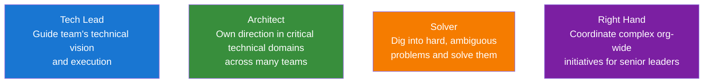
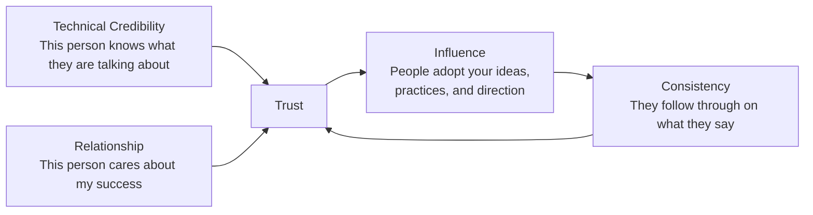

# 07 · Technical Leadership

> **Level:** Advanced — Leadership & Influence
> **Pre-reading:** [01 · Roles & Responsibilities](01-roles-responsibilities.md) · [04 · Team Effectiveness](04-team-effectiveness.md) · [05 · Negotiation & Stakeholders](05-negotiation-stakeholders.md)

Technical leadership is the practice of **shaping the technical direction of an organisation through influence, vision, and the systematic raising of engineering quality** — without the authority of line management. It is what distinguishes a Principal Engineer from a brilliant Senior Engineer.

---

## What Technical Leadership Is Not

| Common misconception | What it actually means |
|:---|:---|
| "The best coder on the team" | Code output is often inversely correlated with leadership impact at this level |
| "Makes all the important technical decisions" | Good technical leaders make *fewer* decisions by empowering others to make more of them |
| "The person who reviews all PRs" | That is a bottleneck, not leadership |
| "The most opinionated person in the room" | Leadership requires listening before deciding |
| "Saying yes to every technical request" | Saying *no* clearly and with reasoning is one of the most important skills |

---

## The Staff Engineer Archetypes (Will Larson)

Will Larson's *Staff Engineer* (2021) identifies four common archetypes for how staff/principal engineers operate. Understanding these helps you identify your natural mode and develop the others.



| Archetype | Primary mode | Great at | Risk |
|:---|:---|:---|:---|
| **Tech Lead** | Guiding a team's execution | Delivery, code quality, team velocity | Scope stays team-level; doesn't scale beyond one team |
| **Architect** | Setting cross-team technical direction | Long-term system coherence, API contracts, standards | Ivory tower — out of touch with implementation reality |
| **Solver** | Unblocking the hardest technical problems | Deep technical impact when and where it matters most | Impact is episodic; hard to show continuous org-level value |
| **Right Hand** | Organisational coordination and execution | Cross-cutting changes, org-wide initiatives | Too much time in meetings; technical skills atrophy |

### Which archetype does which company need?

| Company stage | Most needed archetype |
|:---|:---|
| Early startup (< 50 engineers) | Tech Lead — get things built |
| Growth stage (50–200 engineers) | Architect + Solver — set foundations while solving fires |
| Large org (200+ engineers) | All four — explicitly define which role is needed |

---

## The Technical Vision Document

A Principal Engineer's most durable output is a **technical vision** — a written description of the desired state of the system and organisation 2–5 years from now, and the path to get there.

### Why it matters
- Enables independent decision-making by teams without constant consultation
- Aligns dozens of teams around a shared direction without heavy governance
- Provides a framework for evaluating trade-offs consistently
- Creates organisational memory that survives personnel changes

### Structure of a Technical Vision Document

```markdown
# Technical Vision — {System/Domain Name}

**Owner:** {Principal Engineer Name}
**Date:** {Date} | **Horizon:** {e.g., 2025–2027}
**Status:** Draft | Under Review | Adopted

---

## 1. Context
What is the current state? What business challenges does this vision respond to?

## 2. Target State
What does great look like in 3 years? (Not how — what)

## 3. Principles
What principles guide our decisions on the path? (3–7 specific, non-obvious principles)

## 4. Strategic Bets
What are the 3–5 major architectural choices we are committing to? Why?

## 5. What We Are NOT Doing
Explicit de-prioritisation — as important as what is included

## 6. Migration Path
How do we get from current state to target state? Phases, milestones, decision points.

## 7. Success Metrics
How will we know we are on track? (DORA metrics, quality attributes measured)
```

---

## Technical Debt Governance

Technical debt is **inevitable** — the discipline is in making it visible, intentional, and managed.

### The Technical Debt Quadrant (Martin Fowler)

```
                    DELIBERATE          INADVERTENT
                ┌──────────────────┬──────────────────┐
                │                  │                  │
  RECKLESS      │  "We don't have  │  "What's layered │
                │  time to design" │  architecture?"  │
                │                  │                  │
                ├──────────────────┼──────────────────┤
                │                  │                  │
  PRUDENT       │  "We must ship   │  "Now we know    │
                │  now; we'll fix  │  how we should   │
                │  later"          │  have done it"   │
                │                  │                  │
                └──────────────────┴──────────────────┘
```

| Quadrant | Description | Response |
|:---|:---|:---|
| **Reckless + Deliberate** | Knowingly bypassing good practices | Unacceptable; prevent through standards and gates |
| **Reckless + Inadvertent** | Bad practices from ignorance | Fix through mentoring, code review, standards |
| **Prudent + Deliberate** | Knowingly ship now, plan to fix | Acceptable — must create the ADR and schedule the fix |
| **Prudent + Inadvertent** | Learn better ways after the fact | Expected — capture learnings in ADR, fix in next iteration |

### The Technical Debt Register

A principal engineer should advocate for a **Technical Debt Register** — a maintained, visible inventory of known technical debt:

| ID | Component | Debt Description | Type | Business Impact | Estimated Cost to Fix | Priority |
|:---|:---|:---|:---|:---|:---|:---|
| TD-001 | Auth Service | No token revocation mechanism | Security | High — cannot invalidate compromised tokens | 2 weeks | P1 |
| TD-002 | Order DB | Schema does not support multi-tenancy | Architecture | Blocks enterprise tier | 3 months | P2 |
| TD-003 | CI Pipeline | No canary deployment support | Infrastructure | All releases are big-bang | 4 weeks | P2 |

---

## Influence Without Authority

The defining challenge of Technical Leadership is achieving change **without the ability to command it**. This requires a distinct set of skills from management.

### The Influence Model



### Influence Tactics That Work at Principal Level

| Tactic | What it looks like | When to use |
|:---|:---|:---|
| **Technical demonstration** | Write the proof-of-concept yourself | When words alone won't convince; skeptical engineers |
| **Data-driven proposal** | Bring metrics, benchmarks, production data | Business stakeholders; cost discussions |
| **Known champion** | Identify an influential engineer who agrees; amplify their voice | When you have low political capital in that team |
| **Published standard** | Write the RFC/ADR; get it endorsed by senior leadership | Long-term org-wide adoption |
| **Joining their work** | Help with *their* problem first; introduce your idea in context | Building relationships in a new team |
| **Teaching/presentation** | Give an internal tech talk or workshop | Spreading concepts to many engineers simultaneously |
| **Blameless post-mortem** | Surface the systemic issue from a specific incident | Making abstract architectural concerns concrete |

---

## Mentorship and Growing Principal-Level Engineers

A principal engineer who cannot grow the next generation is hoarding their value rather than multiplying it.

### The Four Stages of Competence (for Mentoring Framework)

| Stage | Description | How to help |
|:---|:---|:---|
| **Unconscious incompetence** | Don't know what they don't know | Expose to new domains; create awareness |
| **Conscious incompetence** | Know they don't know | Provide resources, context, safe space to learn |
| **Conscious competence** | Can do it, but requires effort | Pair programming, pointed code review, deliberate practice |
| **Unconscious competence** | Does it naturally | Give them autonomy; let them teach others |

### Mentoring Ladder

A structured approach to growing engineers toward staff/principal level:

1. **Expose** — invite them to architecture reviews, design sessions, RFC discussions
2. **Explain** — articulate your reasoning out loud, especially when making trade-off decisions
3. **Involve** — give them ownership of a component of an RFC or ADR with your guidance
4. **Delegate** — let them own a complete RFC/ADR; you review and coach
5. **Sponsor** — actively advocate for their promotion and expanded scope

!!! tip "Sponsorship vs. mentorship"
    **Mentorship**: you help someone become more capable.
    **Sponsorship**: you use your reputation capital to open doors for someone.
    Both are the responsibility of a principal engineer. Sponsorship has more organisational impact but is rarer and requires spending personal capital.

---

## The On-Call and Incident Response Culture

A principal engineer shapes how the organisation responds to production incidents.

### Blameless Post-Mortem Structure

```markdown
# Incident Post-Mortem: {Incident ID}

**Date:** {Date}
**Severity:** SEV1 | SEV2 | SEV3
**Duration:** {Start time} → {End time} ({duration})
**Impact:** {User impact; number of affected users; data affected}
**Owner:** {Named engineer}

---

## Timeline
| Time | Event |
|:-----|:------|
| HH:MM | Alert fired |
| HH:MM | On-call engineer paged |
| HH:MM | Root cause identified |
| HH:MM | Mitigation applied |
| HH:MM | Service restored |

## Root Cause Analysis
5 Whys or fishbone: what was the actual root cause?

## Contributing Factors
What systemic conditions made this possible?

## What Went Well
What worked during the incident response?

## What Could Be Improved
Systemic improvements — not personal failures.

## Action Items
| Action | Owner | Due date | Priority |
|:-------|:------|:---------|:---------|
| Add alerting for X | @engineer | {date} | P1 |
| Implement circuit breaker for Y | @engineer | {date} | P2 |
```

!!! warning "The blameless principle"
    Post-mortems that name individuals as root causes are counter-productive. Engineers who made a decision did so with the information available at the time. The system allowed them to make that decision with that information. Fix the system.

---

## Technology Radar — Governing the Technology Portfolio

The **Technology Radar** (popularised by ThoughtWorks) is a tool for visualising an organisation's technology portfolio and providing guidance on adoption.

### Four Rings

| Ring | Meaning |
|:---|:---|
| **Adopt** | Technologies we use in production and recommend for new projects |
| **Trial** | Technologies we're evaluating in limited production contexts |
| **Assess** | Technologies worth understanding; not yet tried in production |
| **Hold** | Technologies we are moving away from; do not use for new work |

### Four Quadrants

| Quadrant | Examples |
|:---|:---|
| **Languages & Frameworks** | Java 21, Python 3.12, React, FastAPI |
| **Tools** | Terraform, Helm, Grafana, ArgoCD |
| **Platforms** | Kubernetes, AWS, GCP, Snowflake |
| **Techniques** | DORA metrics, trunk-based development, fitness functions |

A principal engineer should be able to **justify where every significant technology in their domain sits** on the radar, and why.
