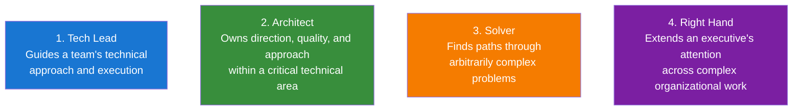
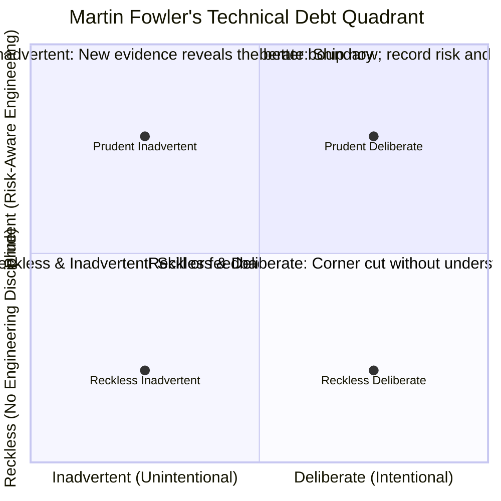
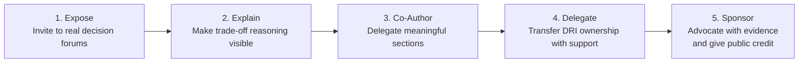

---
tags:
  - Technical Leadership
  - Engineering Strategy
  - Technical Debt
---

# 07 · Technical Leadership

> **Level:** Advanced — Leadership & Influence · **Reading Time:** ~12 mins · **Track:** Org & Leadership
> **Prerequisites:** [01 · Roles & Responsibilities](01-roles-responsibilities.md) · [04 · Team Effectiveness](04-team-effectiveness.md) · [05 · Negotiation & Stakeholders](05-negotiation-stakeholders.md)

Technical leadership shapes technical direction, engineering culture, and systemic quality through vision, standards, and mentorship—without relying solely on line-management authority.

!!! abstract "TL;DR — The 30-Second Mental Model"
    - **Know Your Staff+ Archetype:** Will Larson's **Tech Lead**, **Architect**, **Solver**, and **Right Hand** are useful operating patterns, not a levelling checklist.
    - **Technical Vision = Coherent Autonomy:** Give teams a diagnosis, guiding principles, strategic bets, non-goals, and measurable outcomes so local decisions align without micromanagement.
    - **Govern Debt and Technology by Evidence:** Track ongoing drag and risk, fund work through explicit trade-offs and SLO/error-budget policy, and avoid universal “20% capacity” or arbitrary innovation quotas.

---

## What Technical Leadership Is (and Is Not)

|| Common Misconception (Local Lens) | Principal Reality (System Lens) |
|:---|:---|
|| *"Take every hardest ticket"* | Create leverage so others can solve hard problems safely |
|| *"Make every major decision yourself"* | Design principles, decision rights, and paved roads that scale judgment |
|| *"Review every PR across ten repositories"* | Automate invariants and coach maintainers to uphold the bar |
|| *"Be the loudest voice in review"* | Surface hidden constraints, create clarity, and help the group update on evidence |

---

## The Four Staff+ Archetypes (Will Larson)

In [*Staff Engineer: Leadership Beyond the Management Track*](https://staffeng.com/guides/staff-archetypes/), Will Larson describes four common operating patterns:



|| Archetype | Core Charter | Primary Failure Mode |
|:---|:---|:---|
|| **Tech Lead** | Partner closely with engineering management to guide a team or focused area | Scope stays at execution; crowds out other technical leaders |
|| **Architect** | Combine technical constraints, user needs, and organizational leadership in a critical area | Ivory-tower direction without prototypes, operating feedback, or migration realism |
|| **Solver** | Dig into complex hotspots, sometimes in one area and sometimes across the organization | Episodic hero work leaves no durable capability or shared context |
|| **Right Hand** | Extend a senior executive's attention, scope, and authority | Proxy authority replaces technical credibility; calendar loses contact with implementation reality |

A role can blend patterns, and the useful question is **what the current charter needs**, not which label sounds most senior.

---

## Authoring a Multi-Year Technical Vision

A technical vision usually spans 18–36 months with a shorter review cadence. Applying Richard Rumelt's strategy kernel means combining **diagnosis**, **guiding policy**, and **coherent actions**—not publishing a target-state diagram alone.

### Canonical Technical Vision Template

```markdown
# Technical Vision: {Domain / Platform Name} ({YYYY}–{YYYY})

- **Executive Sponsor:** {Role} · **Lead Author:** {Role}
- **Status:** Draft | Adopted · **Review Cadence:** {Quarterly / Bi-annual}
- **Evidence Baseline & Last Review:** {Links and date}

## 1. Diagnosis
Data-backed assessment of current constraints, what changes at the next scale horizon,
and which assumptions remain uncertain.

## 2. Target State
Observable customer, developer, operational, security, and financial behavior—not a product list.

## 3. Guiding Principles (Trade-Off Tie-Breakers)
3–5 opinionated rules with valid alternatives and explicit exceptions.

## 4. Strategic Bets & Explicit Non-Goals
What we will and will not fund, and which options we intentionally preserve or retire.

## 5. Coherent Actions (Now / Next / Later)
Sequenced capabilities, migration plateaus, owners, dependencies, and decommission work.

## 6. Leading & Lagging Success Measures
Customer outcomes, SLOs, delivery flow, adoption, risk exposure, and business unit cost.

## 7. Review & Reversal Triggers
Which evidence would cause us to accelerate, pause, or reverse each strategic bet?
```

!!! tip "The 'Opposite Test' for Architectural Principles"
    A principle is weak if its opposite is absurd (*"We build reliable software"*). A useful principle has a reasonable alternative another organization might choose, such as *"We accept provider-specific managed services to reduce operating load, except where measured portability or regulatory constraints outweigh that benefit."*

### Principle Examples That Need Context, Not Dogma

- **Managed services by default:** Compare total cost of ownership, reliability, staffing, data obligations, and exit cost—not an arbitrary annual-spend threshold.
- **Async for facts; sync for immediate decisions:** Use events for durable facts/notifications and synchronous calls when a response is required now. Do not ban synchronous commands or imply async removes failure handling.
- **Compatibility by default:** Public APIs and event schemas pass automated consumer/compatibility checks, with an explicit migration and deprecation policy.

---

## Technical Debt Governance at Scale

Technical debt is a metaphor for design deficiencies and their ongoing cost. It is most useful when tied to changed capability, risk, and evidence—not used to label every disliked codebase.

### Martin Fowler's Technical Debt Quadrant



|| Quadrant | Principal Engineer Intervention |
|:---|:---|
|| **Prudent & Deliberate** | Record rationale, accepted downside, and review/payoff trigger; not every item needs immediate repayment |
|| **Prudent & Inadvertent** | Treat improved understanding as learning; refactor where ongoing change and evidence justify it |
|| **Reckless & Deliberate** | Make risk visible, stop unsafe bypasses, and align leadership on explicit non-negotiables |
|| **Reckless & Inadvertent** | Improve feedback, pairing, design coaching, and enabling-team support |

See Fowler's [Technical Debt Quadrant](https://www.martinfowler.com/bliki/TechnicalDebtQuadrant.html) and [Technical Debt](https://martinfowler.com/bliki/TechnicalDebt.html), including his point that stable, rarely changed “cruft” may not deserve the same priority as frequently changed code.

### Maintaining an Org-Wide Technical Debt Register

Treat major debt as a portfolio of risks and options. The values below are illustrative placeholders:

|| ID | Affected Domain | Evidence of Ongoing Drag / Risk | Blast Radius | Remediation & Migration Risk | Next Review Trigger |
|:---|:---|:---|:---|:---|:---|
|| `TD-01` | Identity / Auth | Legacy tokens lack required revocation behavior; enterprise control gap | Security / tenant data | Rotation, compatibility, and rollout plan | Before new enterprise SSO launch |
|| `TD-02` | Orders DB | Measured lock/vacuum behavior repeatedly consumes checkout error budget | Revenue / availability | Backfill, dual-read, cutover, rollback | At next capacity or SLO review |
|| `TD-03` | CI Pipeline | Measured queue and test time delays every change; frequent rerun rework | Delivery flow | Shard/rework tests without reducing signal | After test-fidelity baseline improves |

---

## Growing the Next Generation: The Sponsorship Ladder



Sponsorship is not merely advice: it transfers visible ownership and creates opportunities while preserving a support and escalation path.

---

## Operational Excellence: Blameless Post-Mortem Culture

A Principal Engineer sets the tone for **psychological safety plus rigorous analysis of contributing conditions and safeguards**, consistent with [Google SRE postmortem guidance](https://sre.google/sre-book/postmortem-culture/).

### Five Rules of a Principal-Caliber Post-Mortem

1. **A Human Action Is Not a Sufficient Explanation:** *"Bob ran the wrong script"* is part of the timeline, not the end of analysis. Examine why the action made sense, available information, tooling, safeguards, approvals, and blast-radius controls. “5 Whys” can prompt exploration, but complex incidents rarely have one linear root cause.
2. **Quantify Impact and the Timeline:** Record trigger, detection, mitigation, restoration, customer/workload impact, and SLO/error-budget effect. Distinguish mitigation from full recovery instead of hiding both behind `MTTR`.
3. **Record What Worked and What Did Not:** Capture detection, runbooks, rollback, communication, and lucky conditions honestly; do not turn resilience into a story about heroes.
4. **Create Systemic, Owned Actions:** Each priority action has a DRI, resources, due/review date, and completion evidence. Favor controls that reduce a class of failures over “be more careful.”
5. **Share and Verify Learning:** Distribute the review appropriately, track action effectiveness, and test whether other services share the same conditions. Blameless does not mean accountability-free or consequence-free for deliberate policy violations.

---

## Technology Radar — Governing the Technology Portfolio

A [Technology Radar](https://www.thoughtworks.com/radar) can make adoption, experimentation, and retirement decisions visible. The following **example entries are not universal recommendations**; build your radar from your own workload, skills, support, security, and exit-cost evidence.

|| Radar Ring | Policy | Illustrative Entry Shape |
|:---|:---|:---|
|| **Adopt (Golden Path)** | Supported default with templates, operations, security, upgrades, and success measures | A small set of proven languages, stores, telemetry, and delivery patterns |
|| **Trial (Bounded Production)** | One or a few bounded use cases with an owner, hypothesis, SLOs, and exit criteria | A workflow engine or language evaluated where its specific advantage matters |
|| **Assess (Discovery)** | Time-boxed non-production research with a documented question | Wasm extension model, a new retrieval/index approach, or an emerging protocol |
|| **Hold (Retire / Constrain)** | No new adoption unless an explicit exception is approved; existing instances have an owner and migration plan | Unmaintained internal frameworks or versions outside the supported lifecycle |

Radar reviews must include **decommissioning, data migration, staffing, security support, and total cost**, not just developer preference.

---

## Active Recall & Self-Check

??? question "Self-Check 1: How do you curb resume-driven technology adoption without becoming the 'Department of No'?"
    **Answer Rubric:**
    1. Co-create a transparent radar and decision rights with the engineers who will operate the choices.
    2. Make Adopt paths genuinely easier through self-service provisioning, observability, security, upgrades, and on-call support.
    3. Require a Trial RFC with a measurable hypothesis, the reason current defaults cannot meet it, bounded production scope, total operating cost, staffing/support, evaluation criteria, and an exit/migration plan. Do not impose an arbitrary `2×` superiority threshold.
    4. Review outcomes and move the technology to Adopt, revise the trial, or retire it—including deletion and knowledge transfer.

??? question "Self-Check 2: A manager says, 'The root cause was Bob forgetting Region B's config.' How do you reframe it?"
    **Answer Rubric:**
    *"Bob's action belongs in the timeline, but the system required synchronized manual edits and allowed one omission to become an outage. Let's examine the deployment design, validation, information available to Bob, and why drift was not detected. A candidate action is automated, reviewed configuration delivery with canary checks and drift detection; we should verify that it addresses the contributing conditions rather than assuming automation alone is sufficient."*
