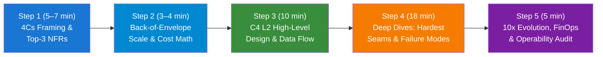

---
tags:
  - Interview Practice
  - System Design
  - Behavioral Interviews
---

# 08 · Interview Playbook & Scenarios

> **Level:** Synthesis — Interview Application · **Reading Time:** ~15 mins · **Track:** Interview Mastery
> **Prerequisites:** All previous sections ([01](01-roles-responsibilities.md)–[07](07-technical-leadership.md))

This playbook synthesizes the guide into execution rubrics for Principal Software Engineer, Software Architect, and senior engineering-leadership loops. Strong candidates frame ambiguity, navigate trade-offs, design for organizational scale, and elevate everyone in the room.

!!! abstract "TL;DR — The 30-Second Mental Model"
    - **Drive the Interview Proactively:** Clarify non-functional requirements, failure modes, and trade-offs rather than waiting for prompts.
    - **Anchor in the 4Cs:** Use this guide's **Context, Constraints, Characteristics, Candidates** sequence before drawing boxes.
    - **Match Behavioral Scope to the Role:** Use **STAR-L (Situation, Task, Action, Result + Systemic Learning/Leverage)** to show what changed beyond your own output.

!!! note "Calibration Caveat"
    Level labels such as L5/L7, loop names, and “bar raiser” practices vary by company. The 4Cs and STAR-L are this guide's rehearsal structures, not universal interview standards. Validate the target company's published loop and level rubric when available.

---

## How Principal-Level Interview Loops Are Calibrated

|| Interview Round | What the Rubric Often Evaluates | Common Local-Scope Signal | Strong Organizational-Scope Signal |
|:---|:---|:---|:---|
|| **1. System Architecture & Design** | Problem framing, trade-offs, failure modes, evolvability | Jumps to boxes; defends one design without downsides | Runs the 4Cs, compares viable options, designs for blast radius, cost, and day-2 operations |
|| **2. Technical Depth ("Deep Dive")** | Mastery of a past flagship system | Vague “we built X”; cannot explain internals or root causes | Explains ADR trade-offs, invariants, production failures, and what new evidence would change the design |
|| **3. Leadership & Influence** | Influence without authority, conflict resolution, talent multiplication | Heroic solo coding or escalation as the default | RFC pre-wiring, principled negotiation, sponsorship, and durable org improvements |
|| **4. Executive / Product Partner** | Business acumen, ROI translation, scope slicing | Pure jargon or refusal to compromise | Translates risk into customer/SLA/unit-cost terms and offers viable trade-off options |
|| **5. Architecture Critique / Refactoring** | Respectful diagnosis and prioritization | “Burn it down” without understanding historical constraints | Recovers original context, finds systemic risks, and proposes an incremental migration |

---

## The 5-Step Principal System Design Loop (45–60 Min Pacing)

Use this time-boxed pacing as a guide, then adapt to the interviewer:



### Step 1: Clarify via the 4Cs & Lock Top-3 NFRs (5–7 min)
- **Functional Scope:** Identify the core user/API journeys and explicit non-goals.
- **Scale & Constraints:** Ask about traffic, payloads, geographic distribution, data retention, regulatory obligations, team ownership, and legacy dependencies.
- **Stack-Rank Quality Attributes:** For example: *“(1) no lost or duplicate ledger mutations through serializable, idempotent transactions, (2) bounded read latency under the stated freshness model, and (3) tenant blast-radius isolation.”* Keep CAP terminology attached to a specific operation rather than using `CP/ACID` as a synonym.

### Step 2: Back-of-the-Envelope Estimation That Drives Design Decisions (3–4 min)

!!! warning "Never Do Math in a Vacuum"
    Every number should justify a decision or expose an assumption. Do not claim that a generic write rate “fits easily” on a database without record size, durability, index, lock, and latency assumptions.

|| Estimation | Formula / Useful Constant | Decision It Should Drive |
|:---|:---|:---|
|| **Average request rate** | `daily requests / 86,400`; `100M/day ≈ 1,157 RPS` | Apply a measured peak factor and burst duration before choosing capacity |
|| **Peak throughput** | `average RPS × peak factor` | State the factor explicitly; `3×` is an assumption, not a law |
|| **Concurrency (Little's Law)** | `concurrency = throughput × mean residence time` | Size connections, workers, queues, and admission limits; measure tail behavior separately |
|| **Bandwidth** | `requests/sec × average uncompressed bytes` | Choose payload projection, compression, and regional egress controls |
|| **Storage growth** | `writes/day × bytes/record × retention days × replication/index factor` | Select retention, partitioning, and capacity-review triggers |
|| **Queue drain time** | `backlog / (consumer rate − producer rate)`, only when consumer rate is higher | Decide autoscaling, backpressure, and recovery SLOs; otherwise the backlog grows |
|| **Availability arithmetic** | `99.9% = 8.76h/yr` · `99.99% = 52.6m/yr` · `99.999% = 5.26m/yr` | Allocate an error budget across dependencies; choose redundancy from failure scenarios, not “nines” alone |

!!! warning "Do Not Memorize Database or Broker Throughput"
    A node's throughput depends on record size, indexes, locks, durability, batching, hardware, and tail-latency targets. Benchmark the actual workload and state assumptions. Multi-region active-active is not automatically required for `99.99%`: derive topology from dependency budgets, regional RTO/RPO, and failover tests.

### Step 3: High-Level Architecture (C4 Level 2 Container View) (10 min)
Draw a clean **C4 Level 2 Container diagram** showing:
1. **Edge Layer:** DNS/geo-routing, CDN, WAF, API gateway, authentication, rate limiting, and TLS termination.
2. **Stateless Compute Layer:** Core domain services with explicit protocol labels (`gRPC`, `REST`, `GraphQL`, `SSE`).
3. **Data & Messaging Layer:** Selected stores, caches, brokers, ownership boundaries, and consistency/freshness labels.

### Step 4: Deep Dive on the 2–3 Hardest Seams (18 min)
- **Data Model & Partitioning:** Exact keys, indexes, transaction scope, hot-partition behavior, and resharding path.
- **Concurrency & Failure Choreography:** Sequence/state diagram with idempotency, outbox, DLQ/redrive, bounded retries, and reconciliation.
- **Trade-Off Matrix:** Compare the chosen design with the runner-up and state what new evidence would reverse the decision.

### Step 5: Production Readiness, FinOps & 10× Evolution (5 min)
- **Observability & SLOs:** SLIs such as end-to-end freshness, p99 latency, correctness, queue lag, and multi-window burn alerts.
- **Blast Radius & Degradation:** Load shedding, per-tenant isolation, cell evacuation, and deterministic fallbacks.
- **Security & Privacy:** Identity, authorization, data retention, tenant isolation, and supply-chain controls.
- **FinOps Cost Driver:** Name the largest unit-cost contributor and how you would measure it.

---

## End-to-End Walkthroughs: Classic Principal Scenarios

=== "Scenario 1: Global Payment / Ledger System"
    **Prompt:** *"Design a multi-region payment and wallet ledger processing 20,000 TPS."*

    **Principal Execution Rubric:**
    1. **Deconstruct Consistency by Sub-Domain:**
       - **Core double-entry mutation:** Serializable transaction with the recency/linearizability guarantees required by the API. Prevent double-spend and balance races under retries and failover.
       - **Webhooks and analytics:** Eventual consistency through a transactional outbox with replay and consumer idempotency.
    2. **Idempotency & Effectively-Once Effects:**
       - Require a high-entropy client idempotency key (UUID/ULID or equivalent); UUIDv7 can help index locality but is not a correctness requirement.
       - Store key, request hash, state, and response atomically with the local ledger mutation. For an external provider call, persist intent first, use the provider's idempotency key, and reconcile unknown outcomes rather than claiming end-to-end “exactly once.”
    3. **Immutable Double-Entry Model:**
       - Append balanced ledger entries and derive or maintain balances with explicit concurrency controls. Ordered locks or optimistic versioning can prevent races; an append-only log alone does not enforce available balance.
    4. **Hot-Account Mitigation:**
       - Stripe hot-account writes across sub-accounts where the domain permits. If available balance must be exact, coordinate reservations and read all relevant buckets or maintain a correct transactional aggregate; asynchronous aggregation is acceptable only for non-authoritative analytics.

=== "Scenario 2: Monolith-to-Services Migration Under Live Load"
    **Prompt:** *"An 18-team monolith deploys slowly and fails 25% of deployments. Should we pause features for nine months and rewrite it?"*

    **Principal Execution Rubric:**
    1. **Reject the default big-bang rewrite:** Preserve business learning and avoid chasing a moving target; still verify that a feature freeze is not required for a specific regulatory remediation.
    2. **Stabilize delivery first:** Improve CI feedback, rollback/roll-forward, ownership, and internal module boundaries before adding network distribution.
    3. **Discover seams with evidence:** Map bounded contexts, team ownership, change coupling, scaling needs, and incident blast radius. Select one high-value extraction, not the easiest demo.
    4. **Execute a measured Strangler migration:**
       - Place routing at the edge and establish explicit data ownership.
       - Backfill with checkpoints; use an outbox/CDC with schema and replay handling.
       - Shadow reads and compare invariants without exposing users to duplicate side effects.
       - Cut over gradually with rollback criteria, then remove legacy writes and compatibility plumbing only after the observation window.

=== "Scenario 3: Global Rate Limiter & Quota System"
    **Prompt:** *"Design quota enforcement for 1,000,000 RPS across 50 edge PoPs."*

    **Principal Execution Rubric:**
    1. **Classify the limit:** A best-effort anti-abuse limit, a contractual billable quota, and a financial spend cap need different consistency. Do not put one architecture on all three.
    2. **Avoid a synchronous global dependency:** Use local token buckets with regional coordination or leased token allocations for approximate limits. Keep a strongly coordinated path for quotas where overage is unacceptable.
    3. **Bound rather than invent drift:** Calculate potential over-allowance from outstanding leases, active nodes, sync interval, and request rate; do not promise a generic `1–2%` error.
    4. **Define failure policy explicitly:** On coordinator loss, choose fail-open, fail-closed, or conservative local quotas per endpoint and tenant contract. A conservative local cap can protect the service, but it does not simultaneously guarantee full legitimate throughput and complete DDoS protection.

---

## Behavioral Interviews: The STAR-L Framework

Standard `STAR` becomes stronger at broad scope when you add **L — Leverage & Systemic Learning**:

```markdown
- **S (Situation — concise):** Establish organizational and technical scale.
- **T (Task):** Explain why the problem required your role and what you personally owned.
- **A (Action — deepest section):** Use "I" for your decisions and "we" for shared execution:
  1. Technical diagnosis and trade-off analysis (4Cs / ADR)
  2. Influence without authority (pre-wiring, prototypes, negotiation)
  3. Multiplication (delegation, pairing, sponsorship)
- **R (Result):** Quantify validated customer, business, reliability, and delivery outcomes.
- **L (Leverage & Learning):** Name the permanent guardrail, paved road, capability, or strategy change—and what you would do differently.
```

The percentages sometimes assigned to STAR sections are only pacing heuristics. Spend the most time on your reasoning and actions, and do not invent metrics for a story.

### The 5 Essential Principal Stories to Prepare

|| Story Archetype | What the Interviewer Is Probing | Must-Have Signal |
|:---|:---|:---|
|| **1. Cross-Org Alignment Without Authority** | Can you align skeptical teams around a contentious decision? | Pre-wired critics, objective evidence, explicit decision owner |
|| **2. Saying "No" / Holding the Line with Execs** | Can you protect systemic integrity under pressure? | Interest-based negotiation, safe options, business-risk translation |
|| **3. Proactive Systemic Foresight** | Do you detect architectural risk before a crisis? | Leading indicators, quantified debt interest, incremental mitigation |
|| **4. High-Stakes Failure / Wrong Call** | Are you humble and fast to update? | Own the decision, name the invalidated assumption, add a lasting guardrail |
|| **5. Multiplying Talent (Sponsorship)** | Do you create future Staff/Principal leaders? | Delegated visible ownership, coaching, credit, advocacy |

---

## The Architecture Critique Checklist

When asked to critique an existing system:

1. **Recover Historical Context:** Ask when it was built, for what scale, and under which constraints.
2. **Trace Happy and Unhappy Paths:** Follow a write, a read, a timeout, a duplicate, and a recovery.
3. **Audit 7 Structural Risk Vectors:**
   - [ ] **Single Points of Failure:** Synchronous chains, single-AZ state, global control planes.
   - [ ] **Unbounded Queues / Missing Backpressure:** Producer outruns consumer; no admission or TTL policy.
   - [ ] **Distributed Data Inconsistency:** Non-atomic dual writes, missing outbox, unclear reconciliation.
   - [ ] **Noisy Neighbor / Missing Bulkheads:** Runaway tenant exhausts shared pools.
   - [ ] **Security & Privacy Seams:** Weak tenant authorization, excessive identity scope, sensitive logs/events, unencrypted paths where protection is required.
   - [ ] **Observability Blind Spots:** Missing trace context, correctness SLIs, and actionable SLO alerts.
   - [ ] **Conway's Law Friction:** Shared state mutated by multiple teams without an owning contract.
4. **Prioritize by Risk × Cost:** Separate immediate containment, structural fixes, and long-term evolution; name validation and rollback for each.

---

## Active Recall & Final Readiness Check

??? question "Final Check 1: Your outbox adds 80ms. Why not call all downstream services synchronously in parallel?"
    **Answer Rubric:**
    Validate the latency observation, then separate critical from non-critical work:
    - Parallel fan-out can reduce happy-path elapsed time, but every required dependency adds tail-latency and availability coupling. If four independent dependencies each have `99.9%` availability and **all are required and failures are independent**, composite availability is approximately `0.999^4 ≈ 99.6%`. State those assumptions; real failures are often correlated.
    - Keep fraud/payment authorization synchronous only when the business truly requires the decision before confirmation. Move email, analytics, and other post-commit side effects to an outbox with retry, idempotency, and reconciliation.
    - Offer a measurement: compare end-to-end p99, conversion, and failure recovery under a dependency stall rather than defending one pattern dogmatically.

??? question "Final Check 2: What five meta-signals demonstrate Principal-level judgment across rounds?"
    **Answer Rubric:**
    1. **Problem Framing Before Solutioning:** Context, constraints, and ranked quality attributes precede technologies.
    2. **Explicit Trade-Off Narration:** You name downsides, assumptions, and reversal triggers.
    3. **Sociotechnical Awareness:** You include ownership, cognitive load, developer experience, and operating cost.
    4. **Altitude Control:** You move from executive outcomes to protocols, transactions, indexes, and failure evidence without losing coherence.
    5. **Strong Opinions, Loosely Held:** You defend correctness/safety invariants while updating quickly when new evidence invalidates the design.
