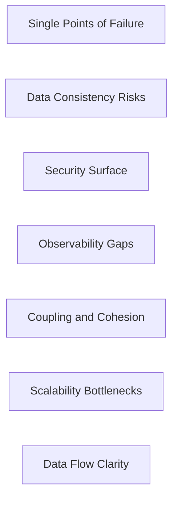

# 08 · Interview Scenarios & Synthesis

> **Level:** Synthesis — Interview Application
> **Pre-reading:** All previous sections

This section translates the conceptual knowledge from sections 01–07 into interview execution. Principal-level interviews are evaluated differently from senior engineer loops — understanding the evaluation framework lets you communicate in the language the interviewers are listening for.

---

## How Principal-Level Interviews Are Structured

| Round type | What they're evaluating | Your primary tool |
|:---|:---|:---|
| **System design** | Breadth of thinking, trade-off reasoning, constraint identification | Structured design framework + explicit trade-off narration |
| **Technical depth** | Can they go deep on their claimed expertise? | Prepare 2–3 deep domains you can discuss at L5+ level |
| **Leadership behavioural** | Influence, conflict, failure, growth | STAR method with principal-scope examples |
| **Cross-functional** | Stakeholder negotiation, business alignment | Examples of translating technical risk to business language |
| **Architecture review** | Can they critique and improve an existing system? | Structured critique: what's good, what's fragile, what I'd change |

---

## The System Design Framework for Principal-Level Interviews

### Step 1: Clarify Requirements (5 min)

Never start designing before asking:

**Functional requirements** (what the system does):
- What are the core use cases? (Top 3)
- What is explicitly out of scope?

**Non-functional requirements** (quality attributes — this is where principal-level thinking shows):
- Scale: DAU, QPS, data volume, peak vs. average traffic
- Latency: p99 targets; acceptable for which operations?
- Consistency: can the system tolerate eventual consistency? Where?
- Availability target: 99.9%, 99.99%, 99.999%?
- Geographic distribution: single region, multi-region, global?
- Compliance: GDPR, PCI-DSS, HIPAA?

!!! tip "The principal-level differentiator"
    Senior engineers ask about features. Principal engineers ask about quality attributes, constraints, and the cost of getting them wrong. Lead with NFRs.

### Step 2: Capacity Estimation (3 min)

Back-of-envelope numbers establish whether you understand the scale:

| Useful constants | Value |
|:---|:---|
| Seconds in a day | 86,400 (~100K) |
| Bytes in 1 MB | 10^6 |
| Bytes in 1 GB | 10^9 |
| RAM read throughput | ~10 GB/s |
| SSD random read | ~100 MB/s |
| Network throughput | ~1 Gbps = 125 MB/s |
| Average HTTP request size | 1–10 KB |

Example calculation pattern:
- 10M DAU, 5 reads/user/day = 50M reads/day = **578 reads/second** (peak: ~3x = 1,700 rps)
- 10M DAU, 1 write/user/day = 10M writes/day = **116 writes/second** (peak: ~5x = 580 wps)
- 1 KB per write → **116 KB/s** storage write rate

### Step 3: High-Level Design (10 min)

Draw the L2 C4 diagram (Container level):
- Client(s)
- Load balancer / API Gateway
- Core services (name them; say what each owns)
- Data stores (specify: relational, document, cache, blob, queue)
- External integrations

### Step 4: Deep Dive on 2–3 Key Components (15 min)

The interviewer will steer you. Common areas:
- Database choice and schema design
- API design (idempotency, versioning, pagination)
- Caching strategy
- Handling failures: retries, circuit breakers, dead letter queues
- Data sharding strategy
- Consistency model for specific operations

### Step 5: Trade-offs and Bottlenecks (5 min)

Proactively discuss:
- Where is the bottleneck at 10x scale?
- What did you sacrifice for what you gained?
- What would you do differently with 2x engineering time?
- What's the first thing that would break in production?

---

## Key Trade-Off Scenarios to Prepare

### Consistency vs. Availability (Bank Transfer Example)

**Question:** "Design a banking system. Should it prioritise consistency or availability?"

**Principal-level answer structure:**
1. Acknowledge this is domain-specific, not universal
2. Banking = financial correctness is paramount → **strong consistency required for account balances and transfers**
3. But: different components have different requirements:
   - Account balance display: strong consistency
   - Transaction history fetch: can tolerate slight read lag (replica)
   - Fraud risk score: eventually consistent fine
   - Currency exchange rates: cache with TTL acceptable
4. Architectural implication: hybrid approach — ACID transactions for the core ledger; eventual consistency where acceptable
5. Technology: PostgreSQL (or Spanner for geo-distribution) for ledger; Redis for caching non-critical data

### Microservices vs. Monolith (Startup Example)

**Question:** "Should a 3-month-old startup with 5 engineers use microservices?"

**Principal-level answer:**
1. Start with **Conway's Law** — 5 engineers = 1 team; 1 team produces 1 deployable unit most efficiently
2. Microservices solve an **organisational problem** (team autonomy at scale) as much as a technical one — a team of 5 has no organisational problem to solve
3. Operational overhead of microservices is significant: service discovery, distributed tracing, multiple deployment pipelines, network failure handling — a 5-person team cannot carry this cost without sacrificing product velocity
4. **Recommendation**: Modular Monolith — strong module boundaries (DDD bounded contexts), single deployment, monolithic DB. Design the interfaces as if they were services — they can be extracted later if team scales
5. When to reconsider: when a specific component needs independent scaling, or when a second team takes ownership

### Database Selection

**Question:** "How do you choose between a relational and a NoSQL database?"

| Decision factor | Relational (PostgreSQL, MySQL) | Document (MongoDB) | Key-Value (Redis, DynamoDB) | Column (Cassandra) |
|:---|:---|:---|:---|:---|
| **Schema stability** | Known, stable schema | Evolving, flexible schema | Simple key-value | Wide column, sparse |
| **Relationship complexity** | Complex joins, FK constraints | Embedded documents | None | None |
| **Consistency requirement** | ACID required | Tunable | Tunable (DynamoDB) | Tunable (eventual) |
| **Scale pattern** | Vertical + read replicas | Horizontal sharding | Horizontal | Horizontal |
| **Query flexibility** | Arbitrary SQL | Limited aggregation pipeline | Key access only | Partition key access |
| **Best use case** | Finance, orders, user accounts | Catalogues, content, events | Caching, sessions, leaderboards | Time-series, IoT, activity |

---

## Leadership Behavioural Questions — STAR at Principal Level

Principal-level behavioural questions probe for **organisational scope**. The STAR method applies, but the scope of the story must match the level.

| Question | What they're really asking | Scope required |
|:---|:---|:---|
| "Tell me about a time you influenced a major technical decision" | Can you move decisions without authority? | Cross-team or org-wide impact |
| "Describe a time you disagreed with senior leadership on a technical matter" | Can you hold ground on technical correctness? | Specific, data-backed disagreement; respectful but persistent |
| "Tell me about a time you identified a systemic problem before it became a crisis" | Long-horizon thinking; architectural foresight | Early detection + systemic fix, not firefighting |
| "Describe how you've grown other engineers" | Force multiplication; coaching at scale | Multiple engineers; promoted or meaningfully elevated |
| "Tell me about a major technical decision that turned out to be wrong" | Intellectual honesty; fast learning; not defensive | Own it; describe what you learned; what you would do differently |

### STAR Template for Principal Level

```
Situation: [Scale of the organisation / system; why this mattered beyond one team]

Task: [What was your specific responsibility? Were you explicitly chartered or self-directed?]

Action: [What did YOU do? Not "we". Emphasise influence, writing, presenting, or direct technical work.]

Result: [Quantified outcome. Not just "it went well". DORA metric improvement? 
         Cost reduction? Risk eliminated? Engineers promoted?]

Reflection: [What would you do differently? What did this teach you?]
```

---

## The Architecture Critique Framework

When asked to review an existing architecture:

### Step 1: Understand the Intent First
- What problem was this designed to solve?
- When was it designed? What constraints existed then?

### Step 2: Identify Quality Attributes
- Which quality attributes does this architecture optimise for?
- Which ones are underserved?

### Step 3: Apply Systematic Critique



For each dimension, ask:
- Is this a problem now? At 10x scale? At 100x?
- What is the cost of this weakness? What is the cost to fix it?

### Step 4: Prioritise and Communicate
Never just list problems. Prioritise by:
- Severity if it fails
- Probability of failure
- Cost to fix

---

## Common Principal Engineer Interview Questions — Reference List

### Architecture & Design
- Design a URL shortener / Twitter / ride-sharing / payment system / notification system
- How would you migrate a monolith to microservices without downtime?
- How would you design a globally distributed, highly available system?
- Walk me through an ADR you have written. Why those alternatives? Why that decision?

### Technical Depth
- Explain CQRS and when you would and would not use it
- How does a saga pattern handle distributed transaction failures?
- What is the difference between strong consistency and eventual consistency? Give a real example of each from your experience.
- How would you design a rate limiter for an API with 100K RPS?

### Leadership & Influence
- How do you set technical standards across teams that don't report to you?
- How have you handled a senior engineer who disagreed with an architectural decision you advocated for?
- Walk me through how you handled a major production incident. What systemic change resulted?
- How do you balance technical debt repayment against feature delivery?

### Organisational & Business
- How do you prioritise architectural investments when everything seems urgent?
- Tell me about a time you had to say no to a business requirement on technical grounds.
- How have you used Conway's Law deliberately in an organisation you've been part of?
- How do you build a technical vision that a VP would endorse and engineers would follow?

---

!!! tip "The final frame"
    In a principal-level interview, your goal is not to show you know the right answer. Interviewers know you might not. Your goal is to demonstrate:
    1. You ask the right questions before proposing a solution
    2. You reason through trade-offs explicitly, out loud
    3. You consider organisational and human factors alongside technical ones
    4. You communicate at the appropriate level of abstraction for your audience
    5. You hold your opinions confidently but update them when presented with good evidence
