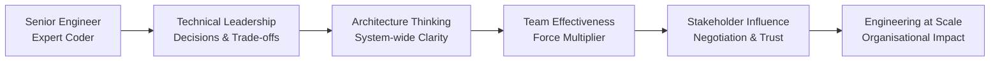
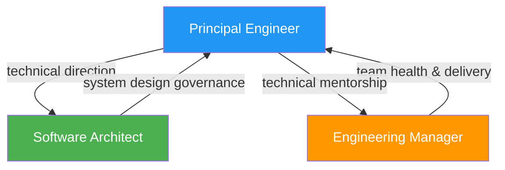

# Principal Software Engineer — Interview Prep Knowledge Base

> **Goal:** Crystal-clear theoretical mastery of the concepts evaluated in Principal Software Engineering, Software Architect, and Engineering Manager roles at large-scale multinational companies.
> Built for engineers who already code well and now need to *think* and *lead* at scale.

---

## The Mental Model: From Engineer → Principal

The difference between a Senior Engineer and a Principal Engineer is not *depth* — it is **scope of influence** and **ownership of outcomes**.

---

## Core Knowledge Dimensions

| # | Section | What You Must Master |
|---|:---|:---|
| [01](01-roles-responsibilities.md) | **Roles & Responsibilities** | Architect vs Principal vs EM — where they overlap, where they diverge |
| [02](02-architecture-diagramming.md) | **Architecture Diagramming** | C4, UML, ArchiMate — when to use which, and why it matters |
| [03](03-architect-thinking.md) | **Architect Thinking** | Architect personalities, 4Cs of architecture, mindset shifts |
| [04](04-team-effectiveness.md) | **Team Effectiveness** | Making effective teams, diffusion of responsibility, Team Topologies |
| [05](05-negotiation-stakeholders.md) | **Negotiation & Stakeholders** | Business negotiation, ADRs, the politics of technical decisions |
| [06](06-engineering-at-scale.md) | **Engineering at Scale** | Distributed systems principles, Conway's Law, organisational design |
| [07](07-technical-leadership.md) | **Technical Leadership** | Technical vision, tech debt governance, mentoring, RFC culture |
| [08](08-interview-scenarios.md) | **Interview Scenarios** | Design walkthroughs, trade-off framing, behavioural questions |

---

## Learning Path

### Phase 1 — Conceptual Foundation (Sections 01–03)
Understand **what the role actually is** before diving into patterns. Many engineers fail principal-level interviews because they answer as senior engineers — technically correct but without the organisational scope the role demands.

### Phase 2 — People & Systems (Sections 04–05)
Architecture is a **sociotechnical** discipline. Half the evaluation in a principal-level loop is about how you work *with* people — teams, business stakeholders, and organisation structures.

### Phase 3 — Scale & Leadership (Sections 06–07)
Demonstrate that you understand systems at **organisational scale** — not just distributed system patterns, but how decisions propagate through an engineering organisation.

### Phase 4 — Interview Execution (Section 08)
Synthetic practice through realistic scenarios. Use the prior three phases as vocabulary.

---

## What Principal-Level Interviews Actually Evaluate

!!! warning "The common failure mode"
    Most candidates who fail principal-level loops are **technically strong but scope-limited**. They solve the coding or design problem brilliantly, but fail to show the system-wide, cross-team, long-horizon thinking the role demands.

| Evaluation Dimension | What They're Looking For |
|:---|:---|
| **Technical breadth** | Can you reason across the full stack — infra, data, security, APIs? |
| **Technical depth** | Can you go deep on at least 2–3 domains when pressed? |
| **Design thinking** | Do you start from constraints and trade-offs, not solutions? |
| **Communication** | Can you make a complex system legible to a VP in 5 minutes? |
| **Influence without authority** | Can you align engineers who don't report to you? |
| **Long-term thinking** | Do you see how today's decision creates tomorrow's debt? |
| **Organisational awareness** | Do you understand how Conway's Law shapes what you build? |

---

## Roles at a Glance

| Dimension | Software Architect | Principal Engineer | Engineering Manager |
|:---|:---|:---|:---|
| **Primary focus** | System structure & quality attributes | Technical vision & deep expertise | Team health & delivery execution |
| **Output** | Architecture decisions, views | Technical standards, RFCs, code | Roadmaps, hiring, performance |
| **Authority** | Design authority | Influence without authority | Line management |
| **Time horizon** | 1–3 years | 1–5 years | 3–12 months |
| **Success metric** | System meets quality attributes | Engineering org improves via their work | Team ships reliably; engineers grow |

→ **[Deep Dive: Roles & Responsibilities](01-roles-responsibilities.md)**

---

!!! tip "Breadth first, depth on demand"
    This guide is intentionally wide. If a concept feels shallow, that is your signal to go deeper on that topic. Each section links to focused deep-dive articles.
