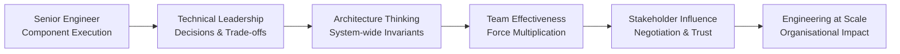
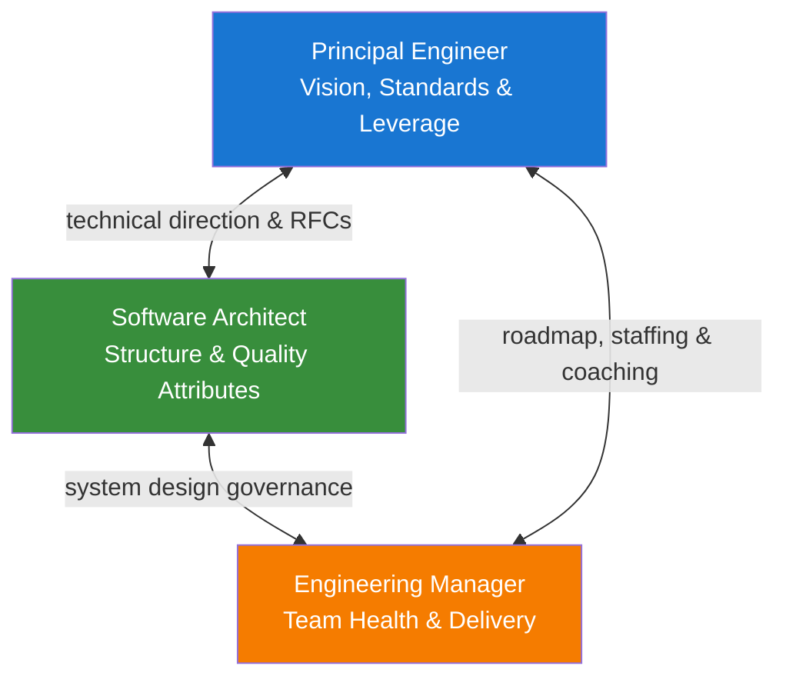

---
quiz:
  enabled: true
tags:
  - Interview Prep
  - Principal Engineering
  - Systems Design
---

Principal Engineering · Architecture · Organizational Leadership

# Principal Engineer Interview Guide

Build the judgment to **reason, align, and lead at organizational scale**—from distributed-system invariants and architecture decisions to team topology, negotiation, and technical strategy.

**Goal:** Practical mastery for Principal Software Engineer, Software Architect, and Senior Engineering Manager interview loops, grounded in production reality rather than memorized diagrams.

  Source reviewed · 15 Nov 2026
  Active recall in every chapter
  Light + dark reading modes

!!! abstract "TL;DR — The Core Thesis"
    - **The Shift:** Senior-to-Principal growth is not about coding faster; it is about expanding **scope of influence**, **time horizon**, and **ownership of systemic outcomes**.
    - **How to Use This Guide:** Follow a **Study Roadmap**, rehearse the **Active Recall** prompts without opening the answers, and practice contrasting local execution with organizational leverage.
    - **How to Read Examples:** Level labels, team sizes, timings, and performance figures are illustrative heuristics. Time-sensitive guidance links to primary sources; always calibrate against the target company and measured workload.

---

## The Mental Model: From Senior Engineer → Principal

---

## Explore by Knowledge Pillar

-   :material-account-group-outline:{ .lg .middle } **01 · Roles & Foundations**

    ---

    Understand the organizational contracts of **Principal Engineers**, **Software Architects**, and **Engineering Managers** — where they overlap and how to avoid role-conflation traps.

    [:octicons-arrow-right-24: Roles & Responsibilities](01-roles-responsibilities.md)

-   :material-vector-auto-fix:{ .lg .middle } **02 · Architecture Diagramming**

    ---

    Communicate with precision across audiences using **C4 Model**, **UML**, and **ArchiMate** without mixing abstraction levels.

    [:octicons-arrow-right-24: Architecture Diagramming](02-architecture-diagramming.md)

-   :material-brain:{ .lg .middle } **03 · Architect Thinking**

    ---

    Master the **4Cs Decision Framework** (Context, Constraints, Characteristics, Candidates), **Fitness Functions**, and **Architect Personalities**.

    [:octicons-arrow-right-24: Architect Thinking](03-architect-thinking.md)

-   :material-sitemap-outline:{ .lg .middle } **04 · Team Effectiveness**

    ---

    Apply **Conway's Law**, **Team Topologies**, **Cognitive Load theory**, and **Named Ownership** to design high-velocity engineering organizations.

    [:octicons-arrow-right-24: Team Effectiveness](04-team-effectiveness.md)

-   :material-handshake-outline:{ .lg .middle } **05 · Negotiation & Stakeholders**

    ---

    Use **Principled Negotiation**, **RFC governance**, and **ROI/FinOps framing** to align VPs, Product, and skeptical teams without formal authority.

    [:octicons-arrow-right-24: Negotiation & Stakeholders](05-negotiation-stakeholders.md)

-   :material-server-network:{ .lg .middle } **06 · Engineering at Scale**

    ---

    Reason through **CAP/PACELC**, **Caching & Sharding**, **Cell-Based Architecture**, **GenAI/LLM System Patterns**, and **Type 1 vs. Type 2 Decisions**.

    [:octicons-arrow-right-24: Engineering at Scale](06-engineering-at-scale.md)

-   :material-compass-rose:{ .lg .middle } **07 · Technical Leadership**

    ---

    Operate across Will Larson's **Staff+ Archetypes**, author multi-year **Technical Visions**, govern **Technical Debt**, and run **Blameless Post-Mortems**.

    [:octicons-arrow-right-24: Technical Leadership](07-technical-leadership.md)

-   :material-bullseye-arrow:{ .lg .middle } **08 · Interview Playbook**

    ---

    Execute the **5-Step Principal System Design Loop**, **L7+ Behavioral STAR-L stories**, and **Architecture Critique rubrics** under interview pressure.

    [:octicons-arrow-right-24: Interview Scenarios](08-interview-scenarios.md)

---

## Structured Study Roadmaps

Choose the track that matches your timeline and upcoming interview loop:

=== "Track A: 7-Day Sprint (Interview Next Week)"
    Focus on high-leverage mental models and execution rubrics:

    - [ ] **Day 1 — Role Calibration:** Read [01 · Roles & Responsibilities](01-roles-responsibilities.md) & [01.02 · Principal Engineer](01.02-principal-engineer.md)
    - [ ] **Day 2 — Decision Framing:** Master [03.02 · The 4Cs of Architecture](03.02-four-cs-architecture.md) (Context → Constraints → Characteristics → Candidates)
    - [ ] **Day 3 — Distributed Systems at Scale:** Review [06 · Engineering at Scale](06-engineering-at-scale.md) (CAP/PACELC, Caching, Sharding, Reliability)
    - [ ] **Day 4 — Org & Conway's Law:** Study [04.02 · Team Topologies](04.02-team-topologies.md) & [04.01 · Diffusion of Responsibility](04.01-diffusion-responsibility.md)
    - [ ] **Day 5 — Influence & Business Alignment:** Read [05 · Negotiation & Stakeholders](05-negotiation-stakeholders.md) & [07 · Technical Leadership](07-technical-leadership.md)
    - [ ] **Day 6 — System Design & STAR Rehearsal:** Drill [08 · Interview Scenarios](08-interview-scenarios.md) out loud
    - [ ] **Day 7 — Active Recall Audit:** Answer every `??? question` prompt across all chapters without peeking

=== "Track B: 4-Week Deep Mastery"
    Build durable mental models for both interviews and day-one impact in a Staff/Principal role:

    - [ ] **Week 1 — Foundations & Communication:** Sections `01`, `01.01–01.03`, and `02`, `02.01–02.03` (Practice drawing C4 L1/L2 and Sequence diagrams)
    - [ ] **Week 2 — Architectural Judgement:** Sections `03`, `03.01`, `03.02` (Write a sample ADR and a 3-option weighted decision matrix from your own past work)
    - [ ] **Week 3 — Sociotechnical Systems:** Sections `04`, `04.01`, `04.02`, and `05` (Map your current org using Team Topologies and stakeholder power/interest grids)
    - [ ] **Week 4 — Scale, Vision & Synthesis:** Sections `06`, `07`, and `08` (Draft a 1-page Technical Vision and 5 Principal-scope STAR-L stories)

=== "Track C: By Interview Round Type"
    Jump directly to the modules that map to a specific interview session:

    | Upcoming Round | Primary Modules to Review |
    |:---|:---|
    | **System Design / Architecture** | [02.01 · C4 Model](02.01-c4-model.md) · [03.02 · The 4Cs](03.02-four-cs-architecture.md) · [06 · Engineering at Scale](06-engineering-at-scale.md) · [08 · Interview Playbook](08-interview-scenarios.md) |
    | **Leadership & Behavioral ("Bar Raiser")** | [01.02 · Principal Engineer](01.02-principal-engineer.md) · [03.01 · Personalities](03.01-architect-personalities.md) · [07 · Technical Leadership](07-technical-leadership.md) · [08 · STAR-L Framework](08-interview-scenarios.md) |
    | **Cross-Functional / Executive / Product** | [04.02 · Team Topologies](04.02-team-topologies.md) · [05 · Negotiation & Stakeholders](05-negotiation-stakeholders.md) |
    | **Enterprise / Domain Architecture** | [01.01 · Software Architect](01.01-software-architect.md) · [02.02 · UML](02.02-uml-architects.md) · [02.03 · ArchiMate](02.03-archimate.md) |

---

## Senior vs. Principal: The Calibration Matrix

!!! warning "The #1 Failure Mode in Principal Loops"
    Most candidates who fail principal-level loops are **technically strong but scope-limited**. They design a clean microservice or solve the algorithm, but answer with a **1-team, 3-month lens** instead of an **org-wide, 3-year lens**.

| Evaluation Dimension | Senior Engineer Signal (L5) | Principal Engineer Signal (L7+) |
|:---|:---|:---|
| **Problem Framing** | Clarifies functional requirements and starts designing components | Clarifies business context, regulatory/org constraints, and forces a top-3 NFR ranking first |
| **Trade-off Reasoning** | Defends a single "best" architecture | Presents 2–3 viable candidates with an explicit trade-off matrix and cost-of-change analysis |
| **System Boundaries** | Draws boxes for services and databases | Aligns boundaries to **Conway's Law**, team cognitive load, and independent deployability |
| **Operational Reality** | Mentions monitoring or retries at the end | Designs **SLOs, observability, blast-radius isolation (cells), and FinOps unit economics** from the start |
| **Influence & Disagreement** | Escalates to a manager or argues code style | Uses **RFCs, objective criteria, data prototypes, and principled negotiation** to align peers |
| **Technical Debt** | Complains that product won't give time to refactor | Quantifies debt as **velocity drag / business risk** and embeds standards into automated CI fitness functions |

---

## Roles at a Glance

| Dimension | Software Architect | Principal Engineer | Engineering Manager |
|:---|:---|:---|:---|
| **Primary focus** | System structure & quality attributes | Technical vision, standards & deep expertise | Team health, hiring & delivery execution |
| **Key artifacts** | ADRs, C4/ArchiMate views, fitness functions | RFCs, technical vision docs, reference code | Roadmaps, career ladders, performance reviews |
| **Authority model** | Design authority | Influence without authority | Formal line management |
| **Time horizon** | 1–3 years | 1–5 years | 3–12 months |
| **Success metric** | System meets quality attributes with low coupling | Engineering org velocity & quality multiply | Team ships predictably; engineers grow & stay |

---

## Quick Diagnostic: Test Your Readiness

Try answering these three warm-up prompts before diving into the chapters:

??? question "Diagnostic 1: Why is 'we need 99.999% availability, strong consistency, and low cost' a trap in a design interview?"
    **Principal Calibration:**
    The requirement is underspecified, not mathematically impossible in every architecture. `99.999%` permits about **5.26 minutes of downtime/year**, but strong consistency and low cost need operation-specific definitions. During a partition, CAP constrains linearizability and CAP-availability; during normal operation, synchronous coordination can add latency and cost. A Principal Engineer segments invariants by workload, allocates an end-to-end error budget across dependencies, prices the required failure scenarios, and chooses regional topology from measured RTO/RPO—not from a blanket claim that five nines always requires active-active or costs `3–10×`.
    → See [03.02 · The 4Cs of Architecture](03.02-four-cs-architecture.md) and [06 · Engineering at Scale](06-engineering-at-scale.md).

??? question "Diagnostic 2: Eight product teams are each building slightly different CI/CD and observability wrappers. How do you fix this without a top-down mandate?"
    **Principal Calibration:**
    Avoid a mandate ("everyone must use tool X by Friday"), which triggers resistance. Instead, diagnose the **extraneous cognitive load** across the 8 stream-aligned teams ([04.02 · Team Topologies](04.02-team-topologies.md)), partner with the most pained team in **Collaboration mode** to extract a self-service paved road (**X-as-a-Service**), and make the golden path the easiest path (templates, automated CI checks) rather than a ticket queue.

??? question "Diagnostic 3: Everyone on a 10-person team is assigned to review every PR and respond to on-call alerts, yet bugs slip through and alerts sit unacknowledged. Why?"
    **Principal Calibration:**
    **Diffusion of Responsibility** (Latané & Darley bystander effect). When "the team" owns an artifact, *nobody* feels personally accountable. The fix is **Named Ownership** (`CODEOWNERS`, single primary on-call, named SLO owner, RACI on ADRs) paired with a blameless culture.
    → See [04.01 · Diffusion of Responsibility](04.01-diffusion-responsibility.md).

---

## Interactive Knowledge Check

Use these short quizzes to check your recall. For deeper, open-ended interview practice, use the `??? question` prompts at the end of each chapter.

<quiz>
Which sequence represents the 4Cs architecture decision framework?

- [ ] Candidates → Characteristics → Context → Constraints
- [x] Context → Constraints → Characteristics → Candidates
> Correct. Gather context and hard constraints before ranking quality attributes and comparing viable designs.
- [ ] Context → Candidates → Constraints → Characteristics
</quiz>

<quiz>
In the C4 model, what does a "Container" represent?

- [ ] A Docker or OCI container only
- [x] An independently runnable or deployable unit, such as an API, database, or queue
> Correct. C4's use of "container" is broader than the Docker meaning.
- [ ] Any source-code class or function
</quiz>

<quiz>
What is the most effective way to reduce diffusion of responsibility for a production service?

- [ ] Assign ownership to the entire engineering organization
- [ ] Send every alert to a large team channel
- [x] Name a directly responsible owner and backup, with blameless practices
> Correct. Named accountability clarifies who coordinates action; blamelessness keeps the focus on improving the system.
</quiz>
